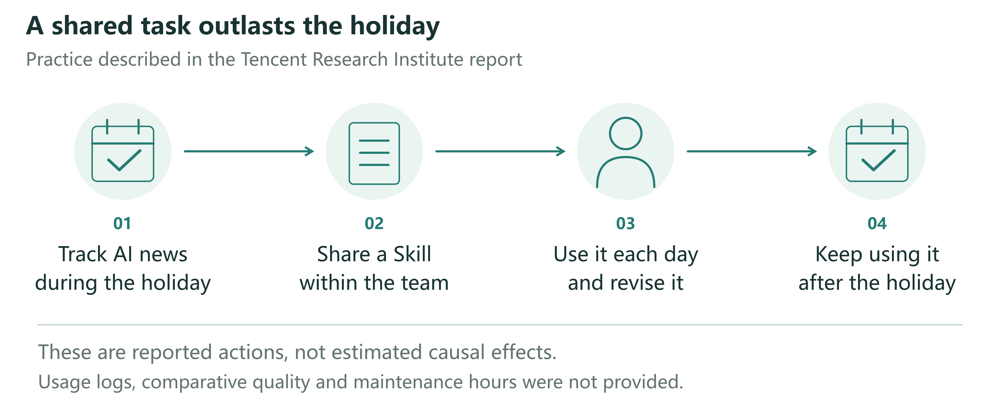
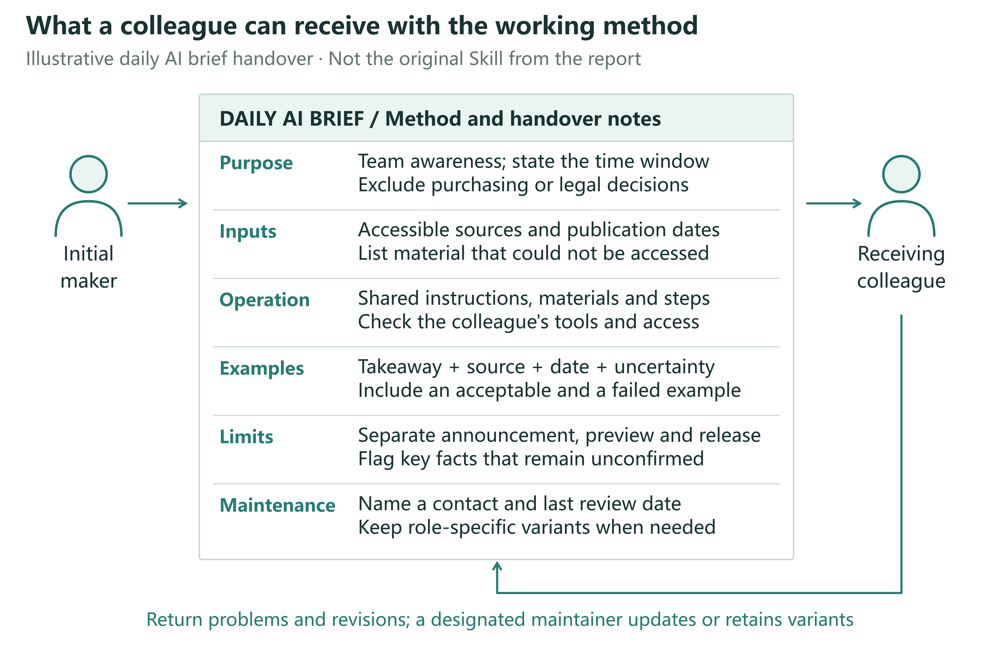
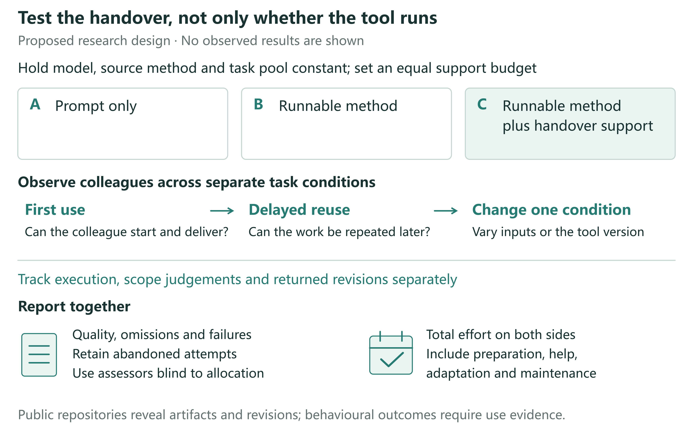

# Making personal AI know-how work across a team

## Abstract

After an employee uses AI to complete a task, can a colleague carry on using the method? This question is central to turning personal know-how into team capability. A shared Skill described in a Tencent Research Institute report illustrates how repeated use and revision can bring a tracking task into everyday work, without revealing the full transition from personal method to team practice. Drawing on knowledge transfer and organizational routines, we propose observing execution, judgments of applicability, and the return of revisions separately. Subsequent task quality, responses to exceptions, and total effort on both sides provide criteria for evaluating reuse; handover and maintenance support are possible explanations to be tested. We examine differences between roles and the work of maintenance, and outline research using public materials and controlled comparisons. The central questions are who can use a method, when it remains usable, and whose time makes continued use possible.

## 1. Why the tool was still in use after the holiday

During the Spring Festival holiday, a research team needed to keep following developments in AI. According to page 37 of Tencent Research Institute's report, its AI-native group shared a Skill for tracking developments during the 2026 holiday. Members invoked it daily and revised it in response to the results. After the holiday, the tool continued to support their everyday monitoring of AI developments.[1]

The reported news-tracking practice. Page 37 of the Tencent Research Institute report describes a shared task, a shared Skill, daily use and revision, and continued use after the holiday. The figure depicts these actions without assuming that one employee independently invented the tool. Quality assessments, maintenance hours, and usage logs were not disclosed; continued use does not establish a net benefit.[1]

A Skill can be understood as a set of working instructions and associated materials that AI can invoke. Anthropic's implementation, for example, organizes instructions and optional scripts and resources in folders. The Tencent case does not make the original artifact available, so its specific format cannot be established from that example.[2]

What makes this account interesting is the continuity of the work. The team still needed to follow developments, the tool was adjusted through repeated use, and effort invested in one task could serve later tasks. Page 73 of the report also presents a scenario in which someone joins the group, receives a runnable Skill from a colleague, uses and modifies it, and returns the changes. This is an illustrative account of an everyday arrangement, not an interview transcript from an identified employee.[1]

The reported practice was already a shared activity. The report does not identify who first proposed the method or independently built its first version, nor does it trace a continuous path from individual experimentation to collective adoption. It therefore presents an outcome that warrants explanation: how a method enters shared work and persists beyond its initial task. This prompts our question: what handover is needed for the AI know-how that ordinary employees develop in their work to become something their colleagues can use repeatedly?

Page 17 of the same report gives concrete examples of employees turning experience into tools. At Anker, one employee without a programming background reportedly built a supply-chain operations system in three months; another built a system for automatically submitting, monitoring, and responding to Amazon Cases in two months. The tasks and resulting tools are identifiable, but the account does not follow who used them, whom users approached when problems arose, or how long they remained operational. Anker's Rocket Class, a separate initiative described on pages 35–36, gives selected employees time to address real business problems before returning to their original teams. This reflects organizational attention to bringing experience back into teams. The report neither establishes that the two system builders participated in that initiative nor measures colleagues' subsequent reuse.[1]

Together, these accounts identify a question that can be studied close to everyday work. A maker's successful task completion suggests that a method may be useful; a recipient's completion of their own task provides evidence about the handover; continued use on later tasks and under changed conditions requires further explanation. Treating all three as successful adoption can draw attention to demonstrations, tool counts, and training attendance while obscuring repeated questions, reconfiguration, and abandonment. We bring knowledge transfer and organizational routines research to observable handover events to examine how personal methods might become resources for shared work.

## 2. Why building a method does not complete the handover

An AI briefing may suit its maker's reading habits. They know which sources matter, which stories were discussed last week, and which product an ambiguous name denotes. Passing a prompt to a colleague does not necessarily transfer these conditions. The recipient may lack access to the original files, serve a different audience, or need information about product launches rather than model capabilities. The same prompt can run successfully while producing material that does not fit the recipient's work that day.

Knowledge transfer research has long shown that difficulties concern recipients, the knowledge itself, and relationships between participants, as well as a sender's willingness to share.[3] Organizational routines research likewise distinguishes a general understanding of an activity from its performance by particular people in particular circumstances.[4] A tool placed in shared storage is therefore material for a handover. Conditions left unstated by both parties may become apparent only when recipients apply it to their own tasks.

These questions already feature in organizational research on generative AI. Wiesenfeld and Kellogg’s qualitative study examines LLMs in knowledge search, creation, transfer, and forgetting, together with related organizational arrangements.[5] A field experiment has also directly tested how AI changes individual and team performance on product innovation tasks.[6] These studies provide a basis for understanding AI in organizations. The latter workshop experiment, however, does not test whether one employee’s method can be handed to another, reused later, and maintained. We focus on that subsequent process.

We define a team's capability for reuse as members other than the original maker being able to continue completing work within a specified task domain and to respond appropriately when work falls outside that domain or cannot be completed. Outcomes include quality at delayed use, responses to exceptions, and total effort across participants. Handover materials, adaptation assistance, and maintenance arrangements are conditions that may explain those outcomes. This definition permits continued AI assistance and requests for help. A system requiring its maker's presence on every occasion may still be valuable, but that dependence on their labor must be recorded. A recipient clicking “run” once does not establish independent reuse.

Research should consequently distinguish three events: a maker completing a task in the original setting, another person first completing a task in their own setting, and that recipient completing subsequent tasks. These are neither developmental stages through which everyone must pass nor a fixed sequence. Tools may be jointly developed from the outset; recipients may alter a method before running it. Observation can begin with a particular handover and subsequent use. A single two-person handover, however, supplies only partial evidence about team capability. Stable reuse at team level requires observations across members, relevant tasks, and time.

Generative AI brings together features that warrant closer attention to this established problem. Natural-language descriptions can both explain a method to colleagues and instruct a system to execute it. Recipients may thus obtain usable results before understanding the method fully. Yet execution depends on models, connected tools, and context; copying the text need not reproduce those conditions. This relates to theoretical work on how encapsulation changes the visibility of organizational activities.[7] As some work passes to the system, responsibility for setting the purpose, defining applicability, and arranging updates may also change, raising questions about the organization of human–AI work.[8] We propose separately observing whether a method executes, how recipients judge its applicability, and how revisions return to shared materials. Whether these transfer together is a more specific question than whether additional documentation helps.

Consider an automatically generated briefing that a second person can readily open. Its maker may regard the handover as complete. The recipient may nevertheless circulate it to colleagues in other roles, change its focus, and repeatedly ask the maker for additional information. Ostensibly the same tool is shared, but the work it performs has changed. Executability may lower the threshold for trying a method without establishing fitness for a new purpose. This issue also occurs in conventional automation. The research opportunity lies in studying how methods that can be created and modified in everyday language move between roles, rather than declaring knowledge transfer itself a new phenomenon.

## 3. Handing over a way of working

The news-tracking task makes the handover tangible. The “daily AI briefing method sheet” below is an illustrative design; the report does not provide the original Skill. It first identifies the audience and task domain, such as tracking product updates relevant to a team's work, and states which tasks it does not undertake. It then specifies available sources, required files, and access conditions, so recipients know where to begin instead of discovering missing requirements one failed run at a time.

Operating instructions explain how to supply inputs, start the process, and inspect its output. Examples show what information, sourcing, and dates a usable item should contain. They might distinguish a public product release from media speculation about future features. An unsupported assertion would fail the briefing's requirements even if fluently written. Examples give both parties a shared reference for completion. Different kinds of work need different references; a single briefing format cannot serve as a standard for every role.

The sheet should also make routes for adjustment visible. Changing a topic, shortening the output, and altering the source range may require different modifications. Recipients need to know which options they can change, which revisions affect others, and where to request changes. Where execution depends on particular tools, current operating conditions and responsibility for updates should be specified. Recipients need not understand every implementation detail to know whether an adjustment affects only their copy or will change what a colleague receives on the next run.

A working method that can be handed over. The daily AI briefing example specifies scope, sources and access, operating steps, output examples, adjustable elements, and an update route. This is a proposed design, not an original document from the Tencent case or a requirement that all work use the same materials. Its effects should be tested against recipients' task performance and effort on both sides.

Bringing these conditions into a handover does not require employees to write a complete manual first. More material can itself impose a burden. For a simple, one-off task, a prompt and an example may suffice. For work repeated weekly by several people using shared data, missing operating conditions or maintenance routes may turn every use into redevelopment. Frequency alone cannot determine whether a method is worth documenting. Theory on capability development also proposes that knowledge codification can benefit infrequent tasks for which experience is difficult to accumulate through repetition. This is a theoretical argument, not an observed effect of the present handover design.[9] Research should compare task repetition, differences, and duration rather than equating documentation length with adequate handover.

Nor does a method sheet turn all tacit experience into codifiable knowledge. Recipients may discover what they need to ask only through their own tasks. Industry news of little use to another business team, for example, may reflect a difference in priorities rather than an execution failure. Allowing recipients to try a method and then request specific adjustments is part of the handover. By explaining source choices and identifying what a new use requires, makers and recipients may develop a version suitable for subsequent work. This account builds on research that treats knowledge transfer as a continuing process.[3]

This raises a question for investigation. After input requirements or operating conditions change, recipients may still launch a method and obtain output without adjusting their understanding of its scope. Even when they adapt it, their revisions may not reach the materials colleagues use next. Execution, applicability judgments, and the return of revisions therefore require separate observation. If all three remain aligned without additional support, or execution alone adequately explains later task performance, examining them separately may add little explanatory value.

A prediction about handover support can then be more precisely bounded. With the same core tool, comparable tasks, and equal resource ceilings, examples and adjustment routes may improve subsequent adaptation rather than merely first execution. Additional material may offer no benefit when a tool is sufficiently intuitive, and even detailed instructions may be ineffective when recipients are doing different work. Studies should also allow for slower first use followed by more stable reuse, rather than making speed of initial adoption the sole criterion of success.

## 4. Bringing changes back into shared work

Further work becomes visible after the tool reaches a second person. One briefing user changes the topic, another needs original sources, and a third discovers a broken link. The maker could handle these problems individually, they could be addressed in shared materials, or separate versions could serve different roles. Each approach has costs. Once personal know-how enters a team, the organization must decide which changes warrant collective maintenance and who has time to undertake it.

The report's scenario of modifying and returning a Skill suggests how recipients might contribute, but returning a change is only a beginning. A summary length suitable for sales may not suit research and development. Adding sources can increase information while making another user's screening take longer. Combining every change in a single version may remove duplicated effort while impairing existing uses. A shared version can preserve stable components, with explicit options or separate variants accommodating role differences. Choices about consolidation should reflect task similarities and maintenance costs, not simply the number of tools a team holds.

This connects to the relationship between shared patterns and particular performances in organizational routines. Shared methods can constrain work and be reinterpreted through use. Team capability cannot therefore be inferred from document consistency alone; it also concerns how members apply methods and how changes enter subsequent performances.[4] For generative tools, modifications may affect prompts, input materials, model selection, or external connections. Counting prompt versions alone would miss changes elsewhere.

Maintenance also raises questions about time and credit. The initial maker may receive recognition, while those who later answer questions, explain limitations, and update dependencies produce less conspicuous contributions. A popular tool may burden its maker if support is added to their existing duties. Recipients may repair their own copies to finish work quickly, without time to return those changes. These competing processes require observation: reuse may reduce duplicated work, concentrate labor among a few people, or disperse maintenance across copies that remain invisible to one another.

Reactions to a shared tool are consequently an inadequate measure of organizational investment. More informative questions concern what recipients must prepare before first use, who helps them when conditions change, and whether a solution saves the next colleague from repeating that effort. Organizations can allocate time for adaptation and support, acknowledge useful revisions, and make request routes visible. Such arrangements should vary with a tool's importance and frequency of use. A frequently changing but rarely reused tool may not warrant a maintained common version.

A second prediction concerns differences between recipients' tasks. Requiring everyone to use one version need not increase sustained reuse when those tasks differ substantially. Documented, maintainable variants may improve fit while increasing update costs. Where variants merely solve the same problem, a common revision may instead save work. Tests should record the task differences variants serve and their subsequent maintenance, rather than treating growth in version counts as capability diffusion. A third prediction concerns labor allocation: when support concentrates on one maker, more users may bring longer waits and greater maintenance effort, eventually reducing the gains from further distribution. This pattern may not arise when updates are stable or users can resolve support needs themselves.

## 5. Investigating reuse with public materials

Research can begin with public workflows, instructions, and version histories without assuming access to internal company data. Researchers should define the materials, period, and inclusion criteria; preserve reproducible versions; and compare how tools specify purposes, operating conditions, output requirements, and maintenance routes. Issue discussions, changes, and deprecation notices can reveal publicly reported adaptation difficulties. Added input examples and repairs to broken connections are directly observable material changes. Discontinued and non-working projects should remain in the sample, rather than selecting only successful demonstrations.

These records first address how public methods are organized and modified. Downloads, bookmarks, and commits cannot alone establish whether employees repeatedly complete work using them. A commit may be the original maker's formatting change. An unanswered issue may indicate difficulty or discussion moving elsewhere. Accounts do not establish employee status or organizational affiliation. A first stage should therefore describe materials and revisions; behavioral predictions require a second stage observing actual recipients independently using methods to complete tasks. Public visibility and permitted research use should also be checked separately. Tool features can be studied without identifying ordinary contributors.

Technical evaluation should inform, but remain distinct from, this behavioral research. The public SkillsBench preprint, for example, uses task verification to compare agent performance under different Skill conditions, offering one way to check whether tools accomplish specified tasks. This differs from evidence that a second employee can reuse a method later in their own work, respond to change, and bear its maintenance costs.[10]

A future study could compare three handovers. Group A receives a prompt and basic task instructions; B receives a runnable method; C receives the same runnable method with handover, adaptation, and maintenance support. All groups use a common foundation model, source method, and task pool, with equal total support budgets. The B–C comparison is especially informative because it asks whether added handover support changes recipients' performance with a method that already runs. The A–B difference also includes the convenience of automated execution and cannot be attributed wholly to improved knowledge transfer.

Proposed handover comparison. A receives a prompt, B a runnable method, and C a runnable method with handover and maintenance support. Model, source method, task pool, and total support budgets remain comparable. Assessments cover first use, delayed reuse, and separate changes to inputs or tool versions. Quality, failure and abandonment, and total maker and recipient effort are reported together. B–C is the central comparison, but support is a bundled intervention. No experimental results are shown.

This comparison estimates the total effects of handover strategies under equal resource ceilings. Time spent preparing C's instructions, examples, and maintenance routes must be counted, not supplied free; A and B should have the same support-resource ceiling. The cost of packaging the runnable method required for B, relative to A, must also count. Permitted content and forms of assistance should be specified beforehand, and delivered materials and support recorded. Otherwise, an intended file-only handover could become a comprehensive one through ad hoc assistance. Equal ceilings do not require equal expenditure. C remains a bundled intervention: effects cannot be assigned to one sheet or field without separately manipulating its components.

Participants should have the basic access needed for the tasks before random allocation, with prior domain knowledge and tool familiarity recorded. Holding tasks, makers, and source methods constant or balancing them across conditions helps exclude pre-existing tool quality as an explanation. Material exchange between groups in a shared workplace changes the comparison. Assignment should follow the actual handover unit, and such exchanges should be documented. Public materials can supply shareable task packages, but generalization from public tasks to everyday company work still requires testing.

Assessment should cover first use, delayed reuse, and changed conditions. Delayed tasks can retain the original scope while changing content, so remembering answers is not mistaken for reusability. Changes to input requirements or tool versions should be introduced separately, holding other conditions constant, with unchanged tasks assessed at the same time and task order randomized or counterbalanced. Otherwise, differences between stages mix time and familiarity with the changed conditions. Simultaneous changes to models, sources, and purposes also obscure reasons for failure. Task scope, minimum acceptable quality, and primary comparisons should be specified before outcomes are observed.

Process records should match the three distinctions: launching and producing output; judgments and actions on tasks predetermined to be within or outside scope; and revisions passing agreed checks and reaching the version subsequent users actually receive. Groups should have equal opportunities to handle failures and return revisions; submission clicks are not effective adjustments. Such records can locate changes associated with a strategy, but correlations between processes and outcomes do not identify mediation. The three-group comparison primarily tests handover strategies. Common versions versus role-specific variants, and maintenance burdens associated with rising user numbers, require separate changes to version policy or usage load.

Outcomes should not be reduced to runtime. Assessors unaware of allocation can judge quality against prespecified task criteria. Time records should cover setup, reading, execution, rework, seeking and providing help, and maintenance. Failed starts, withdrawal, and switches to manual work should remain in analyses by original random assignment, rather than comparing only those who received complete support. For out-of-scope tasks, seeking help or transferring responsibility may be appropriate. These actions should be distinguished from failure within scope, following subsequent outcomes and effort on both sides. Otherwise, users who recognize when to seek help may be rated as less capable.

Preparation costs and reuse benefits occur at different times. One-time and per-use investments should be reported separately, with costs discussed for a specified number of uses or observation period. This avoids both hiding preparation costs and charging all of them to the first recipient. Better quality without time savings, or recipient time savings at the maker's expense, are meaningful but distinct results. Unless quality–time trade-offs are specified in advance, they should not be collapsed into an apparently definitive efficiency gain.

The design also specifies conditions under which the claims would fail. A sufficiently precise comparison finding no meaningful B–C difference would suggest that handover support is not a principal constraint for those tasks; imprecise estimates would not establish this. If all groups fail after input changes, the source method's scope may matter more than handover. If C gains only initially and maintenance costs offset later benefits, more sustainable team capability has not been established. Such findings would delimit when packaging and maintaining a method is worthwhile, rather than constitute inconvenient exceptions to adoption.

## 6. From recognizing makers to supporting shared work

Tencent's report locates part of the impetus for organizational change in employees' actual AI use. The shared Skill is valuable as an example because it shifts attention from one person's exceptional achievement to repeated handling of an ordinary task. Following this direction means asking whether recipients can bring a method into their work, adapt it when conditions change, and obtain support from people who have time to continue providing it.[1]

This does not require every employee to become a developer. Some identify recurring tasks, others turn methods into tools, others supply useful examples, and still others update and answer questions. These contributions can jointly sustain shared work. Recognizing handover and maintenance labor helps avoid concentrating all credit on the initial demonstration. Whether resources devoted to these activities help should be judged by outcomes and effort, not hours spent using AI.

There are limits. Rarely repeated tasks may be better completed directly. Methods serving substantially different purposes may offer ideas without warranting reuse. Work involving restricted access or professional responsibilities requires limits on who receives and uses it. Shared capability does not entail unrestricted diffusion. A tool specifying which tasks it does not serve may be easier to incorporate reliably into work than one advertised as suitable for everyone.

Turning personal AI know-how into team capability is thus a transition to investigate, rather than an automatic consequence of placing files in shared storage. Three everyday questions provide a starting point: did the second person complete their own work, could they use the method again later, and who supplied the labor that kept it usable? These observations preserve the value of employees' initiative while making team reuse an organizational practice whose effects can be tested, improved, and bounded.

## References

1. Tencent Research Institute. From super individuals to super teams: Emergent pathways of organizational transformation in the AI era. Research report (2026) [in Chinese]. 

2. Anthropic. Equipping agents for the real world with Agent Skills. Anthropic Engineering (16 October 2025; updated 18 December 2025). https://www.anthropic.com/research/equipping-agents-for-the-real-world-with-agent-skills

3. Szulanski, G. Exploring internal stickiness: Impediments to the transfer of best practice within the firm. Strategic Management Journal 17(S2), 27–43 (1996). https://doi.org/10.1002/smj.4250171105

4. Feldman, M. S. & Pentland, B. T. Reconceptualizing organizational routines as a source of flexibility and change. Administrative Science Quarterly 48(1), 94–118 (2003). https://doi.org/10.2307/3556620

5. Wiesenfeld, B. M. & Kellogg, K. C. Generative organizational learning: Affordances for new modes of knowledge search, creation, transfer, and forgetting with LLMs. Strategic Organization 24(2) (2026; first published online 2025). https://doi.org/10.1177/14761270251408580

6. Dell'Acqua, F. et al. The cybernetic teammate: A field experiment on generative AI and teamwork. Organization Science 37(4), 1217–1242 (2026). https://doi.org/10.1287/orsc.2025.20702

7. Hinds, P. & von Krogh, G. Generative AI, emerging technology, and organizing: Towards a theory of progressive encapsulation. Organization Theory 5(4) (2024). https://doi.org/10.1177/26317877241293478

8. Puranam, P. Human–AI collaborative decision-making as an organization design problem. Journal of Organization Design 10, 75–80 (2021). https://doi.org/10.1007/s41469-021-00095-2

9. Zollo, M. & Winter, S. G. Deliberate learning and the evolution of dynamic capabilities. Organization Science 13(3), 339–351 (2002). https://doi.org/10.1287/orsc.13.3.339.2780

10. Li, X. et al. SkillsBench: Benchmarking How Well Agent Skills Work Across Diverse Tasks. Preprint (13 February 2026). https://www.skillsbench.ai/skillsbench.pdf
