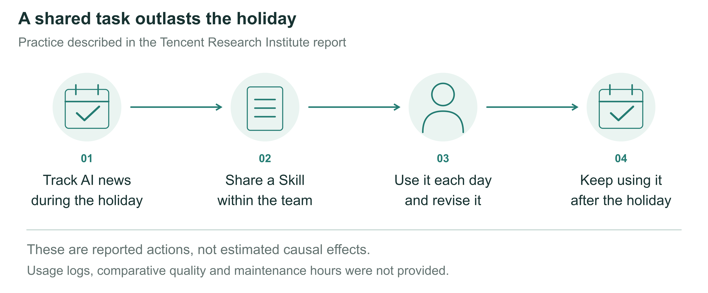
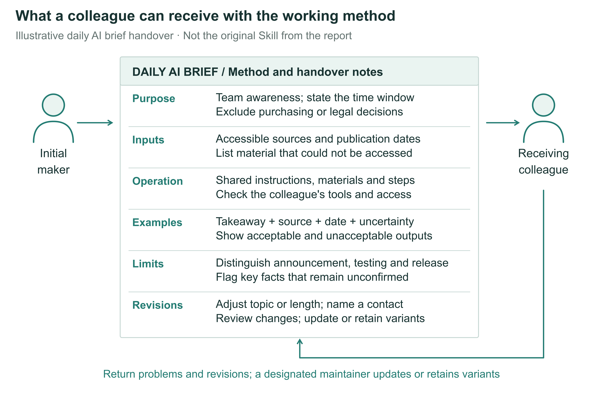
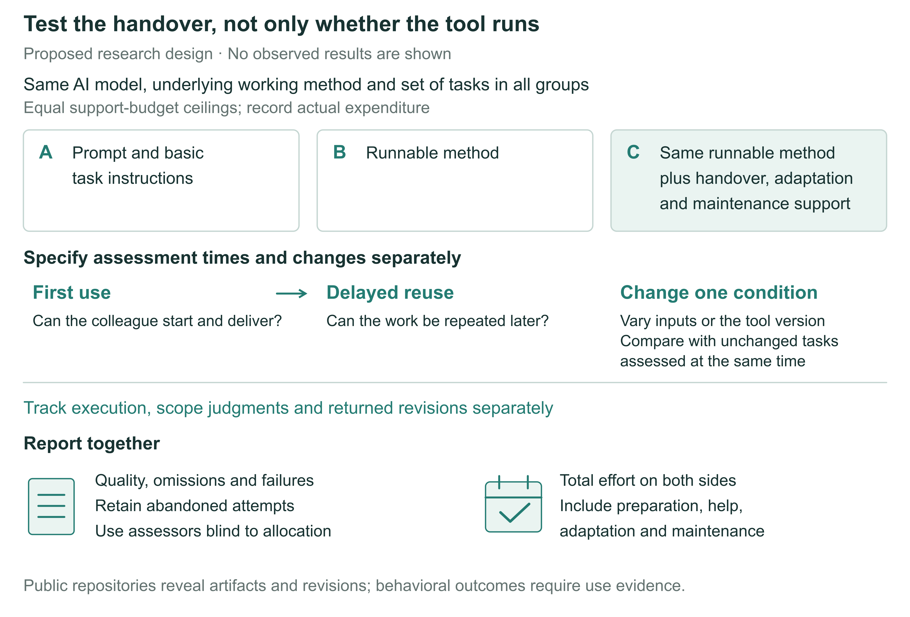

# Making personal AI know-how work across a team

Richard T.Millian

Hangzhou Normal University

## Abstract

An AI method becomes a resource that a team can rely on only if colleagues can use it beyond the original task. Drawing on shared news-tracking practice, knowledge transfer and organizational routines, this Perspective distinguishes execution, judgments of applicability and the return of revisions. A recipient may generate an output without recognizing that it does not fit a new role; a useful local change may never reach the next user. Reuse should therefore be assessed through delayed task quality, responses to exceptions and effort across participants. The proposed research links analysis of public materials with controlled behavioral comparisons to examine handover support, differences between roles and maintenance arrangements. The organizational value of personal know-how lies in colleagues' continued ability to complete work, considered alongside the labor needed to sustain it.

## 1. Why the tool was still in use after the holiday

During the 2026 Spring Festival holiday, Tencent Research Institute's AI-native group shared a Skill for tracking AI developments. Members used it daily and revised it in response to the output. The tool remained in everyday use after the holiday.[1] A method used for a temporary task had become part of subsequent work.

Continued use of a news-tracking method. The figure summarizes the reported sequence of sharing, use, revision and continued use after the holiday. Continued use does not establish a net benefit: the report provides no comparative quality assessment, maintenance hours or complete usage logs.[1]

A Skill can be understood as a set of working instructions and associated materials that AI can invoke. Anthropic's implementation, for example, organizes instructions and optional scripts and resources in folders. The Tencent case does not make the original artifact available, so its specific format cannot be established from that example.[2]

Such continuity allows effort invested in one task to serve later work. The report also uses a hypothetical newcomer scenario to describe a colleague handing over a runnable Skill, the recipient using and modifying it, and the changes being returned.[1] Receiving revisions as well as sharing a method gives recipients a part in its further development.

The case describes collective use, without tracing who first proposed the method or how individual experimentation became collective adoption. It leaves a practical question: how can employees hand over the AI methods they develop so that colleagues can use them in their own work and keep doing so?

The report's Anker cases offer a different starting point. One employee without a programming background built a supply-chain operations system in three months; another built a system for automatically submitting, monitoring and responding to Amazon Cases in two months. A separate initiative, Rocket Class, gave selected employees time to solve real business problems before returning to their original teams. These accounts describe tool creation and efforts to bring experience back into teams. They do not track colleagues' subsequent use or establish whether the system builders participated in Rocket Class.[1]

Building, handing over and sustaining use require different evidence. Completion by the maker suggests that a method may be useful in its original setting. A colleague completing their own task with it provides direct evidence of reuse; continued use under changed conditions requires follow-up. Treating all three as successful adoption allows tool counts, demonstrations and training attendance to obscure repeated help-seeking, reconfiguration and abandonment. This Perspective takes the handover and subsequent use as its unit of observation, asking when personal methods can support shared work.

## 2. Why building a method does not complete the handover

An AI briefing carries its maker's working habits: which sources deserve attention, which stories were discussed last week, and which product an ambiguous name denotes. Passing on a prompt need not pass on these judgments. A recipient may lack access to the original files or serve readers who need to know when a product launches, rather than how model capabilities have changed. The same prompt can run successfully while producing little that the recipient can use that day.

A colleague can generate the daily brief but needs to know when a product becomes available; the original method emphasizes model capabilities. The handover still needs to address scope, sources and output requirements. Illustrative scenario.

Knowledge transfer research has long shown that difficulties concern recipients, the knowledge itself, and relationships between participants, as well as a sender's willingness to share.[3] Organizational routines research likewise distinguishes a general understanding of an activity from its performance by particular people in particular circumstances.[4] A tool placed in shared storage is therefore material for a handover. Applying the method to recipients' own tasks may reveal conditions that neither party had made explicit.

These questions already feature in organizational research on generative AI. Wiesenfeld and Kellogg’s qualitative study examines LLMs in knowledge search, creation, transfer, and forgetting, together with related organizational arrangements.[5] A field experiment has also directly tested how AI changes individual and team performance on product innovation tasks.[6] These studies provide a basis for understanding AI in organizations. The latter workshop experiment, however, does not test whether one employee’s method can be handed to another, reused later, and maintained. We focus on that subsequent process.

A team's capability for reuse is defined here as members other than the original maker being able to complete work repeatedly within a specified task domain and respond appropriately to out-of-scope or uncompleted tasks. Methods and materials are shareable resources; subsequent performance indicates whether the team has the corresponding capability. Outcomes therefore include delayed task quality, responses to exceptions and effort across participants. Instructions, adaptation assistance and maintenance arrangements may explain these outcomes. Seeking help is compatible with reuse, but if every run requires the maker's presence, that labor must be counted. One successful click does not establish a completed handover.

Observation needs to distinguish the maker completing the original task, a recipient first completing their own task, and that recipient using the method again. These are not fixed developmental stages: methods may be jointly developed, and recipients may modify them before first use. A two-person handover can reveal difficulties and how they are resolved, but offers only partial evidence of team capability. Stable reuse requires observations across members, relevant tasks and time.

Generative AI introduces distinctive conditions into this established problem. Natural language can explain a method to colleagues and instruct a system to execute it, allowing recipients to obtain apparently usable results before understanding the method fully. Yet copying instructions does not reproduce the model, connected tools or context. This relates to theoretical accounts of how encapsulation changes the visibility of organizational activities.[7] When execution passes partly to a system, responsibility for setting purposes, judging scope and arranging updates also warrants examination.[8] The questions are whether a colleague can run the method, judge when it applies, and return useful revisions to subsequent users.

Once a colleague can generate a briefing, its maker may regard the handover as complete. The recipient may nevertheless begin circulating it to a different role, change its focus and repeatedly request additional information. The file appears unchanged, but the work it serves has shifted. Being able to run a method lowers the threshold for trying it without ensuring fitness for a new purpose. Conventional automation faces this difficulty too. Generative AI offers an opportunity to examine how people in different roles understand, adopt and adapt methods created and modified in everyday language.

## 3. Handing over a way of working

For a daily AI brief, a usable handover should first establish whom it serves, what it covers and which questions fall outside its scope. Available sources, required materials and access conditions should follow, allowing the recipient to start work without discovering each missing requirement through a failed run. Figure 2 illustrates a method sheet built around these needs; it is not the original Skill from the report.

Operating instructions explain how to supply inputs, start the process, and inspect its output. Examples show what information, sourcing, and dates a usable item should contain. They might distinguish a public product release from media speculation about future features. An unsupported assertion would fail the briefing's requirements even if fluently written. Examples give both parties a shared reference for completion. Different kinds of work need different references; a single briefing format cannot serve as a standard for every role.

The sheet should also explain which elements can be changed and whom colleagues can approach to request a revision. Changing a topic, shortening the output, and altering the source range may require different modifications. Recipients need to know which options they can change themselves and which revisions affect others. Where execution depends on particular tools, current operating conditions and responsibility for updates should be specified. Recipients need not understand every implementation detail to know whether an adjustment affects only their copy or will change what a colleague receives on the next run.

A working method that can be handed over. The daily AI briefing example specifies scope, sources and access, operating steps, output examples, adjustable elements, and an update route. This is a proposed design, not an original document from the Tencent case or a requirement that all work use the same materials. Its effects should be tested against recipients' task performance and effort on both sides.

Handover materials should fit the task. A prompt and an example may suffice for a simple, one-off activity. Weekly work involving several people and shared data may need explicit operating conditions and maintenance arrangements; without them, each use can become a fresh attempt to work out the method. Frequency is not the only consideration. Theory on capability development suggests that codification may also benefit infrequent tasks, for which experience is difficult to accumulate through repetition.[9] Adequacy should be judged against task differences, repetition and duration, rather than documentation length.

A method sheet cannot capture all tacit experience. Some questions emerge when colleagues encounter their own tasks: a briefing runs correctly, but its news is of little use to another business team. The problem may be scope rather than execution. Trying the method and discussing specific adjustments can bring previously unstated judgments into the handover. As makers explain source choices and recipients specify what a new use requires, they may develop a version suited to subsequent work. This process accords with research treating knowledge transfer as a continuing activity.[3]

One possible disconnect can therefore be tested: after conditions change, the method still produces output, but the recipient does not reconsider its applicability. Even a successful local revision may leave colleagues using an older version. Execution, judgment and the return of revisions need separate records. Conversely, if these activities remain coordinated without extra support, or execution alone explains subsequent performance adequately, the value of distinguishing them would be limited.

A prediction about handover support can then be more precisely bounded. With the same core tool, comparable tasks, and equal resource ceilings, examples and adjustment routes may improve subsequent adaptation rather than merely first execution. Additional material may offer no benefit when a tool is sufficiently intuitive, and even detailed instructions may be ineffective when recipients are doing different work. Studies should also allow for slower first use followed by more stable reuse, rather than making speed of initial adoption the sole criterion of success.

## 4. Bringing changes back into shared work

After the handover, colleagues bring new requirements: one changes the topic, another needs original sources, and a third finds a broken link. Each problem might return to the maker, prompt a shared update or lead to a version for a particular role. Every option takes time. Teams need to decide which changes warrant collective maintenance and allocate time to those doing the work.

A recipient adds a missing source link. If the change stays in a personal copy, the next colleague may still receive the old version. Returning the revision must be followed by review and an update to shared materials. Illustrative scenario.

The report's account of returning revisions suggests a role for recipients in improving the method, but returned changes still require decisions. A summary length preferred by sales may not suit research and development; adding sources may broaden coverage while extending another user's screening time. Merging all changes may remove duplicated effort while impairing existing uses. Shared versions can preserve stable components, with options or separate variants accommodating role differences. The choice depends on task similarity and maintenance costs.

Organizational routines research examines the relationship between shared patterns and particular performances: methods constrain work while being reinterpreted in use. Consistent documents therefore do not establish shared capability; observation must also follow how members use methods and how revisions enter subsequent work.[4] For generative tools, changes can occur in prompts, input materials, model choices or external connections. Counting prompt versions alone would miss these differences.

Maintenance is often less visible than an initial demonstration. A tool maker may receive recognition, while those explaining limitations, answering questions and updating dependencies receive less attention. If support accumulates alongside the maker's existing duties, popularity may increase their burden. Recipients may also repair personal copies without finding time to return changes. Whether reuse saves labor, concentrates it among a few people or disperses it across disconnected copies is an empirical question.

More useful than reactions to a shared tool are accounts of what colleagues prepare before first use, whom they approach when conditions change, and whether a repair saves later users from repeating the work. Organizations can allocate time for adaptation and support, recognize revisions and clarify who receives requests. Collective maintenance also costs time: a frequently changing, rarely reused tool may not warrant a common version.

A second prediction concerns differences between recipients' tasks. Requiring everyone to use one version need not increase sustained reuse when those tasks differ substantially. Documented, maintainable variants may improve fit while increasing update costs. Where variants merely solve the same problem, a common revision may instead save work. Tests should record the task differences variants serve and their subsequent maintenance, rather than treating growth in version counts as capability diffusion. A third prediction concerns labor allocation: when support concentrates on one maker, more users may bring longer waits and greater maintenance effort, eventually reducing the gains from further distribution. This pattern may not arise when updates are stable or users can resolve support needs themselves.

## 5. From public materials to behavioral tests

Research can begin with public workflows, instructions, and version histories without assuming access to internal company data. Researchers should define the materials, period, and inclusion criteria; preserve reproducible versions; and compare how tools specify purposes, operating conditions, output requirements, and maintenance routes. Issue discussions, changes, and deprecation notices can reveal publicly reported adaptation difficulties. Added input examples and repairs to broken connections are directly observable material changes. Discontinued and non-working projects should remain in the sample, rather than selecting only successful demonstrations.

These records first address how public methods are organized and modified. Downloads, bookmarks, and commits cannot alone establish whether employees repeatedly complete work using them. A commit may be the original maker's formatting change. An unanswered issue may indicate difficulty or discussion moving elsewhere. Accounts do not establish employee status or organizational affiliation. A first stage should therefore describe materials and revisions; behavioral predictions require a second stage observing actual recipients independently using methods to complete tasks. Public visibility and permitted research use should also be checked separately. Tool features can be studied without identifying ordinary contributors.

Technical evaluation should inform, but remain distinct from, this behavioral research. The public SkillsBench preprint, for example, uses task verification to compare agent performance under different Skill conditions, offering one way to check whether tools accomplish specified tasks. This differs from evidence that a second employee can reuse a method later in their own work, respond to change, and bear its maintenance costs.[10]

A future study could compare three handovers. Group A receives a prompt and basic task instructions; B receives a runnable method; C receives the same runnable method with handover, adaptation, and maintenance support. All groups use the same AI model, underlying working method, and set of tasks, with equal support-budget ceilings. The B–C comparison is especially informative because it asks whether added handover support changes recipients' performance with a method that already runs. The A–B difference also includes the convenience of automated execution and cannot be attributed wholly to improved knowledge transfer.

Proposed handover comparison. A receives a prompt and basic task instructions, B a runnable method, and C the same runnable method with handover, adaptation, and maintenance support. The AI model, underlying working method, and set of tasks are held constant, with equal support-budget ceilings. Assessments cover first use, delayed reuse, and separate changes to inputs or tool versions. Quality, failure and abandonment, and total maker and recipient effort are reported together. B–C is the central comparison, but support is a bundled intervention. No experimental results are shown.

This comparison estimates the total effects of handover strategies under equal resource ceilings. Time spent preparing C's instructions, examples, and maintenance routes must be counted, not supplied free; A and B should have the same support-resource ceiling. The cost of packaging the runnable method required for B, relative to A, must also count. Permitted content and forms of assistance should be specified beforehand, and delivered materials and support recorded. Otherwise, an intended file-only handover could become a comprehensive one through ad hoc assistance. Equal ceilings do not require equal expenditure. C remains a bundled intervention: effects cannot be assigned to one sheet or field without separately manipulating its components.

Participants should have the basic access needed for the tasks before random allocation, with prior domain knowledge and tool familiarity recorded. Holding tasks, makers, and underlying working methods constant or balancing them across conditions helps exclude pre-existing tool quality as an explanation. Material exchange between groups in a shared workplace changes the comparison. Assignment should follow the actual handover unit, and such exchanges should be documented. Public materials can supply shareable task packages, but generalization from public tasks to everyday company work still requires testing.

Assessment should cover first use, delayed reuse, and changed conditions. Delayed tasks can retain the original scope while changing content, so remembering answers is not mistaken for reusability. Changes to input requirements or tool versions should be introduced separately, holding other conditions constant, with unchanged tasks assessed at the same time and task order randomized or counterbalanced. Otherwise, differences between stages mix time and familiarity with the changed conditions. Simultaneous changes to models, sources, and purposes also obscure reasons for failure. Task scope, minimum acceptable quality, and primary comparisons should be specified before outcomes are observed.

Process records should match the three distinctions: launching and producing output; judgments and actions on tasks predetermined to be within or outside scope; and revisions passing agreed checks and reaching the version subsequent users actually receive. Groups should have equal opportunities to handle failures and return revisions; submission clicks are not effective adjustments. Such records can locate changes associated with a strategy, but correlations between processes and outcomes do not identify mediation. The three-group comparison primarily tests handover strategies. Common versions versus role-specific variants, and maintenance burdens associated with rising user numbers, require separate changes to version policy or usage load.

Outcomes should not be reduced to runtime. Assessors unaware of allocation can judge quality against prespecified task criteria. Time records should cover setup, reading, execution, rework, seeking and providing help, and maintenance. Failed starts, withdrawal, and switches to manual work should remain in analyses by original random assignment, rather than comparing only those who received complete support. For out-of-scope tasks, seeking help or transferring responsibility may be appropriate. These actions should be distinguished from failure within scope, following subsequent outcomes and effort on both sides. Otherwise, users who recognize when to seek help may be rated as less capable.

Preparation costs and reuse benefits occur at different times. One-time and per-use investments should be reported separately, with costs discussed for a specified number of uses or observation period. This avoids both hiding preparation costs and charging all of them to the first recipient. Better quality without time savings, or recipient time savings at the maker's expense, are meaningful but distinct results. Unless quality–time trade-offs are specified in advance, they should not be collapsed into an apparently definitive efficiency gain.

The design also specifies conditions under which the claims would fail. A sufficiently precise comparison finding no meaningful B–C difference would suggest that handover support is not a principal constraint for those tasks; imprecise estimates would not establish this. If all groups fail after input changes, the underlying working method's scope may matter more than handover. If C gains only initially and maintenance costs offset later benefits, more sustainable team capability has not been established. Such findings would delimit when packaging and maintaining a method is worthwhile, rather than constitute inconvenient exceptions to adoption.

## 6. From recognizing makers to supporting shared work

The shared Skill brings organizational change into an ordinary task: employees use a method together, revise it and retain it in everyday work.[1] For managers, evaluation should therefore extend beyond tool creation to colleagues' subsequent performance and the allocation of maintenance work.

A team can build shared resources through different contributions. Some employees identify recurring tasks, others turn methods into tools, others provide examples needed to judge quality, and others maintain the method and answer questions. Recognizing these contributions aligns credit with the work of collaboration. Whether handover and maintenance deserve further investment depends on task outcomes and total effort, rather than hours spent using AI.

Not every method warrants wider use. Rarely repeated tasks may be better completed directly; where roles serve different purposes, borrowing an idea may be more useful than copying a tool. Work involving restricted access or professional responsibility requires limits on recipients and uses. Knowing when not to use a method is part of making it shareable.

The value of personal AI know-how is ultimately tested in colleagues' work: whether recipients complete their tasks, whether they can use the method again later, and who supplies the labor that keeps it usable. Following these questions preserves room for employees' own experimentation while identifying which methods merit retention, how they should be maintained and when reuse should stop.

## References

1. Tencent Research Institute. From super individuals to super teams: Emergent pathways of organizational transformation in the AI era. Research report (2026) [in Chinese]. 

2. Anthropic. Equipping agents for the real world with Agent Skills. Anthropic Engineering (16 October 2025; updated 18 December 2025). https://www.anthropic.com/research/equipping-agents-for-the-real-world-with-agent-skills

3. Szulanski, G. Exploring internal stickiness: Impediments to the transfer of best practice within the firm. Strategic Management Journal 17(S2), 27–43 (1996). https://doi.org/10.1002/smj.4250171105

4. Feldman, M. S. & Pentland, B. T. Reconceptualizing organizational routines as a source of flexibility and change. Administrative Science Quarterly 48(1), 94–118 (2003). https://doi.org/10.2307/3556620

5. Wiesenfeld, B. M. & Kellogg, K. C. Generative organizational learning: Affordances for new modes of knowledge search, creation, transfer, and forgetting with LLMs. Strategic Organization 24(2) (2026; first published online 2025). https://doi.org/10.1177/14761270251408580

6. Dell'Acqua, F. et al. The cybernetic teammate: A field experiment on generative AI and teamwork. Organization Science 37(4), 1217–1242 (2026). https://doi.org/10.1287/orsc.2025.20702

7. Hinds, P. & von Krogh, G. Generative AI, emerging technology, and organizing: Towards a theory of progressive encapsulation. Organization Theory 5(4) (2024). https://doi.org/10.1177/26317877241293478

8. Puranam, P. Human–AI collaborative decision-making as an organization design problem. Journal of Organization Design 10, 75–80 (2021). https://doi.org/10.1007/s41469-021-00095-2

9. Zollo, M. & Winter, S. G. Deliberate learning and the evolution of dynamic capabilities. Organization Science 13(3), 339–351 (2002). https://doi.org/10.1287/orsc.13.3.339.2780

10. Li, X. et al. SkillsBench: Benchmarking How Well Agent Skills Work Across Diverse Tasks. Preprint (13 February 2026). https://www.skillsbench.ai/skillsbench.pdf
