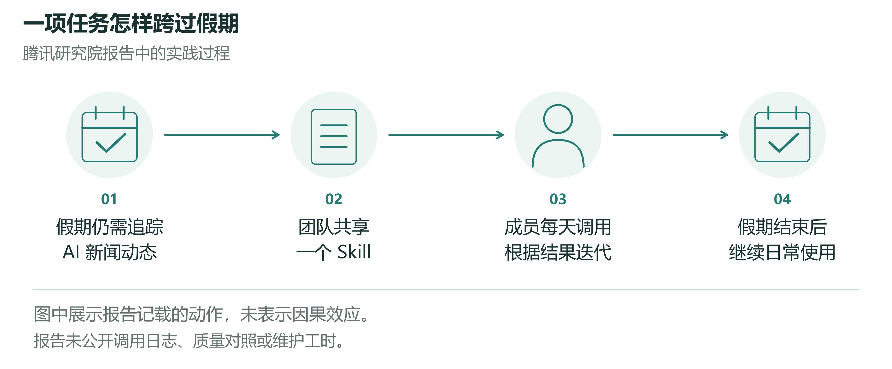
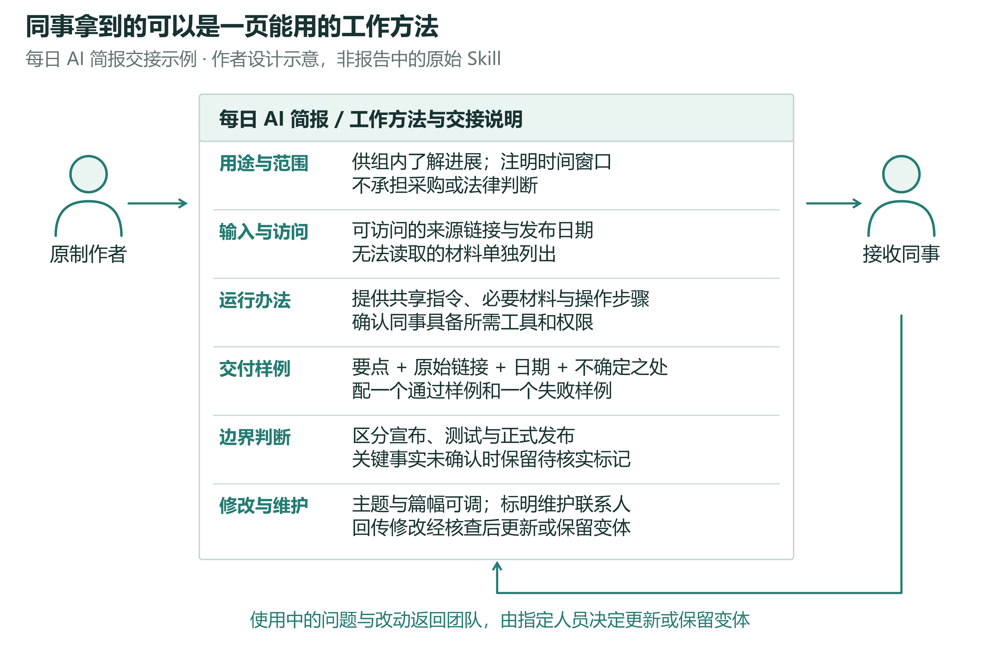
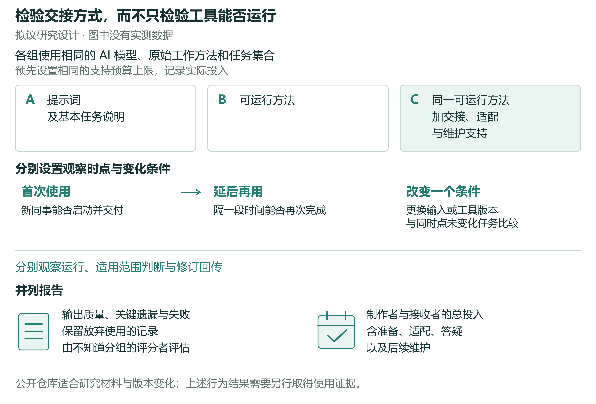

# 个人 AI 经验怎样成为团队可复用的能力

Richard T.Millian

Hangzhou Normal University

## 摘要

一项 AI 方法能否成为团队可以依靠的工作资源，需要在交接之后判断。本文从共享新闻跟踪实践出发，结合知识转移与组织惯例研究，区分方法执行、适用范围判断和修订回传三个环节。接收者能够生成结果，未必意味着结果适合其岗位；个人完成了修改，也未必意味着下一位同事能够获得更新。本文据此提出，以延后使用的质量、异常处置和全部参与者的投入评价复用，考察交接支持、岗位差异及维护安排的作用，并设计公开材料分析与受控行为比较相衔接的研究路线。个人经验的组织价值，应体现在同事能否持续完成工作，以及维持这种能力需要付出多少劳动。

## 1. 假期结束以后，工具为什么还在用

2026 年春节，腾讯研究院 AI 原生小组共享了一项跟踪 AI 动态的 Skill。成员每天调用，依据结果继续修改；假期结束后，这项工具仍被用于日常跟踪。[1] 值得关注的是，服务假期任务的方法进入了后续工作。

新闻跟踪方法的持续使用。图示概括报告记载的共享、调用、迭代和节后使用过程。持续使用不等于已经证明净收益；报告未提供质量对照、维护工时或完整使用日志。[1]

Skill 可以理解为供 AI 调用的一套工作指令和相关材料。例如，Anthropic 的实现把指令及可选的脚本、资源组织在文件夹中；腾讯案例未公开原件，不能据此确定它采用的具体格式。[2]

这类延续使一次任务中的投入有机会服务后来的工作。报告还以新成员加入团队的假设情境，说明同事如何交出可运行的 Skill，接收者如何使用、修改，再将改动送回。[1] 从交出方法到接回修订，经验不再只由最初的制作者掌握。

这一案例呈现的是共同使用，尚未追踪方法最初由谁提出、怎样从个人尝试转为集体采用。它留下的问题是：员工在自己的工作中摸索出的 AI 方法，怎样才能让同事接得住，并在后续任务中继续用下去？

报告中的安克案例提供了另一种起点：一名非程序员用三个月搭建供应链运营系统，另一名员工用两个月搭建亚马逊 Case 自动提交、监控和回复系统。安克另设“火箭班”，让获选员工集中解决真实业务问题，再回到原团队。这些记录展示了个人制作工具及组织推动经验回流的尝试，但未追踪同事后续使用，也未说明上述制作者是否参加火箭班。[1]

做出工具、交给同事和持续复用，需要不同的证据。制作者完成任务，说明方法在原场景中可能有用；同事借助它完成自己的工作，才提供了直接的复用证据；条件变化后能否继续使用，还需追踪。如果把这些过程一并算作“推广成功”，工具数量、演示和培训容易遮住反复求助、重新配置与最终放弃。本文将交接及其后续使用作为观察单位，讨论个人方法何时能够支持团队的共同工作。

## 2. 为什么做出来和交出去之间仍有距离

一份 AI 简报通常带着制作者的工作习惯：哪些来源值得追踪，哪些消息上周已经讨论过，某个含糊的名称指的是哪项产品。提示词传给同事时，这些判断未必随之传递。接收者可能没有原文件的访问权限，也可能面向另一类读者，需要产品何时上线，而非模型能力如何变化。同一份提示词虽然成功运行，结果仍可能用不到当天的工作中。

同事已经能生成每日简报，但需要了解的是产品何时可用，原方法却侧重模型能力。交接仍需核对关注范围、来源和交付要求。情境示意。

知识转移研究早已说明，转移困难涉及接收者、知识本身以及双方关系，不能仅以发送方是否愿意分享解释。[3] 组织惯例研究也区分关于一项工作的概括性理解与具体人员在特定情境中的实际执行。[4] 由此看，存入共享空间的工具只是交接材料；接收者把它用于自己的任务时，双方原先没有说出的条件可能逐渐显现。

这些问题已经进入生成式 AI 的组织研究。Wiesenfeld 和 Kellogg 的质性研究讨论了 LLM 如何参与知识搜索、创造、转移和遗忘，以及相关的组织安排。[5] 一项现场实验也已直接检验 AI 如何改变个体与团队的产品创新任务表现。[6] 这些研究为理解 AI 的组织作用提供了基础，但后一项工作坊实验没有检验某位员工的方法交给第二个人后，能否延后复用及如何维护。本文将这一后续过程作为具体研究对象。

本文把团队可复用能力界定为：原制作者之外的成员能够在既定任务范围内持续完成工作，并恰当地处理超出范围或无法完成的情况。方法及其材料是可共享的资源；成员后续的表现才体现团队是否具备相应能力。评价因此涵盖延后使用的质量、异常处置和所有参与者的投入，而交接说明、适配帮助与维护安排是可能解释这些结果的条件。求助并不意味着复用失败，但若每次运行都要制作者陪同，就应把这部分劳动计入，而不能仅凭一次点击认定交接已经完成。

观察需要区分制作者完成原任务、接收者首次完成自己的任务，以及接收者在后续任务中再次使用。它们不构成固定的成长阶段：方法可能由多人共同制作，接收者也可能先修改再运行。一次双人交接可以揭示困难及其解决过程，却只是团队能力的局部证据；判断稳定复用，还需覆盖不同成员、相关任务和不同时间。

生成式 AI 为这一既有问题增加了新的研究条件。自然语言既能向同事解释方法，也能指挥系统执行；接收者可能在尚未充分理解方法时，就得到看似可用的结果。但复制指令并不会自动复制模型、连接工具与上下文。这与封装改变组织活动可见性的理论讨论有关。[7] 当部分执行交给系统，谁决定任务目的、界定适用范围并负责更新，也需要重新考察。[8] 关键在于：同事能否运行，能否判断何时适用，以及有用的修订能否到达后续使用者。

例如，同事能用共享方法生成简报后，制作者可能认为交接已经结束。接收者却开始面向另一岗位发送简报，改变关注范围，并反复请求补充信息。文件看似相同，承担的工作却已变化。能够运行降低了尝试门槛，并不足以保证适合新用途。传统自动化同样面临这一问题；生成式 AI 值得进一步研究之处，在于以日常语言制作和修改的方法如何被不同岗位的人理解、采用和调整。

## 3. 交接的是一套工作方法

以每日 AI 简报为例，一份可交接的方法应先让同事弄清楚：为谁整理、关注什么，以及哪些问题不在处理范围内。随后列出可用来源、所需材料和访问条件，让接收者能开始工作，而不是等运行失败后再逐项猜测。图 2 是据此提出的方法页示意，并非报告中的原始 Skill。

操作部分需要说明怎样提供输入、启动流程和查看输出。输出样例则告诉接收者，一条可用信息应包含怎样的内容、来源和时间说明。例如，产品公开发布与媒体对未来功能的推测可以在样例中明确区分；一条没有来源的断言即使写得流畅，也不满足这项简报的要求。样例的作用是让双方对任务完成有共同参照。不同工作应有不同参照，不能把一套简报格式当成适用于所有岗位的标准。

方法页还应说明哪些部分可以修改，以及同事可以向谁提出修改需求。更换关注主题、缩短篇幅与改变来源范围，可能涉及不同程度的修改；应说明哪些选项可以自行改变，哪些改动会影响其他使用者。对于运行依赖特定工具的部分，还应标明当前可用条件与负责更新的人。接收者不必先理解全部实现细节，便可以知道一次调整究竟只影响自己的副本，还是会改变同事下一次运行的结果。

一页可交接的工作方法。以每日 AI 简报为例，展示任务范围、来源与访问条件、运行步骤、输出样例、可调整部分及更新入口。这是作者提出的设计示意，不是腾讯案例的原始文件，也不表示所有工作都需要同样的材料。它的效果应通过接收者完成任务的表现及双方投入检验。

交接材料应与任务相称。一次性的简单任务，提示词加一个示例可能足够；每周重复、多人参与且依赖共享数据的任务，则可能需要明确的操作条件与维护安排，否则每次使用都要重新摸索。任务频率也不是唯一依据。能力形成理论提示，低频任务难以通过反复实践积累经验，也可能从知识编码中受益。[9] 判断交接是否充分，应结合任务差异、重复性及持续时间，不能以文档长短代替。

方法页也无法容纳全部默会经验。有些问题要到同事处理自己的任务时才会显现：简报运行正常，选出的新闻却对另一个业务团队没有用。这可能是关注范围不同，并非执行故障。让接收者先试用，再讨论具体调整，能把原先没有说清的判断带入交接。制作者解释来源选择，接收者说明新用途需要的信息，双方才有机会形成适合后续工作的版本。这一过程与将知识转移视为持续活动的研究相呼应。[3]

由此可以检验一种可能的脱节：条件变化后，方法仍能生成结果，接收者却没有重新判断它是否适用；接收者即便完成了修改，同事拿到的也可能仍是旧版。运行、判断和回传需要分别记录。反过来，如果三者无需额外支持也能协调维持，或者执行情况已足以解释后续表现，进一步区分它们的解释价值就会受到限制。

交接支持的预测可以在此基础上进一步限定：在同一核心工具、相近任务和相同资源上限下，任务示例及调整入口可能改善后续适配，而不只影响首次运行。若工具足够直观，补充材料可能没有帮助；若接收者处理的是不同工作，再详细的原用法也可能无效。研究还应允许首次使用变慢、后续使用更稳定的结果，而不以“首次上手更快”作为唯一成功标准。

## 4. 改动怎样回到团队

交接之后，同事会带来新的需求：有人调整关注主题，有人需要原始来源，也有人发现链接已经失效。这些问题可以逐个交回制作者，也可以更新共享材料，或保留服务于不同岗位的版本。每一种选择都涉及时间。团队需要判断哪些修改值得共同维护，并为承担这项工作的人留出时间。

接收者补上了遗漏的来源链接。如果修改只留在个人副本，下一位同事仍可能拿到旧版。回传之后，还需要核查并更新共享材料。情境示意。

报告所描述的修订回传提示了接收者参与改进的可能，但回传之后仍需取舍。销售团队偏好的摘要长度，未必适合研发团队；增加来源可以扩充信息，也可能延长另一岗位的筛选时间。把所有修改合并到一版，可能消除重复劳动，也可能破坏原有用途。共享版本可以保留稳定部分，通过明确选项或独立变体处理岗位差异。版本应怎样划分，取决于任务的相似程度与维护成本。

组织惯例研究关注共同模式与实际执行的关系：共享方法约束工作，也在使用中被重新解释。因此，文档一致并不足以说明团队形成了共同能力，还需观察成员怎样运用方法，以及修改怎样进入下一次执行。[4] 对生成式工具，变化可能发生在提示词、输入材料、模型选择或外部连接中；仅统计提示词版本会遗漏这些差别。

维护劳动往往不如首次演示醒目。制作工具的人可能得到认可，之后解释限制、回答问题、更新依赖的人却未必获得同等关注。支持需求如果持续叠加在制作者的本职工作上，工具越受欢迎，个人负担反而可能越重。接收者也可能只修好自己的副本，来不及把改动送回。复用究竟节省了劳动，还是将劳动集中到少数人、分散到互不相通的副本，需要实际记录才能判断。

比分享获得多少赞更有用的信息，是同事第一次运行前做了什么准备，遇到变化时向谁求助，以及一次修复能否减少后来者的重复劳动。组织可以为适配和支持安排时间，记录修订贡献，并明确问题由谁接收。共同维护也有成本：一个频繁变化、很少再用的工具，未必值得长期保留统一版本。

这里提出第二个预测：接收者任务差异较大时，强制所有人使用同一版本未必带来更多持续复用；允许有说明、可维护的岗位变体，可能提高适配，但也增加更新负担。若所谓变体只是在解决同一类问题，统一修订反而可能更节省劳动。检验时需要同时记录变体服务的任务差异与后续维护，避免把版本数量的增加直接解释为能力扩散。第三个预测则关注劳动分配：当支持需求集中在一个制作者身上时，使用人数增长可能伴随服务等待和维护投入上升，直到继续分发的收益下降。若更新足够稳定、支持能够自助完成，这种趋势也可能不出现。

## 5. 从公开材料到行为检验

研究可以从公开工作流、工具说明和版本记录开始，而不需要先假定能够取得企业内部数据。第一步是界定可检查的材料集合、时间范围与纳入条件，保存可复现的版本，再比较工具是否说明用途、运行条件、输出要求与维护入口。问题讨论、修改记录和废弃说明能够帮助识别作者公开提到的适配困难。例如，某个版本增加了输入示例，某次修改更新了失效连接，这些都属于可直接观察的材料变化。研究应保留停止维护和运行失败的项目，避免只挑展示成功的工具。

这类资料首先回答“公开方法如何被整理和修改”。它无法仅凭下载量、收藏数或提交数回答“员工是否因此能重复完成工作”。一次提交可能来自原制作者，也可能是格式修改；一个问题长期无人回复，既可能表示使用困难，也可能表示讨论转移到其他地方。不能从账号推断员工身份或同组织关系。第一阶段因此限于材料与变更的描述，行为预测需要第二阶段取得真实接收者独立使用方法完成任务的证据。公开可见与允许怎样使用资料也应分别核查；研究可以报告工具特征，而无须识别普通贡献者的真实身份。

技术评估与这项行为研究也应衔接而不混同。例如，公开预印本 SkillsBench 使用任务验证程序比较智能体在不同 Skill 条件下的任务表现，提供了检查工具是否能完成既定任务的一种方法。这与第二名员工在自己的工作中延后复用、处理变化以及承担维护成本，是不同层面的证据。[10]

为进一步检验交接，应在未来研究中比较三种方式：A 组得到提示词和基本任务说明，B 组得到可运行的方法，C 组得到同一可运行方法及交接、适配和维护支持。三组使用相同的 AI 模型、原始工作方法和任务集合，并设置相同的支持预算上限。B 与 C 的比较尤其重要：它让研究聚焦于一个已经能够运行的方法，增加交接支持后是否改变接收者的工作表现。A 与 B 的差异还包含自动执行的便利，不能全部解释为知识转移改善。

拟议的交接比较。A 为提示词和基本任务说明，B 为可运行方法，C 为同一可运行方法加交接、适配与维护支持。AI 模型、原始工作方法和任务集合保持相同，各组设置相同的支持预算上限。观察涵盖首次使用、延后再用，以及分别改变输入或工具版本时的表现。成果质量、失败与放弃、制作者和接收者的总投入并列记录。B 与 C 是关键比较，但支持是一项组合干预；本图不含实验结果。

这样的比较估计的是相同资源上限下，不同交接策略的总效果。C 组准备说明、样例和维护入口的时间应计入，而不是作为免费资源；A、B 组也应拥有相同上限的支持资源。由 A 到 B 所需的封装制作成本同样计入。研究应预先规定各条件允许的答疑内容和方式，记录实际交付的材料与支持；否则，原计划只交文件的条件也可能在临时答疑中变成完整交接。相同的是可投入的资源上限，实际花费可以不同。C 组仍是一项组合干预，效果不能归因于某一页说明或某个字段；若要区分各成分作用，需要后续分别操纵。

参与者应在具备完成任务所需的基础权限后，随机进入交接条件，并记录其原有领域知识和工具熟悉程度。将任务、制作者和原始工作方法固定或在设计中平衡，可以减少“本来更好的工具恰好落在某一组”的解释。不同组若在同一工作环境中自由交换材料，会改变比较含义；研究应按实际交接单元安排分组，并记录这种交流。公开材料可用于构造可共享的任务包，但在公开任务上得到的效果仍需检验能否推广到企业日常工作。

评价需要覆盖首次使用、延后再用和遇到变化三类情况。延后任务可以与初次任务范围相同，但更换具体内容，避免把记住答案误认为方法能够复用。变化任务应分别改变输入要求或工具版本，保留其他条件，并与同时点的未变化任务比较，随机或平衡任务顺序。否则，阶段差异会混入时间与熟悉度影响，不能归因于条件变化。若同时改动模型、来源与任务目标，失败的原因也无法区分。研究须在观察结果前说明适用任务范围、最低可接受质量及主要比较。

过程记录应与本文区分的三个环节对应：能否启动并产出结果，对预设适用与不适用任务作何判断和处置，修订是否通过事先约定的核查并进入后续使用者实际取得的版本。各组应有相同的故障处置和回传机会，不能以点击提交次数代替有效调整。这些记录可以显示策略作用时哪些环节发生了变化，不能单凭环节与结果相关就确定中介机制。三组比较主要检验交接策略；统一版本与岗位变体的比较、使用人数增长造成的维护负担，需要另行改变版本政策或使用负载。

结果也不能压缩为运行耗时。成果质量可以由不知道分组的评估者依预先确定的任务标准判断；同时记录启动配置、阅读说明、实际运行、返工、求助、答疑和维护的时间。工具未运行、接收者退出或转用手工方法都应保留，并按最初随机分组分析，不仅比较最终接受了完整支持的人。遇到超出适用范围的任务，选择求助或转交可能正是合适的工作行为；应区分这种处置与在适用范围内无法完成，追踪求助后的结果和双方投入。否则，一个懂得何时求助的人可能反而被算作较差的使用者。

准备材料的成本与重复使用的收益发生在不同时间。研究应分别报告一次性投入和每次使用投入，并对明确的使用次数或观察期限讨论成本，避免把一次准备费用完全隐去，也避免把它全部压到第一位接收者身上。提高质量但没有节省时间、节省接收者时间却增加制作者负担，都是有意义且不同的结果。除非事先说明质量与时间如何权衡，不宜将它们合成一个看似确定的“效率提升”。

上述设计同时给出了本文主张的失败条件。若 B、C 在有足够精度的比较中没有有意义的差异，交接支持可能并非该类任务的主要约束；估计不精确则仍无法作此判断。若所有组都在输入变化后失效，原始工作方法的适用范围可能比交接方式更重要。若 C 仅在短期取得优势，而维护成本抵消后续收益，就不能声称已经形成更可持续的团队能力。这些发现可以帮助限定何时值得封装和维护一项方法，而不是被当成推广过程中应当删除的例外。

## 6. 从奖励制作者到支持共同工作

共享 Skill 的实践把组织变革落在了一项普通任务上：员工共同使用、持续修改，方法得以留在日常工作中。[1] 对管理者而言，这意味着评价不能止于工具是否做出来，还要追踪同事接手后的表现，以及维护是否有人承担。

团队的共同积累可以来自不同贡献。有人识别重复任务，有人把方法做成工具，有人提供判断质量所需的样例，也有人持续更新和答疑。承认这些劳动，才能让奖励与实际协作相对应。投入交接与维护是否值得，应由任务结果和总体投入判断，而非使用 AI 的时长。

并非每种方法都值得推广。很少重复的任务可能直接完成更合适；岗位目标差异较大时，借鉴思路可能比复制工具更有用；涉及特殊权限或专业责任的工作，则需要限定接收者与使用范围。清楚说明何时不应使用，也是共同方法的一部分。

个人 AI 经验的价值，最终要在同事的工作中得到检验：接手者能否完成任务，过一段时间能否继续使用，以及谁承担了让方法保持可用的劳动。以这些问题追踪交接，既能保留员工自主探索的空间，也能识别哪些经验值得沉淀、怎样维护，以及何时应当停止复用。

## 参考文献

1. 腾讯研究院. 2026 从超级个体到超级团队：AI 时代组织变革的涌现路径研究报告. 研究报告（2026）. 

2. Anthropic. Equipping agents for the real world with Agent Skills. Anthropic Engineering (16 October 2025; updated 18 December 2025). https://www.anthropic.com/research/equipping-agents-for-the-real-world-with-agent-skills

3. Szulanski, G. Exploring internal stickiness: Impediments to the transfer of best practice within the firm. Strategic Management Journal 17(S2), 27–43 (1996). https://doi.org/10.1002/smj.4250171105

4. Feldman, M. S. & Pentland, B. T. Reconceptualizing organizational routines as a source of flexibility and change. Administrative Science Quarterly 48(1), 94–118 (2003). https://doi.org/10.2307/3556620

5. Wiesenfeld, B. M. & Kellogg, K. C. Generative organizational learning: Affordances for new modes of knowledge search, creation, transfer, and forgetting with LLMs. Strategic Organization 24(2) (2026; first published online 2025). https://doi.org/10.1177/14761270251408580

6. Dell'Acqua, F. et al. The cybernetic teammate: A field experiment on generative AI and teamwork. Organization Science 37(4), 1217–1242 (2026). https://doi.org/10.1287/orsc.2025.20702

7. Hinds, P. & von Krogh, G. Generative AI, emerging technology, and organizing: Towards a theory of progressive encapsulation. Organization Theory 5(4) (2024). https://doi.org/10.1177/26317877241293478

8. Puranam, P. Human–AI collaborative decision-making as an organization design problem. Journal of Organization Design 10, 75–80 (2021). https://doi.org/10.1007/s41469-021-00095-2

9. Zollo, M. & Winter, S. G. Deliberate learning and the evolution of dynamic capabilities. Organization Science 13(3), 339–351 (2002). https://doi.org/10.1287/orsc.13.3.339.2780

10. Li, X. et al. SkillsBench: Benchmarking How Well Agent Skills Work Across Diverse Tasks. Preprint (13 February 2026). https://www.skillsbench.ai/skillsbench.pdf
