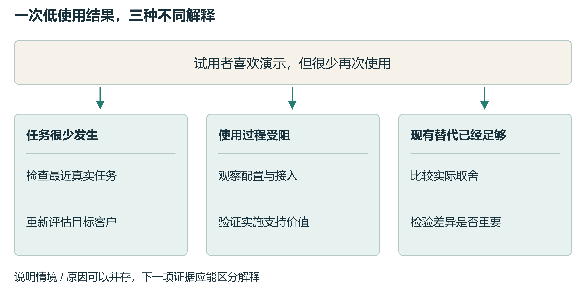
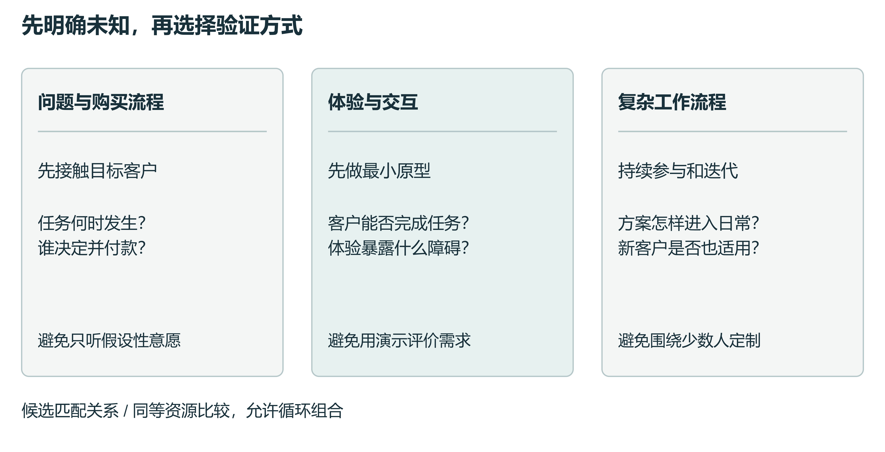
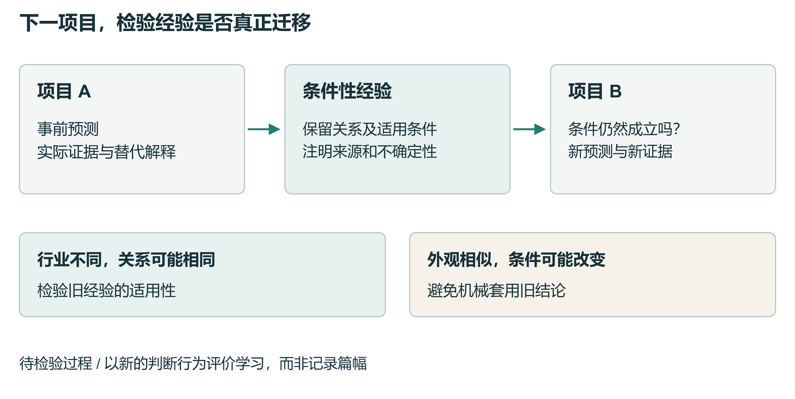

# 从快速试做到判断积累

Richard T.Millian

Hangzhou Normal University

## 摘要

生成式人工智能使小团队更容易制作产品原型，却没有消除对客户需求和持续投入价值的不确定性。一次试用失败可以引出需求不足、客户错配或使用障碍等不同解释；增加试做次数也未必使团队在下一项目中判断得更准确。本文结合科学创业实验、市场机会识别、类比迁移与AI辅助决策研究，提出一个以跨项目学习为中心的概念框架。框架区分制作、证据获取、项目取舍与经验迁移，并将经验表述为带有客户条件、替代解释和适用边界的判断。我们据此讨论验证顺序如何随关键不确定性变化，提出可检验的命题及训练设计。评价重点是新项目中的客户行为预测、证据选择和资源取舍，同时考虑无效延续与过早终止。该框架尚待行为研究检验，适用于把快速试做转化为累积学习的研究与实践。

## 产品完成以后

一款产品已经可以演示，团队却还无法回答下一步该不该继续投入。设想一个为本地商家开发营销工具的小团队：AI能够生成整洁的宣传海报，试用者表示喜欢，付费和重复使用却迟迟没有出现。团队可以继续改善版式，也可以寻找另一群客户，或者结束项目。每种行动背后，都有一个对失败原因的判断。这个说明情境中的困难，在于同一结果能够支持多种解释；更漂亮的原型不会自动排除其中任何一种。

腾讯研究院关于超级个体与超级团队的报告，以快速开发、跨职能实践和行动中学习描绘组织变化。其中，flomo的实践把部分需求验证前移：产品人员借助AI跑通原型，再交由工程师上线；其他案例也描述了设计师与业务人员参与开发的变化。报告在结尾追问能力增强之后应当选择什么值得做。[1] 这些观察把研究视线引向产品探索中的取舍，但报告中的案例并未识别AI对市场判断的因果影响。对小团队而言，一个更具体的问题是：试做更容易之后，每次尝试能否留下足以改善下一次决定的知识？

已有研究为这一问题提供了基础。科学创业研究将价值解释、假设和实验连接起来；AI辅助创业研究则开始考察对话如何支持商业模式学习。[2, 3] 本文沿着这些工作进一步讨论跨项目迁移。我们提出，团队需要保留经验成立的条件，在新项目中重新识别这些条件，并据此形成可被后续行为检验的预测。本文是基于定向文献整合的观点论文，提出机制与研究设计，不报告新的实验结果。

## 制作速度与证据质量

原型制作、证据获取和项目选择可以以不同速度改善。可运行的软件、可观看的演示和可使用的服务，分别使某些问题更容易被检验，但它们本身并不等于客户证据。团队需要知道原型正在检验什么：技术能否运行，客户能否完成任务，还是客户是否愿意为结果改变既有行为。若把这些问题合并为一个笼统的“验证成功”，后续投入就缺少清楚依据。

数字实验研究已经把实验与识别、扩展和放弃商业机会联系起来。Koning等利用创业企业采用A/B测试技术的时间差异研究这一关系；其证据支持把实验看作组织学习的一部分，但不能直接外推为AI使用的效果。[4] AI也可能降低访谈材料整理、测试设计和数据分析的成本。因此，值得检验的是制作与现实验证的相对成本，以及团队如何重新配置时间，而非预先认定工具只会加快制作。

这里有两条竞争路径。第一条路径中，团队把节省的开发时间用于接触目标客户，设计更有辨别力的测试，因而更快修正重要假设。第二条路径中，团队不断增加功能和演示，将产品完成度当作投入依据，关键市场假设却保持不变。两条路径都可能产生更多原型，只有过程与后续决策记录能够将它们区分。

AI建议的实际作用也取决于使用情境。Otis等在肯尼亚创业者中随机提供AI商业助手，没有检出显著的总体平均经营改善，但发现基线表现不同的群体存在效应差异。[5] 这一研究提醒我们把工具访问与建议选择分开；它没有直接测量跨项目产品判断力。本文使用“产品判断力”作为工作定义，指团队在证据有限时界定客户、解释价值、选择验证方式并决定投入的能力，不将其视为已经验证的单一量表。

## 把客户定位落实到行为

一项技术可能服务多个市场，先比较候选机会有助于明确选择依据。Gruber等关于技术创业的研究发现，创业经验、进入市场前识别的机会集合与后续表现之间存在联系，但机会数量增加带来的收益会递减。[6] 对AI辅助探索而言，扩展候选市场之后还需要判断哪些差异真正影响采用和购买。

以营销工具为例，偶尔做活动的单店店主，与需要协调多家门店的品牌运营人员，虽然都属于餐饮行业，面对的任务频率、责任和购买流程却可能不同。客户定位应记录使用情境、现有替代、使用者、付款者及切换成本。人口统计特征可以辅助描述，但不能取代对任务和决策过程的理解。所谓精细划分，应提高对新客户行为的解释和预测能力。

细分规则也可能被小样本误导。团队反复切分少量试用者，总能找到某个表现较好的群体。因此，探索阶段形成的规则应在新的客户样本中验证，并保留招募渠道及未参与者的信息。访谈中的兴趣、实际试用、重复使用和付款支持不同判断；对低频任务，观察期必须覆盖真实使用机会。客户价值、企业可持续供给和短期收入也需要分别考察。

模拟客户不能自动填补现实证据的缺口。Brand等的工作论文比较模型与人类的支付意愿，发现模型估计存在偏差，利用既有调查数据调整模型的收益也受到产品类别和人群边界限制。[7] AI可以帮助形成备选解释与访谈问题，但同一个系统生成的客户画像、需求回答和商业论证，不能被当作彼此独立的市场确认。

## 失败结果需要被诊断

在前述情境中，低使用可能意味着客户很少需要制作海报，也可能意味着客户需要这项服务，却无法顺利完成配置。前者要求重新评估目标客户或价值主张，后者可能值得投入实施支持。若没有观察客户的任务过程，两种解释都可能被写进一篇流畅的复盘，却没有获得更强证据。

同一失败结果可以对应不同的后续决定。图中商家工具是说明情境，不代表真实企业或实验结果。每一分支给出一种候选解释及能帮助区分它的证据；分支不是穷尽分类，也不表示原因互斥。判断应允许多种原因共同存在。

我们建议围绕关键假设组织诊断。需求假设涉及问题是否频繁而重要；采用假设涉及客户能否将方案纳入工作；商业模式假设涉及付款者、价格和服务成本。实施失败与证据不足应单独保留：一个未能可靠运行的原型，无法公平检验完整的价值主张；一项没有覆盖客户使用机会的测试，也不足以否定需求。

对失败的回顾还可能受到事后解释影响。Boso等对创业者的纵向观察将失败经历、学习与后续企业表现联系起来，但这种设计不足以保证每次失败都产生学习，或完整识别其中的因果过程。[8] 为降低解释随结果漂移的问题，团队可在测试前记录预测、样本来源、观察期、替代解释和取舍条件，失败后再逐项更新。若证据无法区分解释，应留下“尚不能判断”，而非强行提炼一条教训。

及时终止无效项目是选择质量的一部分，过早放弃同样有成本。Camuffo等的四项随机试验表明，科学决策训练能够影响项目终止和转向模式，但终止次数本身不应成为训练目标。[2] 决定继续时，需要考虑下一次验证是否可能改变选择及其成本；决定停止时，则需要检查否定性证据是否真正针对核心假设。

## 验证顺序取决于待解问题

先访谈还是先制作原型，取决于当前需要获得哪种证据。若连任务是否经常发生、购买者是谁都不清楚，直接接触客户可能更有价值。若客户只有在体验之后才能识别某项交互需求，最小原型则可能成为必要的研究工具。若产品需要嵌入复杂工作流程，持续参与能够帮助双方共同形成问题和方案。

客户参与也有成本。Chang和Taylor的元分析报告了客户参与效果随产品开发阶段与情境变化的模式，提示持续参与不应被当作无条件有效的原则。[9] 这些汇总关系并不构成AI时代探索顺序的随机比较。共创过程中还需观察积极客户是否具有代表性，以及围绕他们形成的方案能否被新的客户使用。

验证方式围绕关键不确定性选择。三条路线是候选匹配关系，尚需比较研究；它们可以循环组合，并非互斥的固定流程。比较顺序效果时，应控制或记录时间、预算、客户接触和证据可得性，避免把投入差异解释为流程优势。

Agarwal等在坦桑尼亚农业创业者中比较两种训练路径，发现将价值形成逻辑与证据检验结合的条件具有经营表现优势。[10] 这为围绕因果解释组织测试提供依据，也保留了情境边界。一个原型的作用应由它能够区分的解释来评价。低成本的人工服务、任务观察或购买流程访谈，有时足以检验某个关键环节，无需等待完整系统。

## 经验在下一项目中接受检验

一条可迁移的经验需要同时说明关系与条件。营销工具的失败或许支持这样的暂时判断：当任务低频且免费替代充分时，单纯改善输出质量未必带来持续付费。它没有理由扩展为“所有小商家都不值得服务”。同样，新项目即使服务另一行业，只要面对相似的任务频率和替代条件，旧经验也可能值得检验。

类比迁移研究提供了一条训练线索。Gentner等在谈判任务中发现，比较案例之间的关系结构有助于形成和使用抽象策略。[11] 这支持设计跨案例比较，但并不证明同样训练能够改善真实产品投资。迁移要求识别结构相似性，也要求识别决定性差异；只寻找相似之处，可能让过去的失败成为新的偏见。

将经验迁移到下一项目需要条件检查。项目A留下带有来源和边界的暂时判断；项目B先检查相关条件，再作出事前预测，并依据新证据修正判断。箭头表示本文提出的学习过程，不表示已经测得的因果效应。跨项目表现是检验对象，记录数量不是学习成效。

据此，复盘产物可包括原有预测、观察证据、被削弱的解释、仍然成立的解释、适用条件，以及下一项目的检验方式。记录只是外部支持。若团队在新项目中仍然无法辨别付款者或选择有效测试，即使复盘写得完整，也不能据此认定判断力提高。反过来，有些团队可能通过讨论形成准确判断，却留下很少文字；研究需要同时观察记录和行为。

这一分析提出三项可反驳命题。第一，在同等资源下，围绕明确价值解释选择证据，比单纯增加试做，更可能改善项目取舍；若额外制作本身提供了同样有辨别力的反馈，差异可能缩小。第二，带有条件比较和新情境预测的复盘，比一般总结，更可能改善跨项目判断；若训练只改善了当前作品或自信，这一命题不获支持。第三，迁移效应受到条件匹配影响；表面相似而关键条件改变时，机械应用旧经验可能产生负迁移。

## 把训练落实为可观察的行为

训练可以从一对有意安排的案例开始。两种产品在外观和行业上不同，却面临相同的使用者与付款者分离问题；另一对产品表面相似，任务频率与替代方案却不同。参与者先独立选择客户与验证方法，说明理由，再比较证据。比较结束后，要求其在第三个案例中提出预测，使训练从案例理解推进到迁移检验。

完整训练拟覆盖客户与任务识别、价值解释、验证设计、失败诊断、资源取舍和跨项目迁移。每一环节都应留下可检查的决定，而非仅记录参与时长。例如，验证设计需要说明何种结果会改变下一步行动；失败诊断需要提出能够区分解释的新增证据；资源取舍同时面对值得继续和应当停止的案例。训练内容是本框架的实践推论，其效果尚未得到验证。

AI可以辅助整理来源材料、提出反例、制作最小原型和检索旧记录。Kostis等已经区分了与AI对话中的不同学习方式，国内研究构想也讨论了AI进入科学决策各环节的作用。[3, 12] 本文所强调的评价单位是下一项目的行为变化，而非对话流畅度。若训练结束后只有AI保持相同上下文时表现改善，研究应将其描述为系统辅助绩效，并与人的独立迁移区分。

## 怎样检验框架是否成立

一个可行的初步实验可交叉安排AI工具访问与结构化训练，对照组接受同等时长和关注的常规产品实践。参与者先完成项目A，再面对表面不同的项目B；新项目同时包含条件延续与条件改变的案例。训练后的新情境判断是主要评价对象，延迟测量用于区分短期记忆和较稳定的学习。若研究团队决策，应按团队分配并处理群内相关。

客户行为预测可以用预先规定事件及观察期的概率预测评价校准，项目取舍则需独立的结果基准。评价同时计入错误继续和错误停止，并说明不同错误的后果。商业结果受到市场时点、执行与运气影响，单次收入不能充当判断能力的充分指标。证据选择、预测更新、理由质量和后续客户行为应相互补充，而非由一项自评问卷承担所有解释。

实验还需公平比较资源和材料。固定并记录模型版本、访问方式及客户证据来源，使用未参与训练的新案例，保留负面和正面结果。不能让同一个模型生成客户真值、协助决策并独自评定成效。机制检验可以进一步拆分“保留记录”“比较条件”和“新项目预测”，确定哪一部分确有贡献。过程变量与结果相关，并不足以证明中介因果链。

公开材料能够支持先行研究，但也限制推论。连续产品发布、定价变动和公开终止说明可以重建部分决策轨迹；点赞不等于需求，网站仍在不等于留存，发布频率也不能识别AI使用。如果缺少失败前的预测或同一团队的后续项目，分析只能讨论可见的叙事和行为关联，不能声称已经识别学习迁移。正式实证研究还需预注册主要结果与分析规则，并依据最小有意义效应、聚类和失访确定样本量。

## 判断积累的边界

本框架强调在尝试之间保存可修正的关系解释。它承接科学创业与类比学习研究，将评价重心放到新项目中的行为。当前证据不能确定训练的最佳周期、收益持续多久，或何种团队最适合使用。客户需求也可能在产品使用和社会互动中形成，早期证据有限并不必然意味着机会不存在。

因此，敏锐的产品判断需要容纳不确定性。它体现在知道哪项假设最值得先检验、哪些证据能够改变决定，以及旧经验何时需要停止适用。一个结束的项目仍可能留下有价值的知识；一个继续增长的项目也可能掩盖错误理解。AI辅助探索值得追求的累积成果，是团队能够在下一次投入之前提出更清楚的问题，并在现实证据到来时作出更有根据的修正。

## 参考文献

1. 腾讯研究院. 从超级个体到超级团队：AI时代组织变革的涌现路径. 研究报告 (2026). 

2. Camuffo, A., Gambardella, A., Messinese, D., Novelli, E., Paolucci, E. & Spina, C. A scientific approach to entrepreneurial decision‐making: Large‐scale replication and extension. Strategic Management Journal 45(6), 1209-1237 (2024). https://doi.org/10.1002/smj.3580

3. Kostis, A., Lidström, J., Nair, S. & Holmström, J. Too Much AI Hype, Too Little Emphasis on Learning? Entrepreneurs Designing Business Models Through Learning-by-Conversing With Generative AI. IEEE Transactions on Engineering Management 71, 15278-15291 (2024). https://doi.org/10.1109/tem.2024.3484750

4. Koning, R., Hasan, S. & Chatterji, A. Experimentation and Start-up Performance: Evidence from A/B Testing. Management Science 68(9), 6434-6453 (2022). https://doi.org/10.1287/mnsc.2021.4209

5. Otis, N.G., Clarke, R., Delecourt, S., Holtz, D. & Koning, R. The Uneven Impact of Generative Artificial Intelligence on Entrepreneurial Performance: Evidence from a Field Experiment in Kenya. Management Science (advance online publication) (2026). https://doi.org/10.1287/mnsc.2024.06909

6. Gruber, M., MacMillan, I.C. & Thompson, J.D. Look Before You Leap: Market Opportunity Identification in Emerging Technology Firms. Management Science 54(9), 1652-1665 (2008). https://doi.org/10.1287/mnsc.1080.0877

7. Brand, J., Israeli, A. & Ngwe, D. Using LLMs for Market Research. Harvard Business School Working Paper 23-062 (revised 30 April 2026). https://www.hbs.edu/ris/Publication%20Files/23-062_1f58623a-ee21-44b9-a262-276047bc5543.pdf

8. Boso, N., Adeleye, I., Donbesuur, F. & Gyensare, M. Do entrepreneurs always benefit from business failure experience? Journal of Business Research 98, 370-379 (2019). https://doi.org/10.1016/j.jbusres.2018.01.063

9. Chang, W. & Taylor, S.A. The Effectiveness of Customer Participation in New Product Development: A Meta-Analysis. Journal of Marketing 80(1), 47-64 (2016). https://doi.org/10.1509/jm.14.0057

10. Agarwal, R., Bacco, F., Camuffo, A., Coali, A., Gambardella, A., Msangi, H., Sonka, S., Temu, A., Waized, B. & Wormald, A. Does a Theory-of-Value Add Value? Evidence from a Randomized Control Trial with Tanzanian Entrepreneurs. Organization Science 36(2), 601-625 (2025). https://doi.org/10.1287/orsc.2023.17590

11. Gentner, D., Loewenstein, J. & Thompson, L. Learning and transfer: A general role for analogical encoding. Journal of Educational Psychology 95(2), 393-408 (2003). https://doi.org/10.1037/0022-0663.95.2.393

12. 陶奕达, 于晓宇. AI增强的科学决策方法对创业想法形成的作用. 心理科学进展 34(12), 2121–2138 (2026; 网络预先发布). https://doi.org/10.3724/sp.j.1042.2026.2121
