# Health economic value in the AI era: a framework for intertemporal choice

Richard T. Millian

Hangzhou Normal University

## Abstract

Overtime pay, convenient meals and faster AI-assisted work offer visible gains in money or time. Changes in sleep, physical burden and recovery may receive less attention. Drawing on health capital, time allocation, health capability and decision analysis, this Perspective proposes a framework for comparing health-related consequences. It compares feasible options over a common horizon, recording resources and time, health and functioning, experience, and capabilities and agency before appraisal against personal priorities. Measurement, prediction and judgement remain distinct; outcomes retain their units, timing and uncertainty. For AI use, faster tasks need not create more rest, and better assisted performance need not improve independent ability. Cases involving daily and repeated overtime, food choices and digital leisure show how to apply the comparison. Testable propositions concern the distribution of time gains, persistence of effects and decision quality. The framework aims to clarify choices and their consequences while allowing priorities to differ across people and circumstances.

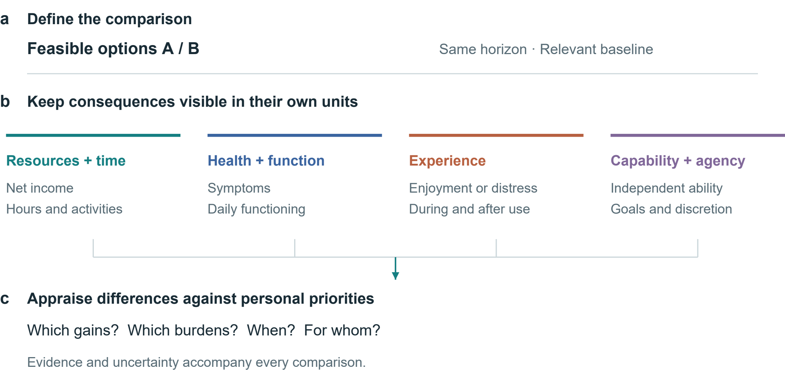

Fig. 1 | A framework for comparing health-related consequences. Feasible alternatives and a common horizon define the comparison. Resources and time, health and functioning, experience, and capabilities and agency remain distinct. Priorities inform appraisal. Connections represent analytical steps, not estimated causal effects.

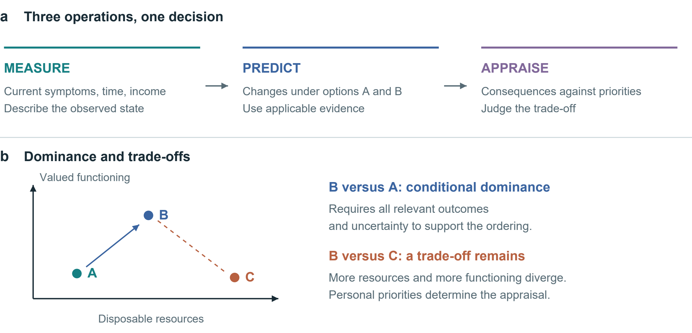

Fig. 2 | Linking measurement, prediction and appraisal. a, Three kinds of information address the same decision. b, Conditional dominance and trade-offs on qualitative axes without numerical units. Other relevant outcomes and uncertainty may change the ordering.

## From economic returns to changes in daily life

Whether overtime pay improves daily life depends on both the income gained and what it requires. Longer daytime work, repeated night shifts and greater efficiency with AI may all increase income, with different implications for sleep, energy and family time. Comparison begins with concrete questions: how much money is gained, where time goes, and whether the person can work, study or care for family the next day. Figure 1 brings these questions together; Figure 2 separates measurement, prediction and appraisal.

Established theories offer different starting points. Grossman treats health as a stock with both consumption and production value; Becker brings non-market time into resource allocation. [1, 2] Marx links the working day to bargaining and the reproduction of labour power. [3] These accounts address health, time and labour relations from distinct perspectives. Marx motivates questions about who receives production gains and who bears health burdens. Identifying a particular health loss still requires evidence about exposure and the feasible alternative; it cannot simply be added to surplus value as a measured quantity.

Health capability concerns both achieved health and the real opportunities people have to maintain it and pursue their goals. [4] A person who needs overtime pay for housing or care may have the right to refuse without the means to do so. Health-dependent utility also means that the same income increment need not yield the same welfare gain in every health state. [5] Appraisal should therefore consider which difficulties the income relieves and the time and health costs of obtaining it.

We use health economic value to describe the significance of health and functioning for resource allocation and personal choice, including the value of health itself and its support for daily activities. It is distinct from earning capacity, total welfare and human worth. The framework specifies feasible alternatives, traces their consequences over time, and makes evidence, uncertainty and personal priorities explicit. A comparison may yield a preference, identify the conditions under which a choice is justified, or leave a disagreement unresolved.

Table 1 | Minimum comparison record. Proposed fields, not a validated scale. Health capability, ICF, WHO-5, MCDA and decision-quality research inform the distinctions. [4, 6, 7, 8, 9]

| Domain | Record | Interpretation |
|---|---|---|
| Decision | Feasible options; ability to refuse; common horizon | Distinguish nominal options from real opportunities |
| Resources and time | Net income change; total work; displaced activities | Record where saved time is used |
| Health and functioning | Relevant symptoms, function or clinical outcomes | Interpret against baseline and clinical context |
| Experience | Enjoyment, relief or distress; during and after | Separate immediate responses from sustained change |
| Capabilities and agency | Independent performance; valued activities; discretion | Include accessibility gains from assistance |
| Evidence and appraisal | Population; comparator; horizon; uncertainty; goals | Retain unknowns and differences in priorities |

## From measurement to appraisal

A laboratory report can describe a blood glucose level, but cannot by itself establish whether a choice is worthwhile. Measurement describes the current state; intervention research estimates possible consequences of changing diet; willingness to bear costs in money, time or taste depends on personal priorities. Measurement, prediction and appraisal therefore require different justifications. Reference ranges do not rank human worth, and average study results do not directly specify an individual future.

Monetary valuation can inform defined policy and resource-allocation questions, but payment does not establish that lost functioning has been restored. Even when a loss is irreversible, people still compare prevention, mitigation and feasible alternatives. Acceptance of compensation can reflect a considered trade-off or a lack of other ways to meet essential needs. Behavioural welfare analysis therefore examines the conditions under which observed choices reveal informed preferences. [10]

Cost–consequence analysis presents outcomes alongside one another, while multicriteria decision analysis makes criteria and weights explicit. [8, 11] Established decision guides already elicit options, values and support needs. [12] Our proposal adds specific records of where saved time goes, how outcomes develop, how functioning differs with and without assistance, and who bears the consequences. Table 1 organizes these fields. Their usefulness must be tested against existing tools.

Standardized health-status instruments can supply comparable information; preference-based measures such as EQ-5D can support health-economic evaluation when used with the appropriate valuation framework. [13] They do not exhaust autonomy, relationships or personally valued capability. Self-determination theory offers a complementary account of autonomy, competence and relatedness, without implying that every activity has the same meaning for every person. [14] Reading, gaming, exercise and companionship therefore enter as alternatives whose consequences require assessment, rather than predetermined categories of virtue or harm.

A common record should accommodate different priorities. When income, sleep and family time conflict, the comparison should show the trade-off and test whether changing priorities changes the choice. An overall score is interpretable only when scales, weights, uncertainty and double counting have been addressed. Outcomes without a defensible conversion can retain their own units and be reported separately.

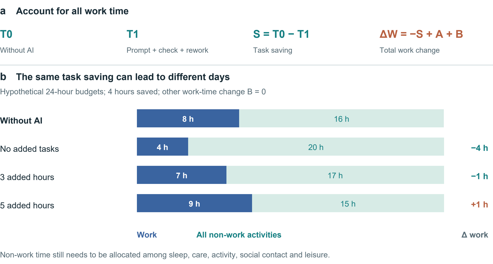

Fig. 3 | Task savings and the allocation of a day. a, The accounting identity includes prompting, verification and rework in T1, additional tasks in A and other work-time changes in B. b, Hypothetical 24-hour budgets with an 8-hour baseline workday, a 4-hour task saving and B = 0. Non-work time is not assigned a health effect.

## Intertemporal comparison and time constraints

Let x_i(a;τ) denote person i's consequence profile under feasible option a at time τ. Components retain their own units: disposable resources, time allocation, health and functioning, experience and capabilities. For components with a meaningful numerical difference, define:

Δx_i(a,b;τ) = x_i(a;τ) − x_i(b;τ).  (1)

This is a contrast, not a causal prediction model. Categorical changes remain descriptive. Every estimated component requires a population, comparator, horizon, source and uncertainty statement. Timing may require a trajectory rather than an endpoint. Let z_j denote an appropriately oriented criterion, with larger values preferred within its applicable range. Conditional dominance requires:

Δz_j ≥ 0 (∀j); Δz_k > 0 (∃k).  (2)

This ordering applies only if the criteria cover the relevant consequences and uncertainty does not overturn it. Many biomarkers are not monotonic, and omitted consequences can reverse an apparent ranking. Where trade-offs remain, personal appraisal is necessary; no universal exchange rate follows from equations (1)–(2).

For AI-assisted work, let S = T0 − T1 be time saved on a fixed task; T1 includes prompting, verification and rework. Let A be time added through additional tasks and B all other net changes in work time, defined to avoid overlap. Then:

ΔW = −S + A + B.  (3)

Figure 3 illustrates the identity. Saving four task hours produces four fewer work hours if A = B = 0, one fewer if A = 3 and B = 0, and one more if A = 5 and B = 0. These are hypothetical allocations, not estimated AI effects. Even a fall in total work does not determine health: the activities replacing work, discretion over them and their subsequent consequences remain to be measured.

Table 2 | Different levels of AI outcomes. Studies illustrate task efficiency, experience and judgement; their designs and endpoints differ.

| Setting and design | Main finding | Interpretive scope |
|---|---|---|
| Professional writing; Randomized; 453 [15] | Faster task completion and better output quality | Full-day allocation and health not measured |
| Customer support; Staggered rollout; 5,172 [16] | About 15% higher resolutions per hour; outcome availability varies | Causal assumptions; allocation of saved time not measured |
| Companionship; Seven-day Study 3 [17] | Immediate loneliness relief; persistent pre-interaction benefit not demonstrated | Differential attrition; control not time-matched |
| Medical scenarios; 1,298 people [18] | Control versus pooled AI: identification OR 1.76 (95% CI 1.45–2.13) | Scenario performance, not clinical morbidity |

## Three levels of AI benefit

Task efficiency is the most direct outcome. Noy and Zhang found faster writing and better output in a randomized study of 453 professionals. [15] Brynjolfsson and colleagues examined a staggered rollout covering 5,172 customer-support agents; their main difference-in-differences estimate indicated about 15% more issues resolved per hour. [16] The latter study was quasi-experimental, measured throughput and lacked compensation data. These studies support productivity gains, but who controls the saved time, and whether income or health improves, require separate measurement. [16]

A second outcome is capability. Performance with assistance and performance after assistance is removed require separate measurement. Bastani and colleagues’ education experiment illustrates the need for an unaided assessment of learning. [19] Evaluation should cover immediate performance, independent performance and transfer to unfamiliar tasks; this experiment does not establish general cognitive harm from AI. Support itself also has value when it makes previously difficult activities accessible, even if unaided ability is unchanged.

A third outcome is how long a benefit lasts. In De Freitas and colleagues’ seven-day Study 3, loneliness relief appeared mainly in immediate post-interaction measures; persistent improvement before interaction was not demonstrated. [17] Differential attrition and an unmatched control duration limit interpretation. Evaluation should record immediate comfort and follow whether it lasts. For short-form content and virtual interaction, relevant outcomes also include enjoyment, sleep, relationships and the ability to stop. Activity labels or duration alone do not establish their value.

Medical advice also raises the question of how information becomes action. Bean and colleagues found that users handling hypothetical medical scenarios did not match the models’ standalone performance; Figure 5d shows identification in the control group relative to pooled AI assistance. [18] This measures scenario judgement, not clinical disease. Facebook-deactivation research likewise examines life beyond platform use, although its findings cannot directly establish generative AI effects. [20] Health-literate AI emphasizes comprehension, agency, accountability and proportionality. [21] Separate measures of task performance, sustained capability and daily outcomes help put these requirements into practice.

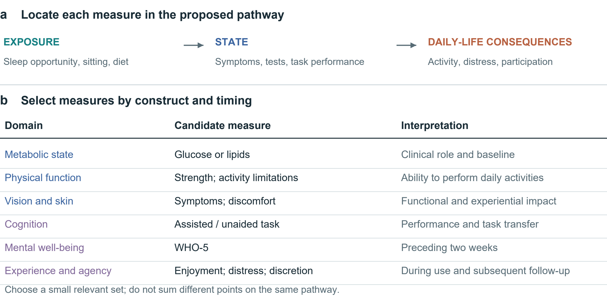

Fig. 4 | Measurement levels and their decision relevance. The upper pathway separates exposure, state and consequences in daily life; arrows indicate relationships to investigate. Candidate measures below are selected for the decision and its timing. ICF links functioning to context; WHO-5 covers mental well-being over the preceding two weeks. [6, 7]

## Choosing measures for the decision

Measures should follow the decision. A dinner comparison may need price, preparation time and satiety; a month of night work also calls for sleep, daytime functioning and recovery measures. Establish feasible alternatives and a common horizon, then select measures relevant to baseline conditions and the person’s concerns. Figure 4 distinguishes exposure, state and consequences for daily life.

Separate exposures, states and consequences. Sleep opportunity, sitting time, diet and screen use describe behaviours or environments. Symptoms, laboratory measures and task performance describe selected states. Their significance depends on daily functioning, experience and valued activities. The ICF helps situate functioning in context. [6] Adding sedentary time, a correlated biomarker and a downstream disease risk into a single score can count the same pathway repeatedly. Candidate causal links should therefore be specified before aggregation or mediation analysis.

Glucose, lipids, blood pressure, strength, vision and skin symptoms measure different aspects of health; “blood quality” is too vague to replace them. Changes need interpretation against baseline, measurement conditions and appropriate ranges. Skin discomfort and appearance can affect experience and social life, but complexion, hair or body shape cannot establish internal organ status. Relationships between physical and psychological health also require measurement. Differences in health must not become a ranking of dignity or human worth.

Experience and functioning should be observed at appropriate times. WHO-5 records mental well-being over the preceding two weeks; it is not a diagnostic test or an instantaneous response measure. [7] A brief attention task, an activity diary and a symptom report likewise capture different constructs. Selection should consider reliability, responsiveness, language, accessibility and burden. Repeated measurement may distinguish transient discomfort from a sustained trajectory, but collecting more data is not automatically better and can increase anxiety or exclusion.

Distinguish observations, predictions and unknowns. An unmeasured effect is not zero; relative effects cannot yield personal absolute risks without applicable baseline risks and models. Keep personal priorities alongside the evidence, and revisit the comparison when circumstances or outcomes change.

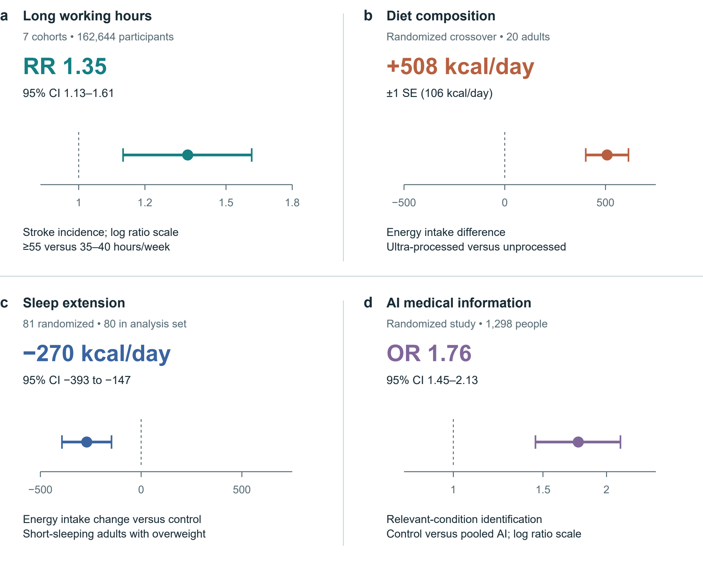

Fig. 5 | Selected estimates with their original uncertainty. a, Stroke incidence from seven cohorts, follow-up 1–20 years. [22] b, Energy intake in a 20-person inpatient crossover diet trial. [23] c, Energy intake change versus control in a sleep-extension trial; 81 randomized, 80 in the reported analysis set. [24] d, Relevant-condition identification in hypothetical medical scenarios: control versus pooled AI assistance. [18] Bars denote 95% CIs in a, c and d; ±1 SE in b. Ratio axes are logarithmic. RR and OR are distinct; neither is an absolute probability change. No effects are pooled or converted to a personal health price.

## Empirical estimates and their scope

Figure 5 preserves four different estimands. Long working hours were associated with stroke incidence in a cohort meta-analysis; this does not estimate the effect of one overtime week. [22] Hall and colleagues' 20-person inpatient crossover experiment found greater energy intake on the ultra-processed diet, whereas Tasali and colleagues' sleep-extension trial found lower estimated energy intake relative to control. [23, 24] The former interval is one standard error, not a 95% confidence interval. Bean and colleagues' odds ratio concerns identification in medical scenarios, not the probability of illness. [18]

Applying these findings to personal choice requires checking the population, exposure, comparator, outcome and follow-up. They show that particular consequences of work, diet, sleep and digital tools can be measured. They do not validate the framework as a whole or supply a personal price for health. Figure 5 retains each study’s units and uncertainty so that readers can judge its relevance.

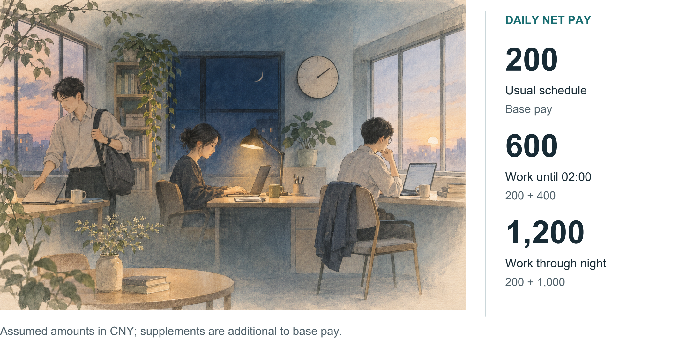

Fig. 6 | Daily income and overnight schedules. Conceptual illustration of hypothetical schedules. With CNY 200 base pay and additional net supplements of CNY 400 or 1,000, totals are CNY 600 or 1,200.

## Trade-offs in everyday settings

<b>Case 1: daily pay and overnight supplements.</b> Suppose ordinary daily pay is CNY 200, with an additional CNY 400 for working until 02:00 or CNY 1,000 for working through the night. Assuming all amounts are net of tax and ordinary pay is unchanged, daily income is CNY 200, 600 or 1,200 (Fig. 6). If CNY 400 and 1,000 instead denote total daily pay, the increments are CNY 200 and 800. Distinguishing base pay, supplements and total income prevents an initial accounting error.

The schedule must then be specified: when work starts, when the person must rise the next day, whether another shift follows, and whether commuting or care duties can change. Finishing at 02:00 with a day off is a different option from finishing at 02:00 before an early shift. An end time alone does not establish sleep duration, and comparison should extend beyond the work episode to subsequent functioning and recovery.

Whether the person gains also depends on what the money enables. Paying rent or care costs may relieve an immediate difficulty; fatigue, restricted activities and other burdens still belong in the comparison. Conversely, the absence of obvious discomfort does not establish an absence of effects. Confirmed income changes, functioning that needs observation and unknown longer-term consequences can be listed separately, allowing the person to identify losses they regard as unacceptable.

Work arrangements may also be negotiable. Fewer consecutive night shifts, time off the next day or the ability to stop can be included as further options. Comparison should examine whether they meet income needs while preserving rest and valued activities. Their effects still require evaluation.

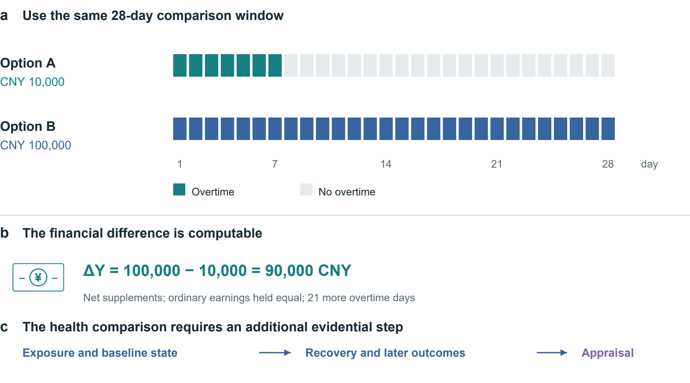

Fig. 7 | Align the overtime alternatives. Both options cover 28 days; supplements are assumed net and ordinary earnings equal. Option B adds CNY 90,000 and 21 overtime days. The timeline and arithmetic are hypothetical. Exposure, baseline state, recovery and later outcomes require additional evidence before an overall appraisal.

## Case 2  Comparing a week with a month

Consider a hypothetical 28-day window. Option A offers a net supplement of CNY 10,000 for seven overtime days; option B offers CNY 100,000 for 28. Holding ordinary earnings equal, ΔY = 100,000 − 10,000 = 90,000 CNY, alongside 21 additional overtime days. Figure 7 aligns the denominators. It does not assign the remaining days in option A a health value automatically. Their activities, recovery opportunities and effects on family members must be recorded; effects extending beyond day 28 require a longer outcome horizon.

Appraisal also needs shift duration and timing, baseline health, the ability to stop, essential financial needs and the next-best feasible option. Different constraints may lead to different choices, while health costs still belong in the record. Whether CNY 100,000 is worthwhile can only be judged under these conditions. A legal or contractual payment addresses responsibility and compensation; it does not show that lost functioning has been restored.

Sleep restriction also shows why subjective adaptation and objective function should be distinguished. In Van Dongen and colleagues' laboratory programme, 35 adults were randomized to 4, 6 or 8 hours in bed for 14 nights; a separate total-deprivation experiment involved 13 adults. Performance deficits accumulated in the 4- and 6-hour groups, while reported sleepiness did not track their full progression. [25] These functional findings do not establish permanent neuronal destruction after one late night. Recovery and persistence require their own evidence.

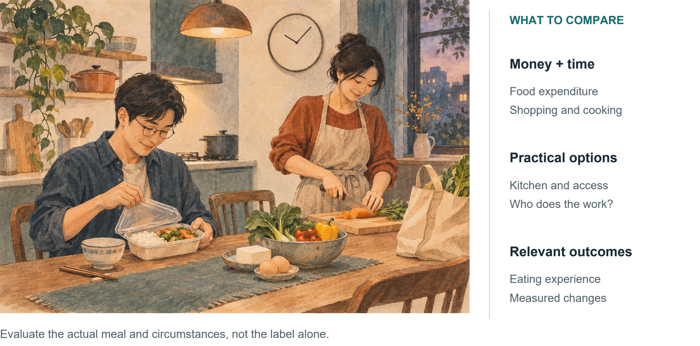

Fig. 8 | Resources and circumstances behind a meal. Conceptual illustration. Purchased and home-prepared meals require appraisal of the actual food, time, labour and availability; health outcomes are not assigned by the image.

## Case 3  Beyond the price of dinner

Comparing a convenient purchased dinner with a meal prepared at home requires more than ingredients or price. Suppose the alternatives are maintained for four weeks. Food expenditure, shopping, cooking and cleaning time, taste and feasibility all enter the comparison (Fig. 8). A person with a kitchen and predictable hours faces different options from a shift worker with limited cooking facilities.

Junk food is an everyday label rather than a sufficiently defined research exposure. Food composition, processing category, intake and duration need specification: takeaway is not synonymous with ultra-processed food, nor home cooking with a balanced diet. Hall and colleagues observed an energy-intake difference, but no significant between-diet differences in short-term glucose tolerance or continuous glucose measures. This neither establishes long-term equivalence nor supports deterioration in every internal measure. [23]

Preparing a meal uses time and labour. Who shops, cooks and cleans should be recorded alongside food spending and the time saved by convenience. A practical comparison can begin with feasible changes to available meal combinations or preparation burden, then observe the eating experience and relevant outcomes. Requiring an ideal menu at the outset can overlook the person’s circumstances.

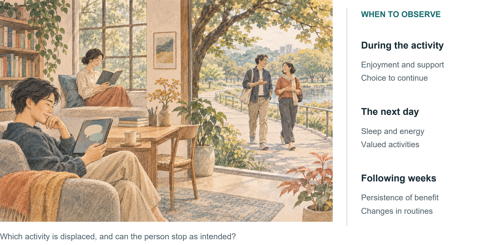

Fig. 9 | Leisure activities and what follows. Conceptual illustration. Digital interaction, reading, movement and social contact are alternatives to compare in terms of displacement, persistence of experience and agency.

## Case 4  Screens, companionship and an evening

Suppose two hours after dinner are discretionary. Short dramas or games, AI conversation, reading, walking and meeting friends are candidate activities (Fig. 9). Appraisal first asks what each displaces. Gaming may displace intended sleep for one person and otherwise unstimulating time alone for another. Online and offline activities cannot be ranked by their labels alone, and leisure need not justify every minute through increased productivity.

Observation can extend from the evening to the next day and subsequent weeks: was the activity enjoyable, did satisfaction persist, could the person stop as planned, and could they carry out valued activities the next day? Attention needs a specified construct, such as sustained attention, switching or memory. Patience likewise needs a defined behaviour; viewing duration alone cannot diagnose cognitive decline. These questions organize observation rather than establish causal pathways.

AI companionship should be assessed for both immediate support and sustained change. Studies have observed loneliness relief after interaction, while follow-up and comparator design limit conclusions about persistence. [17] A personal comparison can track whether use adds to existing support, accompanies delayed sleep and can be ended as intended. Enjoyment and support have value in themselves; observing subsequent changes can inform decisions about future use.

The same principle applies to AI food or medical advice. A credible-sounding answer and an appropriate user decision are different outcomes; medical-scenario experiments have demonstrated a gap between models acting alone and human–AI interactions. [18] Evaluation should examine understanding, recognition of applicability and appropriate action, rather than treating verbal fluency as effectiveness.

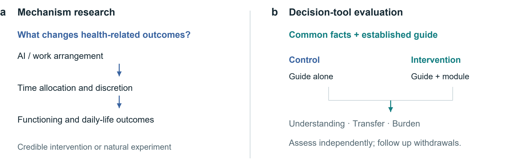

Fig. 10 | Two research questions and their evaluation paths. Mechanism research explains how outcomes arise; tool evaluation tests the added comparison module. An active comparator gives both groups the same facts and established guide. The proposed design is not a completed trial.

Table 3 | Testable propositions and disconfirming observations. Each comparison requires prespecified estimands and outcomes.

| Proposition | Key comparison | Potentially disconfirming result |
|---|---|---|
| Discretion affects allocation of AI time savings | Similar task gains; credible differences in control over workload | No meaningful allocation difference, with sufficiently precise estimates |
| Immediate relief and sustained benefit may diverge | Matched comparator; repeated pre-use, post-use and follow-up measures | Stable pre-use improvement comparable to immediate relief |
| The module improves decision quality | Same guide, with or without the added module | No gain in understanding or transfer, or burden exceeds benefit |

## Testable propositions and evaluation

Validation has two parts: identifying mechanisms that change health-related outcomes, and testing whether the comparison framework improves informed choice. The first supplies evidence for the record; the second tests the tool’s usefulness. Figure 10 separates these research paths, and Table 3 lists propositions and findings that could weaken them.

Workplace studies could combine task logs, whole-day diaries and repeated outcomes with measures of control over workload and schedules. Randomized policies or credible natural experiments would strengthen causal inference. Simple user–non-user comparisons remain vulnerable to job selection, workload, prior health and reverse causation. Prespecified mechanism analyses should avoid obscuring total effects through mechanical adjustment for post-treatment time use.

Tool evaluation should use an active comparator: identical evidence and an established guide, with only the intervention group receiving the added record of time, consequences and uncertainty. Decision-quality research and the Cochrane review inform comparator and outcome selection. [9, 26] Prespecify understanding as a potential primary outcome with independent scoring; transfer, values–choice concordance and calibrated uncertainty can be secondary outcomes.

Record completion time, attrition, anxiety, accessibility and withdrawals’ experiences. Repeated use may bring learning, fatigue or changed decisions. Preregister the population, target effect, sample-size basis, missing-data analysis and multiplicity handling. Interviews can explain understanding or disagreement, but cannot replace causal estimates. Simplify or discontinue a module without meaningful net benefit. Choices closer to the researchers’ preferred lifestyle alone do not establish success.

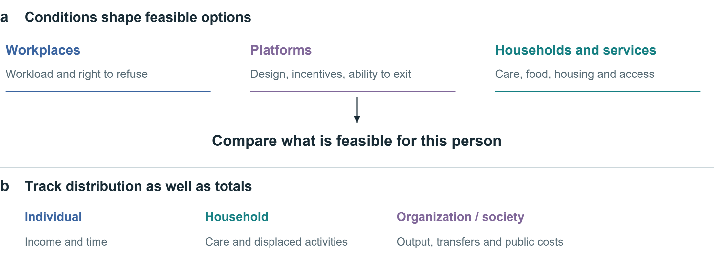

Fig. 11 | Conditions of choice and distribution of consequences. Workplace, platform and household conditions shape feasible options. Income, time and care burdens may accrue to different people. Arrows organize evaluation questions rather than depict estimated causal effects.

## Institutions, distribution and research priorities

Work rules, platform design, housing, food access and care responsibilities constrain personal choices (Fig. 11). Income insecurity or workload demands may make rest difficult, so an emphasis on self-discipline alone misses the conditions limiting choice. The framework can reveal these constraints; expanding feasible options and changing bargaining conditions also require organizational and public-policy action.

The perspective of the comparison must also be explicit. Workers’ net income, firms’ output, unpaid family care and public spending are separate entries. Compensation is income to a recipient but may be a transfer between parties at the societal level. Time saved by one person may become another’s checking, correction or care work. Comparing individual, household and societal outcomes shows both aggregate change and who bears it.

Institutions can also use the framework to ask concrete questions: does a productivity policy return time to workers; does a platform permit meaningful disengagement; and does an intervention remain feasible for people with limited money, mobility or digital access? These are evaluative questions, not established effects of particular policies. The same information should not become a surveillance score used to penalize workers, deny opportunities or blame people for constrained choices. Purpose limitation and proportionate collection are part of making the proposed support usable.

This Perspective brings health-related consequences, their timing and their distribution into one comparison. AI use makes these questions pressing because faster task performance need not improve independent capability or daily life. A shared record can make such differences explicit while allowing personal priorities to vary. Whether the framework improves explanation, prediction or decision quality beyond existing methods remains an empirical question.

This conceptual Perspective draws together economic theory, measurement approaches and selected empirical studies through narrative synthesis. The proposed framework remains unvalidated. Broader measurement may add burden, population effects may not apply to individuals, and priorities can change with circumstances. Context-specific feasibility studies should precede comparison with established decision support, with follow-up to assess whether gains in understanding and choice persist.

## References

1. Grossman, M. On the concept of health capital and the demand for health. Journal of Political Economy 80, 223–255 (1972). https://doi.org/10.1086/259880

2. Becker, G. S. A theory of the allocation of time. The Economic Journal 75, 493–517 (1965). https://doi.org/10.2307/2228949

3. Marx, K. The working-day. Capital, Vol. I, ch. 10. Marxists Internet Archive (n.d.). https://www.marxists.org/archive/marx/works/1867-c1/ch10.htm

4. Ruger, J. P. Health capability: conceptualization and operationalization. American Journal of Public Health 100, 41–49 (2010). https://doi.org/10.2105/AJPH.2008.143651

5. Finkelstein, A., Luttmer, E. F. P. & Notowidigdo, M. J. What good is wealth without health? The effect of health on the marginal utility of consumption. Journal of the European Economic Association 11 (Suppl. 1), 221–258 (2013). https://doi.org/10.1111/j.1542-4774.2012.01101.x

6. World Health Organization. International Classification of Functioning, Disability and Health. WHO (n.d.). https://www.who.int/standards/classifications/international-classification-of-functioning-disability-and-health

7. World Health Organization. The World Health Organization-Five Well-Being Index (WHO-5). WHO, WHO/UCN/MSD/MHE/2024.01 (2024). https://www.who.int/publications/m/item/who-ucn-msd-mhe-2024.01

8. Thokala, P. et al. Multiple criteria decision analysis for health care decision making—an introduction: Report 1 of the ISPOR MCDA Emerging Good Practices Task Force. Value in Health 19, 1–13 (2016). https://doi.org/10.1016/j.jval.2015.12.003

9. Sepucha, K. R. et al. Establishing the effectiveness of patient decision aids: key constructs and measurement instruments. BMC Medical Informatics and Decision Making 13 (Suppl. 2), S12 (2013). https://doi.org/10.1186/1472-6947-13-S2-S12

10. Bernheim, B. D. & Rangel, A. Beyond revealed preference: choice-theoretic foundations for behavioral welfare economics. The Quarterly Journal of Economics 124, 51–104 (2009). https://doi.org/10.1162/qjec.2009.124.1.51

11. Office for Health Improvement and Disparities. Cost consequence analysis: health economic studies. GOV.UK (2020). https://www.gov.uk/guidance/cost-consequence-analysis-health-economic-studies

12. Ottawa Hospital Research Institute. Ottawa Personal Decision Guide. Patient Decision Aids (2025). https://decisionaid.ohri.ca/decguide.html

13. EuroQol Research Foundation. What is the difference between the EQ-5D descriptive system, the EQ VAS and the EQ-5D index values? EuroQol (2023). https://euroqol.org/faq/what-is-the-difference-between-the-eq-5d-5l-descriptive-system-the-eq-vas-and-the-eq-5d-index-values/

14. Ryan, R. M. & Deci, E. L. Self-determination theory and the facilitation of intrinsic motivation, social development, and well-being. American Psychologist 55, 68–78 (2000). https://doi.org/10.1037/0003-066X.55.1.68

15. Noy, S. & Zhang, W. Experimental evidence on the productivity effects of generative artificial intelligence. Science 381, 187–192 (2023). https://doi.org/10.1126/science.adh2586

16. Brynjolfsson, E., Li, D. & Raymond, L. Generative AI at work. The Quarterly Journal of Economics 140, 889–942 (2025). https://doi.org/10.1093/qje/qjae044

17. De Freitas, J., Oğuz-Uğuralp, Z., Uğuralp, A. K. & Puntoni, S. AI companions reduce loneliness. Journal of Consumer Research 52, 1126–1148 (2026). https://doi.org/10.1093/jcr/ucaf040

18. Bean, A. M. et al. Reliability of LLMs as medical assistants for the general public: a randomized preregistered study. Nature Medicine 32, 609–615 (2026). https://doi.org/10.1038/s41591-025-04074-y

19. Bastani, H. et al. Generative AI without guardrails can harm learning: Evidence from high school mathematics. Proceedings of the National Academy of Sciences 122, e2422633122 (2025). https://doi.org/10.1073/pnas.2422633122

20. Allcott, H., Braghieri, L., Eichmeyer, S. & Gentzkow, M. The welfare effects of social media. American Economic Review 110, 629–676 (2020). https://doi.org/10.1257/aer.20190658

21. Ivic, R. K., Ratzan, S. C. & Parker, R. M. Building health-literate artificial intelligence. Nature Human Behaviour, Advance online publication (2026). https://doi.org/10.1038/s41562-026-02595-1

22. Descatha, A. et al. The effect of exposure to long working hours on stroke: A systematic review and meta-analysis from the WHO/ILO Joint Estimates of the Work-related Burden of Disease and Injury. Environment International 142, 105746 (2020). https://doi.org/10.1016/j.envint.2020.105746

23. Hall, K. D. et al. Ultra-processed diets cause excess calorie intake and weight gain: An inpatient randomized controlled trial of ad libitum food intake. Cell Metabolism 30, 67–77.e3 (2019). https://doi.org/10.1016/j.cmet.2019.05.008

24. Tasali, E. et al. Effect of sleep extension on objectively assessed energy intake among adults with overweight in real-life settings: A randomized clinical trial. JAMA Internal Medicine 182, 365–374 (2022). https://doi.org/10.1001/jamainternmed.2021.8098

25. Van Dongen, H. P. A., Maislin, G., Mullington, J. M. & Dinges, D. F. The cumulative cost of additional wakefulness: dose-response effects on neurobehavioral functions and sleep physiology from chronic sleep restriction and total sleep deprivation. Sleep 26, 117–126 (2003). https://doi.org/10.1093/sleep/26.2.117

26. Stacey, D. et al. Decision aids for people facing health treatment or screening decisions. Cochrane Database of Systematic Reviews 1, CD001431 (2024). https://doi.org/10.1002/14651858.CD001431.pub6
