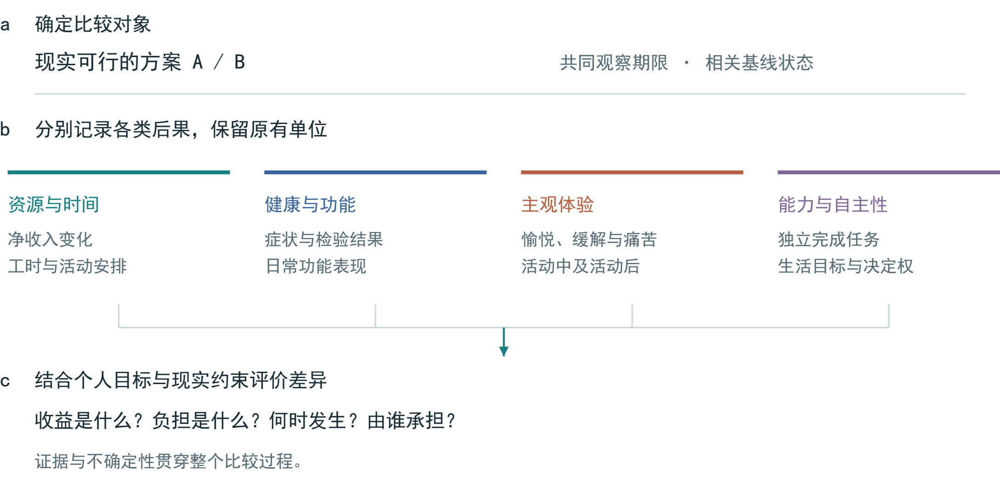
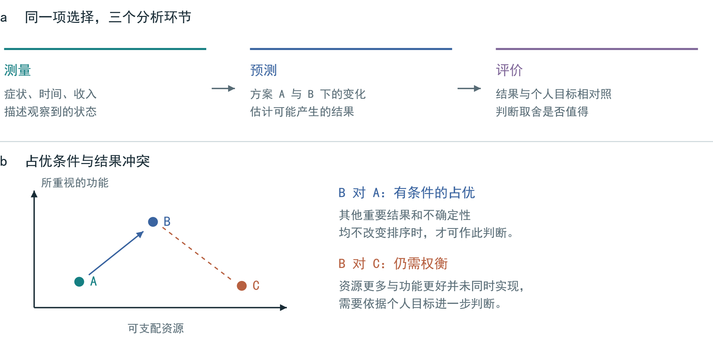
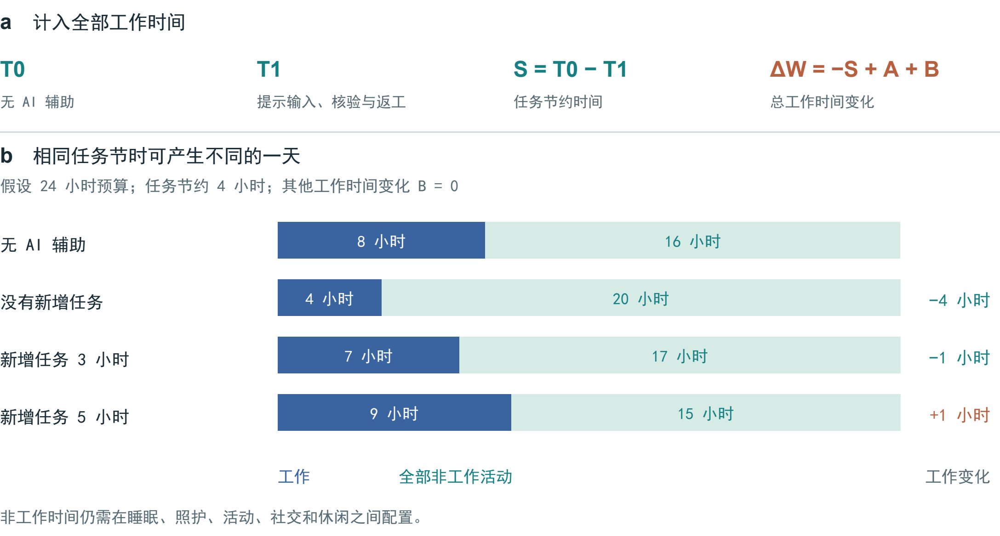
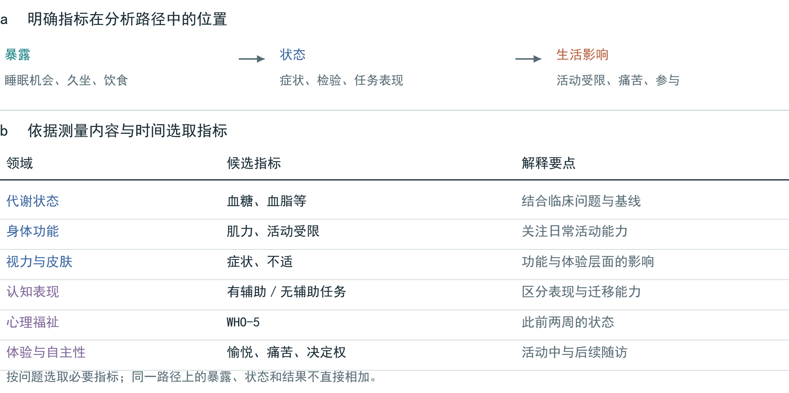
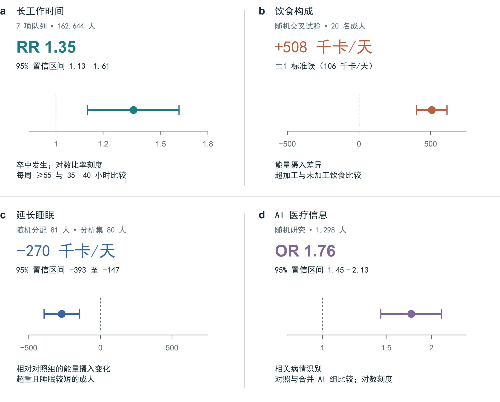
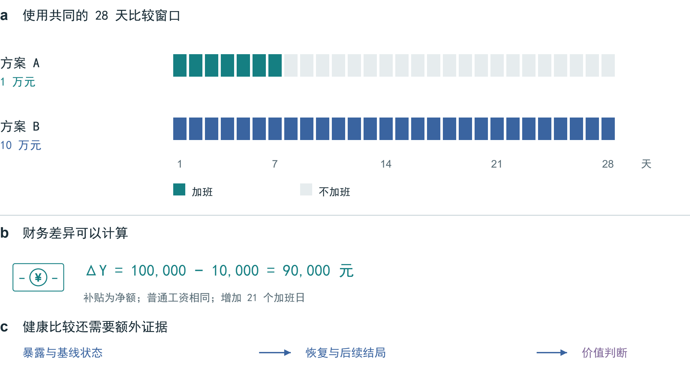
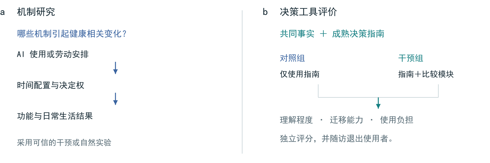

# 人工智能时代的健康经济价值：跨期权衡与评价框架

Richard T. Millian

杭州师范大学

## 摘要

加班带来的收入、便利饮食节省的时间、人工智能提高的任务效率，都容易计入收益；相伴的睡眠变化、身体负担和恢复时间却常被遗漏。本文结合健康资本、时间配置、健康可行能力与决策分析，提出健康后果比较框架。在共同期限内，框架比较现实可行的方案，分别记录资源与时间、健康与功能、主观体验、能力与自主性，并依据个人目标评价取舍。状态测量、结果预测和价值判断各有依据，各项结果保留原有单位、发生时点及不确定性。在 AI 使用中，这一区分尤其重要：任务提速未必增加休息，辅助表现改善也未必提高独立能力。本文以单日及连续加班、饮食选择和数字休闲为例，说明比较方法，并提出关于时间收益分配、效果持续性和决策质量的可检验命题。框架旨在帮助人们理解选择的条件与后果，允许不同处境下的个人保留不同偏好。

图 1 | 健康后果比较框架。 以可行方案和共同观察期限为起点，分别记录资源与时间、健康与功能、主观体验、能力与自主性，再结合个人目标比较。图中为分析环节，非估计所得的因果效应。

图 2 | 测量、预测与评价的衔接。 a，同一问题需要三类信息。b，二维图展示条件性占优与结果冲突；坐标无数值单位，结论还须考虑其他重要结果与不确定性。

## 一、经济收益如何转化为生活改善

一笔加班费能否改善生活，要看收入增加了多少，也要看付出了什么。延长白天工作、连续上夜班和借助 AI 提高效率，都可能增加收入，却可能给睡眠、精力和家庭时间带来不同影响。比较从具体问题开始：钱增加了多少，时间花在何处，第二天还能否正常工作、学习或照顾家人。图 1 将这些问题纳入同一框架，图 2 区分测量、预测与评价。

既有理论为这一问题提供了不同切入点。Grossman 将健康视为兼具消费与生产作用的资本存量，Becker 将非市场时间纳入资源配置分析。[1, 2] 马克思对工作日的讨论，则将劳动时间、议价关系与劳动力再生产联系起来。[3] 这些理论分别关注健康、时间和劳动关系，不能彼此替代。沿着马克思的思路，可以追问生产收益与健康负担由谁承担；具体的健康损失仍须依据劳动暴露及其替代方案来识别，不能直接作为剩余价值的一项实测数量。

健康可行能力理论同时关注已经实现的健康状态，以及人们维护健康、追求自身目标的实际机会。[4] 对依赖加班收入支付住房或照护费用的人来说，有权拒绝加班，并不意味着有条件拒绝。健康状态也会改变收入对生活的意义，同额收入增量未必带来相同的福利改善。[5] 评价收入时，需要同时考察它缓解了哪些困难，以及为此付出的时间和健康代价。

本文所称健康经济价值，是健康与功能变化对资源配置和个人选择的意义，包括健康本身的价值及其对日常活动的支持。它不等同于赚钱能力、总体福利或人的价值。比较框架据此列出可行方案，追踪后果随时间的变化，并结合证据、不确定性和个人目标作出判断。比较可以得到明确的选择，也可以说明某项选择在什么条件下成立，或哪些分歧暂时无法消解。

表 1 | 比较记录的基本项目。 结合健康可行能力、ICF、WHO-5、多准则决策分析与决策质量研究组织信息，尚未构成经验证的量表。[4, 6, 7, 8, 9]

| 维度 | 记录内容 | 比较时的要点 |
|---|---|---|
| 备选方案 | 具体安排；能否拒绝；共同期限 | 区分名义选项与实际机会 |
| 资源与时间 | 净收入变化；总工时；替代的活动 | 记录节约时间的实际用途 |
| 健康与功能 | 相关症状、功能表现或临床结局 | 结合基线及临床情境解释 |
| 主观体验 | 愉悦、缓解或痛苦；活动中与活动后 | 区分即时反应与持续变化 |
| 能力与自主性 | 独立表现；重视的活动；决定权 | 同时考虑辅助的可及性收益 |
| 证据与评价 | 适用人群；对照；期限；不确定性；目标 | 保留未知项及偏好差异 |

## 二、从状态测量到价值评价

体检单可以告诉人们血糖处在什么范围，却不能直接回答一项选择是否值得。检测描述当前状态，干预研究估计改变饮食后可能出现的结果，而是否愿意为此付出金钱、时间或口味上的代价，还取决于个人目标。测量、预测和评价因此各有依据。参考区间不是人的价值尺度，群体研究的平均结果也不能直接当作个人的未来。

货币估值可用于特定的政策和资源配置问题，补偿支付却不能证明身体功能已经恢复。即使某项损失难以逆转，人们仍需比较预防、缓解和其他可行安排。接受补偿也有不同原因：有人认为收益足以抵偿风险，有人则缺少维持生计的其他选择。行为福利分析因此要求关注选择发生的条件，不能把所有实际选择都视为充分知情的价值判断。[10]

成本—后果分析将不同结果并列呈现，多准则决策分析则明确评价标准及其权重。[8, 11] 成熟的决策指南也会询问备选方案、价值取向和支持需求。[12] 本文在这些方法上增加具体记录：节约的时间用在何处，结果能持续多久，有无辅助时的功能有何差别，以及收益和负担由谁承担。这些项目构成表 1 的比较记录，其实际作用仍需与既有工具比较验证。

采用统一工具有利于不同研究之间的比较。EQ-5D 等基于偏好的健康状态测量工具，可在合适的赋值体系下用于卫生经济评价。[13] 不过，日常决策还涉及人际关系、自主安排和个人重视的能力。自我决定理论对自主、胜任和关系需要的讨论，为理解这些方面提供了补充。[14] 因而，阅读、游戏、运动或虚拟陪伴的意义，应结合具体体验与功能变化分析，而不宜仅凭活动名称判断。

比较需要统一记录规则，也需要容纳不同偏好。收入、睡眠与家庭时间发生冲突时，应先列明得失，再考察改变优先顺序是否会改变选择。只有在量尺、权重、不确定性和重复计量问题得到合理处理后，汇总评分才有解释力。缺少可靠换算关系的结果，可保留各自单位，分别报告。

图 3 | 任务节时如何改变一天的安排。 a，T1 包含提示输入、核验及返工；A 为新增任务，B 为其余工作时间净变化。b，假设每天 24 小时，原工作 8 小时，固定任务节约 4 小时，B = 0。非工作时间的健康意义取决于实际用途。

## 三、跨期比较与时间约束

设 x_i(a;τ) 为个体 i 选择方案 a 后，在时点 τ 的结果向量，分别记录资源、时间、健康与功能、体验及能力等信息，各分量保留原有单位。对可以计算数值差异的指标，方案 a 与 b 的比较为：

Δx_i(a,b;τ) = x_i(a;τ) − x_i(b;τ).  (1)

式（1）用于表达比较对象；各分量的数值仍需来自观测资料或具有依据的预测。类别变化可用文字记录。若疲劳、恢复或能力变化随时间累积，则应比较变化轨迹，而非只看某个终点。进一步令 z_j 表示在适用范围内数值越大越受偏好的评价准则；若满足下式，则方案 a 在所列准则上占优：

Δz_j ≥ 0 (∀j); Δz_k > 0 (∃k).  (2)

这一判定以准则足够完整、估计不确定性不足以改变排序为前提。许多生物指标存在适宜范围，不能简单按高低确定优劣。实际决策中更常见的是不同结果相互牵制，此时仍须依据个人目标权衡，无法由式（1）或式（2）推出统一的健康兑换率。

AI 的时间收益可进一步拆分。令 S = T0 − T1 表示完成固定任务所节约的时间，其中 T1 包含提示输入、核验和返工；令 A 表示新增任务耗时，B 表示其余工作时间的净变化。各项互不重复时，总工作时间变化为：

ΔW = −S + A + B.  (3)

图 3 给出固定任务节约 4 小时的假设情境。当 B = 0 时，若没有新增任务，总工时减少 4 小时；新增任务占用 3 小时，总工时只减少 1 小时；新增任务占用 5 小时，总工时反而增加 1 小时。即便总工时减少，节约的时间仍可能用于睡眠、照护或其他活动，其健康意义需要结合实际用途判断。

表 2 | AI 研究的不同结局层次。 所列研究的设计与结局各异，分别用于说明任务效率、体验及判断表现。

| 场景与研究设计 | 主要结果 | 解释范围 |
|---|---|---|
| 专业写作; 随机研究；453 人 [15] | 任务完成更快，产出质量改善 | 未测量全天时间配置与健康 |
| 客服工作; 分阶段部署；5,172 人 [16] | 每小时解决问题数约提高 15%；不同结局的数据可得性不同 | 依赖因果识别假设；未测量时间收益归属 |
| AI 陪伴; 持续 7 天的研究 3 [17] | 即时孤独缓解；尚未证明互动前状态持续改善 | 组间退出差异；对照未匹配时长 |
| 医疗场景; 1,298 人 [18] | 对照组相对合并 AI 组的识别 OR 为 1.76（95% CI 1.45–2.13） | 场景表现，而非临床患病结局 |

## 四、人工智能收益的三个评价层次

任务效率是最直接的评价结果。Noy 和 Zhang 对 453 名专业人士开展的随机研究发现，AI 辅助提高了写作速度与产出质量。[15] Brynjolfsson 等研究了涉及 5,172 名客服人员的分阶段部署，双重差分主分析显示每小时解决问题数约提高 15%。[16] 后者属于准实验研究，测量的是工作效率，且未掌握薪酬数据。两项研究支持生产率收益，但节约的时间由谁支配、劳动者收入和健康是否改善，仍需另行测量。[16]

第二个层次是能力变化。辅助条件下完成任务，与撤去辅助后独立完成任务，需要分别测量。Bastani 等的教育实验说明，判断学习效果还需安排无辅助测评。[19] 评价应同时关注即时表现、独立表现和向陌生任务的迁移，不能据一项实验推断 AI 普遍损害认知。工具支持本身也有价值：即使独立能力未变，原本难以完成的活动变得可及，仍可能改善日常生活。

第三个层次是收益的持续时间。De Freitas 等持续 7 天的第三项研究中，AI 陪伴带来的孤独缓解主要出现在互动后的即时测量，尚未证明互动前的孤独水平持续下降。[17] 组间退出差异和对照时长不匹配限制了结果解释。评价既应记录即时安慰，也应随访效果是否持续。对于短内容和虚拟互动，还可观察愉悦、睡眠、人际联系和能否自主结束使用；活动名称或使用时长本身不足以确定其价值。

医疗建议还涉及信息如何转化为行动。Bean 等发现，使用者处理假设医疗场景时，未达到模型单独作答的表现；图 5d 展示对照组相对 AI 辅助组的病情识别结果。[18] 测量的是场景判断，并非实际患病结局。停用 Facebook 的研究同样关注平台使用之外的生活变化，但不能直接用于推断生成式 AI 的效应。[20] 健康素养导向 AI 强调理解、自主性、责任和相称性。[21] 将任务表现、持续能力和生活结果分别测量，可使这些要求落实为具体评价。

图 4 | 指标的测量层次与决策含义。 上部区分暴露、状态和生活影响；箭头表示待检验的联系。下部列出候选指标及测量时点，按具体问题选取。ICF 强调功能与环境的联系；WHO-5 测量此前两周的心理福祉。[6, 7]

## 五、指标选择与测量层次

指标应随决策问题选择。比较一顿晚餐，可记录价格、准备时间和饱腹感；比较一个月的夜班，还需观察睡眠、白天功能和恢复安排。先确认方案可行、期限一致，再依据基线状况和主要关切选择指标，比罗列全部体检项目更有针对性。图 4 展示了从暴露到生活影响的测量层次。

暴露、状态与生活影响需要区分。睡眠机会、久坐时长和饮食结构描述行为或环境；症状、实验室结果和任务表现描述状态；活动受限、痛苦或参与机会则说明这些状态为何重要。国际功能、残疾和健康分类（ICF）将功能置于具体环境之中，为这种区分提供了依据。[6] 若把久坐、相关代谢指标和下游疾病风险直接相加，就可能重复计算同一条路径上的影响。

血糖、血脂、血压、肌力、视力和皮肤症状各有测量对象，笼统的“血液质量”无法代替具体指标。数值变化需要结合基线、测量条件和适宜范围解释。皮肤不适和外观变化可以影响感受与交往，但不能仅凭肤色、头发或体形判断内部器官状态。身体与心理的联系也需要具体测量。健康差异反映人的处境，不应成为衡量其尊严与价值的尺度。

心理体验和功能表现也各有测量时点。WHO-5 反映此前两周的心理福祉，适合观察一段时期的状态，而不适合测量一次互动后的即时反应。[7] 注意任务、症状报告与活动日记回答的同样是不同问题。工具选择需兼顾信度、反应性、语言适用性和使用负担；重复测量有助于区分短暂波动与持续变化，但频繁记录也可能增加焦虑和退出。

每项比较都应分清观察结果、预测和未知项。未测量不等于没有影响；没有适用的基线风险，也不能把相对效应换算为个人的绝对风险。证据、处境或个人目标改变后，应重新审视原有判断。

图 5 | 四项研究的估计结果。 a，7 项队列的卒中发生，随访 1–20 年。[22] b，20 人住院交叉饮食试验的能量摄入。[23] c，延长睡眠试验：随机分配 81 人，分析集 80 人。[24] d，假设医疗场景的病情识别，对照组相对合并 AI 组。[18] a、c、d 为 95% 置信区间，b 为正负一个标准误。比率轴为对数刻度；RR 与 OR 均非绝对概率变化，四项效应不作合并。

## 六、实证结果及其适用范围

图 5 将四项研究结果分别绘制，以保留各自的结局、单位和不确定性。长工时与卒中发生的关联来自队列研究荟萃分析，不能据此估算加班一周的个人风险。[22] Hall 等的 20 人住院交叉试验发现，超加工饮食条件下能量摄入更高；Tasali 等的延长睡眠试验则发现，相对对照组，估计能量摄入下降。[23, 24] 饮食试验图中的区间为正负一个标准误，其余三项为 95% 置信区间。医疗信息试验的比值比描述病情识别表现，并非患病概率。[18]

将这些结果用于个人选择，须逐项核对研究人群、暴露、比较对象、结局和随访期限。它们说明劳动安排、饮食、睡眠及数字工具的某些后果可以测量；既不能据此验证整个框架，也不能把不同结局合并为个人的健康价格。图 5 保留各研究的单位和不确定性，供判断证据是否适用。

图 6 | 当天收入与夜间安排。 假设情境插画。日薪为 200 元，额外净补贴分别为 400 元和 1,000 元，对应总收入为 600 元和 1,200 元。

## 七、典型情境中的权衡

<b>案例一：200 元日薪与夜间加班补贴。</b>设普通日薪为 200 元；工作到凌晨两点另补 400 元，通宵另补 1,000 元。为便于比较，设金额均已扣税费，普通日薪不变，则当天净收入分别为 200、600 和 1,200 元（图 6）。若 400 元和 1,000 元实际指当天总收入，增量就分别是 200 元和 800 元。先分清日薪、补贴与总收入，才能避免在起点上算错账。

钱款明确以后，还需把时间安排写完整：几点开始工作，次日几点起床，是否仍要上班，通勤和照护能否调整。同样在凌晨两点结束工作，次日可休息与清晨必须到岗，是两个不同的方案。不能仅凭结束时刻推定睡眠时长，也不能只比较加班当晚，而遗漏次日的功能与恢复。

“是否赚了”的判断还取决于收入用途。补贴若用于支付房租或照护费用，可能解除眼前困难；即便如此，也仍应记录疲劳、活动受限和其他负担。反过来，未出现明显不适，也不足以确认没有影响。可先将确定的收入增量、需要观察的功能变化和仍未知的长期后果并列，允许当事人说明哪些损失不可接受。

加班安排也可能协商：减少连续夜班、安排次日休息，或允许中途退出，都可作为新的备选方案。比较时既要考察能否满足收入需要，也要观察能否保留休息和重视的活动。这些安排的实际效果仍需评估。

图 7 | 在共同期限内比较加班方案。 两方案均覆盖 28 天，假定普通工资相同、补贴为净额。B 比 A 增加 9 万元及 21 个加班日。该示例仅计算收入与天数差异，健康评价还需班次、基线和后续恢复等信息。

## 案例二　把一周与一个月放在同一期限内比较

以 28 天为共同期限，设方案 A 加班 7 天，获得税费后补贴 1 万元；方案 B 加班 28 天，获得补贴 10 万元。若普通工资相同，则 ΔY = 100,000 − 10,000 = 90,000 元，同时多出 21 个加班日（图 7）。这一步使收入比较具有相同的时间基准。健康比较还需知道具体班次、其余日子的活动与恢复机会；若影响持续至第 28 天以后，观察期也应相应延长。

判断两方案的得失，还需知道每天加班多久、是否跨夜、原有健康状况、能否中止，以及收入是否用于必要支出。经济约束不同，选择可能不同，健康代价却仍应记录。因此，“10 万元是否值得”只能在这些条件下判断。法律或合同规定的支付处理责任与补偿问题，不能证明失去的身体功能已经恢复。

睡眠研究说明，仅凭自我感觉也可能低估功能变化。Van Dongen 等的实验中，35 名成人被随机分配到连续 14 晚卧床 4、6 或 8 小时的条件，另有 13 人参加完全睡眠剥夺实验。4 小时和 6 小时组的表现损害逐渐累积，报告的困倦程度却未充分反映这种变化。[25] 这提示评价应同时记录主观体验与客观表现。该结果涉及功能损害，不能进一步推断一次熬夜会造成永久性神经元损伤。

图 8 | 一顿饭涉及的资源与生活条件。 情境插画。购餐与自行准备都需要结合具体食品、时间、劳动分担和可获得性评价；图中不预设健康结果。

## 案例三　晚餐的价格之外

比较一份方便购买的晚餐与一顿自己准备的饭，不能只看食材或标价。假设两种安排分别持续四周，应把食材和外卖费用、采购与烹调时间、清理负担、口味及可持续性一并列出（图 8）。有厨房、下班时间固定的人，与轮班工作、缺少做饭条件的人，面对的可行选项并不相同。

“垃圾食品”是日常用语，不是足够明确的研究暴露。研究需要说明食品组成、加工分类、摄入量和持续时间，不能将外卖一概视为超加工食品，也不能将家庭烹饪等同于营养均衡。Hall 等的供餐试验观察到能量摄入差异，但短期葡萄糖耐量和连续血糖监测结果未见显著组间差异；这既不证明长期无影响，也不支持“每项内部指标必然更差”。[23]

准备一餐饭需要时间和劳动，家庭中由谁采购、烹调和清洗，应与食物开支一并记录。便利食品节约的时间也有价值。实际比较可从做得到的调整开始，例如改变可获得的菜品组合，或减轻准备负担，再观察饮食体验和相关结果。要求当事人先接受一种理想菜单，反而容易忽略其生活条件。

图 9 | 闲暇活动及其后续影响。 情境插画。数字互动、阅读、活动与交往均为备选安排，须结合替代活动、体验持续性和自主性比较。

## 案例四　屏幕、陪伴与一个晚上的去向

假设晚饭后有两小时可自由安排：看短剧或玩游戏、与 AI 交谈、读书、散步或见朋友，都是候选活动（图 9）。评价首先要弄清它们替代了什么。对一个人而言，游戏可能挤占原定睡眠；对另一个人而言，同样的活动可能替代独处时的无聊。不能只按“线上”或“线下”为活动排序，也不能把每一分钟闲暇都要求为提高生产率服务。

比较可以从当晚延伸到次日及随后数周，分别询问：活动当时是否愉快，结束后是否仍感到满足，能否按原计划停止，第二天能否完成自己重视的事情。若关注注意力，应明确测量持续注意、任务切换还是记忆；“耐心值”也需要转化为具体行为，不能凭看了多久短视频就判定认知能力下降。上述问题用于组织观察，并非已经确立的因果路径。

评价 AI 陪伴时，也应分别记录即时支持和持续变化。已有研究观察到互动后的孤独缓解，但随访和对照设计仍限制了对长期效果的判断。[17] 在个人比较中，可以观察使用是否补充了原有支持、是否伴随推迟睡眠，以及能否按意愿结束互动。愉悦和支持本身有价值；记录后续变化，则有助于决定是否调整使用方式。

同一原则适用于 AI 饮食或医疗建议。一次回答听起来可信，和使用者据此作出恰当决定，是不同的结果；医疗场景实验已经显示模型单独作答与人机互动表现之间的差距。[18] 研究应检验使用者能否理解建议、识别适用范围并采取恰当行动，而不能用回答的流畅程度代替效果。

图 10 | 两类研究问题及其验证路径。 机制研究解释结果如何产生；工具评价检验新增比较模块的作用。主动对照使两组共享事实与成熟指南，差异在于是否增加比较模块。所列为研究设计，非已获得的试验结果。

表 3 | 待检验命题及反证条件。 每项比较均需预先确定目标效应与结局。

| 研究命题 | 关键比较 | 可能削弱命题的结果 |
|---|---|---|
| 决定权影响 AI 节时分配 | 任务收益相近、工作量决定权有可信差异的群体 | 未见有意义的配置差异，且估计足够精确 |
| 即时缓解与持续收益可能不同 | 匹配对照，重复测量使用前后及随访状态 | 使用前状态获得与即时缓解相当的稳定改善 |
| 比较模块提高决策质量 | 同一指南，比较有无新增模块 | 理解或迁移未改善，或负担超过收益 |

## 八、可检验命题与验证设计

验证分为两部分：一是识别哪些机制改变了健康相关结果，二是检验比较框架是否帮助人们作出更充分知情的选择。前者为记录内容提供依据，后者检验工具的实际作用。图 10 展示两条研究路径，表 3 列出待检验命题及可能削弱它们的结果。

工作场所研究可结合任务日志、全天时间日记和重复测量，记录节约时间的去向及工作量、日程的决定权。组织政策随机试验或可信的自然实验有助于识别因果关系；单纯比较 AI 使用者与非使用者，仍受岗位选择、工作负荷、原有健康和反向因果影响。机制分析应预先设定，避免机械控制干预后的时间变量而遮蔽总效应。

工具评价宜采用主动对照：两组获得相同事实和成熟决策指南，干预组另加时间、后果与不确定性记录。决策质量研究和 Cochrane 综述可为对照及结局选择提供依据。[9, 26] 主要结局应在招募前确定，由独立评分者评价理解程度；陌生情境中的运用、选择与个人价值的一致性，以及对不确定性的把握，可作为次要结局。

还需记录完成时间、退出、焦虑、可及性和停止使用者的体验。重复使用可能带来学习、疲劳或决策变化。预注册方案应说明目标人群、目标效应、样本量依据、缺失数据和多重比较处理。访谈可以解释理解或分歧，不能替代因果估计。若新增记录未带来实质收益，或负担超过收益，应简化或停止使用；选择更符合研究者的生活偏好，不能作为成功标准。

图 11 | 选择条件与后果分配。 工作场所、平台和家庭条件影响方案可行性；同一安排的收入、时间与照护负担可能分布于不同主体。图示组织评价问题，箭头不代表已估计的因果效应。

## 九、制度条件、分配与研究展望

个人选择受到工作规则、平台设计、住房、食物可获得性和照护责任的约束（图 11）。收入不稳定或工作量要求可能使休息难以实现，此时只强调自律，会遗漏限制选择的条件。比较框架可以揭示这些约束；扩大可行选项、改变议价关系，仍需要组织和公共政策的参与。

评价还需明确站在谁的角度。劳动者净收入、企业产出、家庭无偿照护和公共支出应分别记录。一笔补偿对个人是收入，对社会则可能只是主体之间的转移；一个人节约的时间，也可能成为他人的核验、纠错或照护负担。比较个人、家庭与社会层面的结果，才能看清总量变化和实际承担者。

由此可以提出具体的制度评价问题：生产率提升是否增加劳动者可自主安排的时间，平台是否支持自主退出，某项安排是否对资金、行动能力或数字接入受限者同样可行。信息收集应限于决策需要，避免将健康比较转化为监控劳动者或限制机会的评分工具。

本文将健康相关后果、发生时间和承担者纳入同一比较过程。AI 使用使这些问题更为突出：任务做得更快，未必意味着独立能力增强或生活改善。共同的记录规则有助于讨论这些差异，同时允许人们保留不同偏好。框架能否在既有方法基础上改善解释、预测或决策质量，仍须通过研究检验。

本文通过叙述性整合，联系经济理论、测量工具与代表性实证研究，提出一个仍待验证的框架。测量范围扩大可能增加负担，群体结果未必适用于个人，偏好也可能随处境改变。后续研究应先检验具体场景中的可行性，再与既有决策支持工具比较，观察理解和选择是否获得持续改善。

## 参考文献

1. Grossman, M. On the concept of health capital and the demand for health. Journal of Political Economy 80, 223–255 (1972). https://doi.org/10.1086/259880

2. Becker, G. S. A theory of the allocation of time. The Economic Journal 75, 493–517 (1965). https://doi.org/10.2307/2228949

3. Marx, K. The working-day. Capital, Vol. I, ch. 10. Marxists Internet Archive (n.d.). https://www.marxists.org/archive/marx/works/1867-c1/ch10.htm

4. Ruger, J. P. Health capability: conceptualization and operationalization. American Journal of Public Health 100, 41–49 (2010). https://doi.org/10.2105/AJPH.2008.143651

5. Finkelstein, A., Luttmer, E. F. P. & Notowidigdo, M. J. What good is wealth without health? The effect of health on the marginal utility of consumption. Journal of the European Economic Association 11 (Suppl. 1), 221–258 (2013). https://doi.org/10.1111/j.1542-4774.2012.01101.x

6. World Health Organization. International Classification of Functioning, Disability and Health. WHO (n.d.). https://www.who.int/standards/classifications/international-classification-of-functioning-disability-and-health

7. World Health Organization. The World Health Organization-Five Well-Being Index (WHO-5). WHO, WHO/UCN/MSD/MHE/2024.01 (2024). https://www.who.int/publications/m/item/who-ucn-msd-mhe-2024.01

8. Thokala, P. et al. Multiple criteria decision analysis for health care decision making—an introduction: Report 1 of the ISPOR MCDA Emerging Good Practices Task Force. Value in Health 19, 1–13 (2016). https://doi.org/10.1016/j.jval.2015.12.003

9. Sepucha, K. R. et al. Establishing the effectiveness of patient decision aids: key constructs and measurement instruments. BMC Medical Informatics and Decision Making 13 (Suppl. 2), S12 (2013). https://doi.org/10.1186/1472-6947-13-S2-S12

10. Bernheim, B. D. & Rangel, A. Beyond revealed preference: choice-theoretic foundations for behavioral welfare economics. The Quarterly Journal of Economics 124, 51–104 (2009). https://doi.org/10.1162/qjec.2009.124.1.51

11. Office for Health Improvement and Disparities. Cost consequence analysis: health economic studies. GOV.UK (2020). https://www.gov.uk/guidance/cost-consequence-analysis-health-economic-studies

12. Ottawa Hospital Research Institute. Ottawa Personal Decision Guide. Patient Decision Aids (2025). https://decisionaid.ohri.ca/decguide.html

13. EuroQol Research Foundation. What is the difference between the EQ-5D descriptive system, the EQ VAS and the EQ-5D index values? EuroQol (2023). https://euroqol.org/faq/what-is-the-difference-between-the-eq-5d-5l-descriptive-system-the-eq-vas-and-the-eq-5d-index-values/

14. Ryan, R. M. & Deci, E. L. Self-determination theory and the facilitation of intrinsic motivation, social development, and well-being. American Psychologist 55, 68–78 (2000). https://doi.org/10.1037/0003-066X.55.1.68

15. Noy, S. & Zhang, W. Experimental evidence on the productivity effects of generative artificial intelligence. Science 381, 187–192 (2023). https://doi.org/10.1126/science.adh2586

16. Brynjolfsson, E., Li, D. & Raymond, L. Generative AI at work. The Quarterly Journal of Economics 140, 889–942 (2025). https://doi.org/10.1093/qje/qjae044

17. De Freitas, J., Oğuz-Uğuralp, Z., Uğuralp, A. K. & Puntoni, S. AI companions reduce loneliness. Journal of Consumer Research 52, 1126–1148 (2026). https://doi.org/10.1093/jcr/ucaf040

18. Bean, A. M. et al. Reliability of LLMs as medical assistants for the general public: a randomized preregistered study. Nature Medicine 32, 609–615 (2026). https://doi.org/10.1038/s41591-025-04074-y

19. Bastani, H. et al. Generative AI without guardrails can harm learning: Evidence from high school mathematics. Proceedings of the National Academy of Sciences 122, e2422633122 (2025). https://doi.org/10.1073/pnas.2422633122

20. Allcott, H., Braghieri, L., Eichmeyer, S. & Gentzkow, M. The welfare effects of social media. American Economic Review 110, 629–676 (2020). https://doi.org/10.1257/aer.20190658

21. Ivic, R. K., Ratzan, S. C. & Parker, R. M. Building health-literate artificial intelligence. Nature Human Behaviour, Advance online publication (2026). https://doi.org/10.1038/s41562-026-02595-1

22. Descatha, A. et al. The effect of exposure to long working hours on stroke: A systematic review and meta-analysis from the WHO/ILO Joint Estimates of the Work-related Burden of Disease and Injury. Environment International 142, 105746 (2020). https://doi.org/10.1016/j.envint.2020.105746

23. Hall, K. D. et al. Ultra-processed diets cause excess calorie intake and weight gain: An inpatient randomized controlled trial of ad libitum food intake. Cell Metabolism 30, 67–77.e3 (2019). https://doi.org/10.1016/j.cmet.2019.05.008

24. Tasali, E. et al. Effect of sleep extension on objectively assessed energy intake among adults with overweight in real-life settings: A randomized clinical trial. JAMA Internal Medicine 182, 365–374 (2022). https://doi.org/10.1001/jamainternmed.2021.8098

25. Van Dongen, H. P. A., Maislin, G., Mullington, J. M. & Dinges, D. F. The cumulative cost of additional wakefulness: dose-response effects on neurobehavioral functions and sleep physiology from chronic sleep restriction and total sleep deprivation. Sleep 26, 117–126 (2003). https://doi.org/10.1093/sleep/26.2.117

26. Stacey, D. et al. Decision aids for people facing health treatment or screening decisions. Cochrane Database of Systematic Reviews 1, CD001431 (2024). https://doi.org/10.1002/14651858.CD001431.pub6
