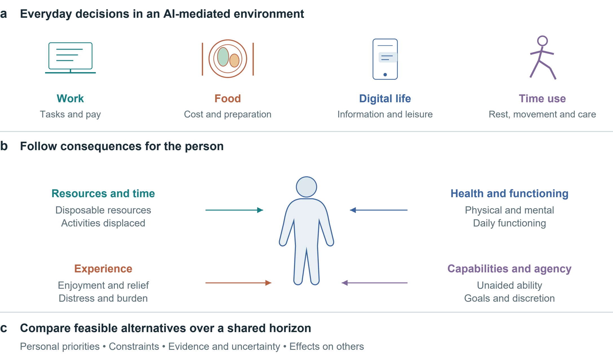
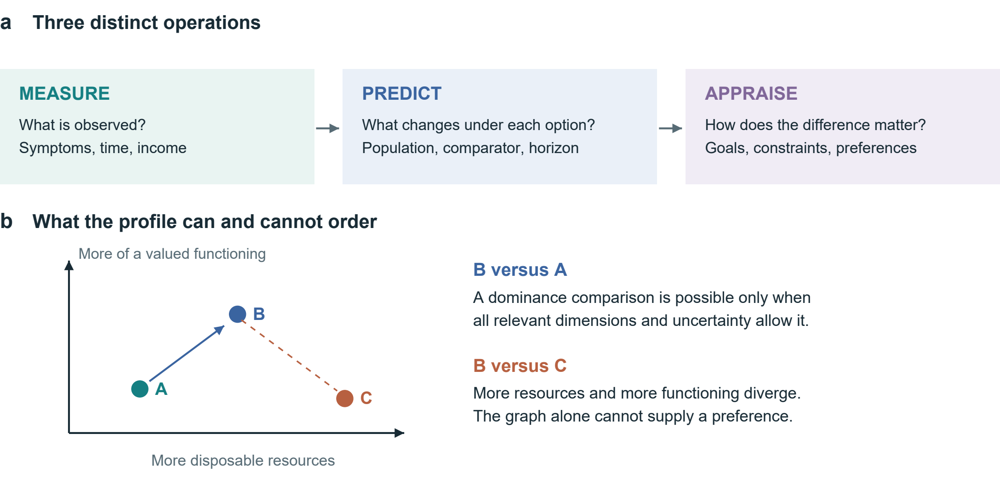
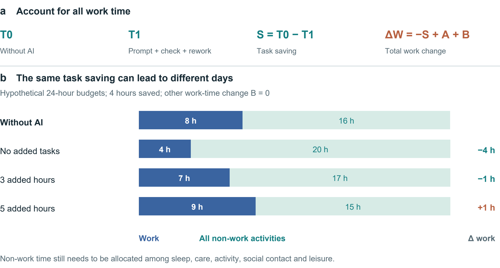
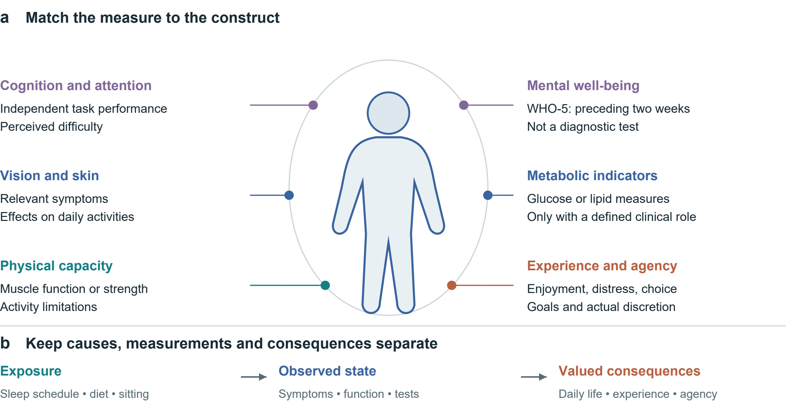
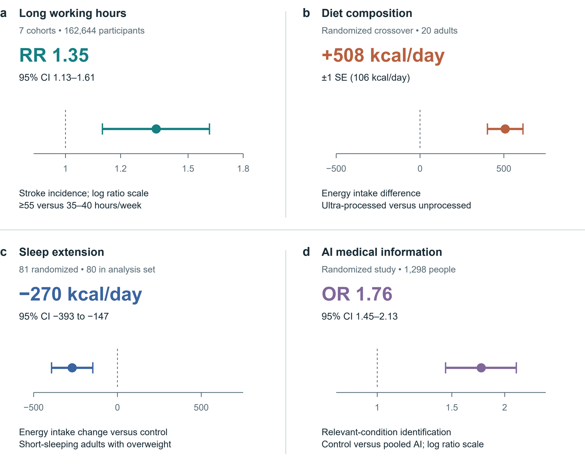
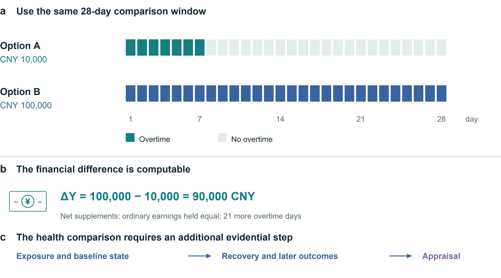
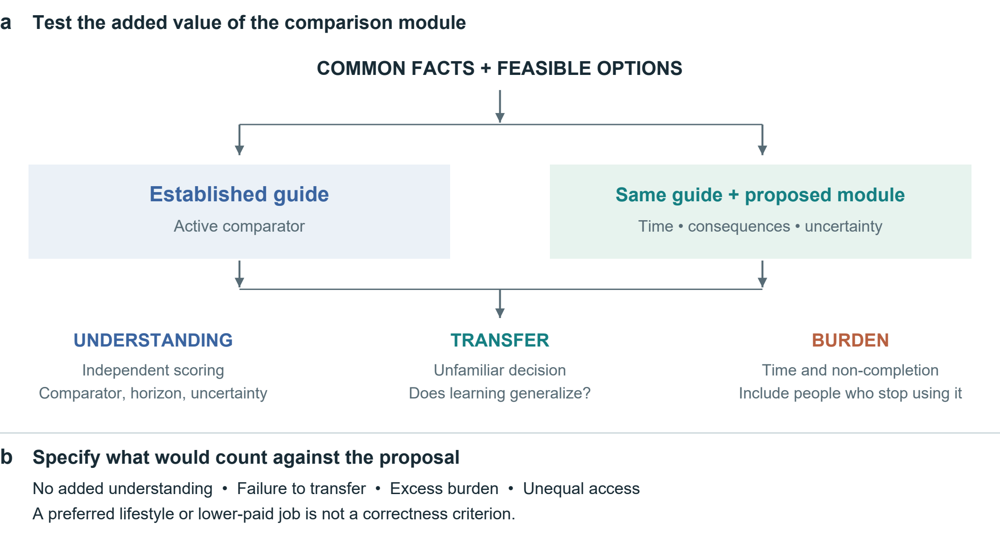
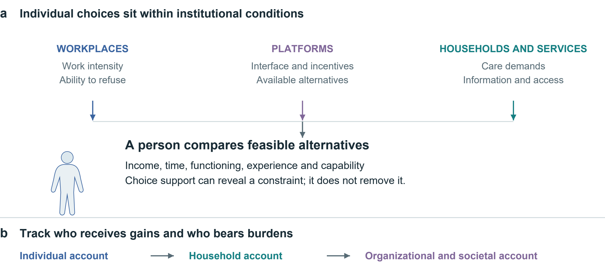

# Health economic value and intertemporal choice in the age of artificial intelligence

Richard T. Millian

Hangzhou Normal University

## Abstract

Income, convenience and task performance are visible returns to everyday choices, whereas changes in health, functioning and control over time are often dispersed across people and years. Artificial intelligence makes this discrepancy especially consequential: faster production need not release usable time, and better assisted performance need not imply durable capability. This Perspective develops a comparative health consequence profile for decisions about work, food, sleep and digital life. Drawing on health capital, time allocation, capability approaches and decision analysis, it separates measurement, prediction and appraisal; retains consequences in their appropriate units; and aligns feasible alternatives over a shared horizon. Selected experimental and field findings illustrate why neither monetary compensation nor a single health score resolves these comparisons. The framework's contribution is a common procedure for making health-relevant trade-offs explicit while preserving personal priorities and institutional constraints. It yields testable propositions about the allocation of AI productivity gains, the persistence of benefits and the quality of decisions. Its usefulness requires prospective evaluation against established decision support, including assessment of burden, unequal access and effects on others.

Figure 1 | Health economic value across everyday decisions. Work, food, digital life and time use enter a common comparison. Four consequence domains remain distinct. The figure organizes assessment; links do not represent estimated causal effects.

Figure 2 | Measurement, prediction and appraisal. a, Each operation asks a different question. b, A qualitative illustration of dominance and trade-offs. Positions are schematic and carry no numerical units. A two-dimensional picture cannot establish dominance if other relevant consequences or uncertainty overturn the comparison.

## From economic returns to lived consequences

An overtime payment and a faster AI-assisted task both offer measurable gains. Whether either improves a person's life depends on what changes with the gain: sleep opportunity, workload, symptoms, relationships, disposable income and the ability to pursue valued activities. The analytical problem is therefore the translation from an observable return into consequences experienced over time. A comparison that records only the payment or task output leaves this translation unexplained. Figure 1 locates the problem across everyday settings; Figure 2 separates the operations needed to address it.

The starting point is established economics. Grossman's health-capital approach treats health as a stock relevant to both well-being and productive time; Becker's allocation-of-time framework makes non-market time part of economic choice.[1, 2] Marx's discussion of the working day directs attention to bargaining, limits on labour and the reproduction of labour power.[3] These traditions motivate different questions rather than a single interchangeable theory. In particular, health losses cannot simply be appended to Marxian surplus value as an empirically measured quantity without a separate account of exposure, counterfactual outcomes and incidence.

Health capability approaches further distinguish achieved states from the real opportunities people have to maintain health and act on their goals.[4] This matters when an apparent choice cannot be refused without losing housing or essential care. Evidence on health-dependent utility also cautions against assuming that a given monetary increment has the same welfare significance in every health state.[5] Neither point makes income irrelevant. Resources can enable care, security and participation; the question is which consequences a particular increment enables or displaces under actual constraints.

We use health economic value to mean the decision-relevant significance of health and functioning within these trade-offs. It is not synonymous with total welfare, earning capacity or a person's worth. Money, time, experience and agency enter the comparison because they interact with health and carry value of their own. The proposed contribution is an integrative accounting procedure: specify a feasible counterfactual, trace consequences over time, attach evidence and uncertainty, and make the evaluative judgement explicit. A legitimate result can be a preference, a conditional choice or an unresolved comparison.

Table 1 | Minimum comparison record. Proposed fields, not a validated scale. Health capability, ICF, WHO-5, MCDA and decision-quality research inform the distinctions.[4, 6, 7, 8, 9]

| Domain | Minimum record | Interpretation |
|---|---|---|
| Decision | Feasible alternatives; refusal; shared horizon | Nominal options may be unavailable |
| Resources and time | Incremental money; total work; displaced activities | Task savings do not imply health gains |
| Health and functioning | Relevant symptoms, function or clinical outcomes | Biomarkers do not rank human worth |
| Experience | Enjoyment, relief or distress; during and after | Immediate benefit may not persist |
| Capabilities and agency | Unaided ability; valued goals; actual discretion | Assistance is compatible with autonomy |
| Evidence and appraisal | Population; comparator; horizon; uncertainty; goals | Unknown is distinct from zero |

## Valuation without a universal health price

Measurement describes a state; prediction estimates what would happen under alternatives; appraisal asks how the difference matters. A blood test belongs to the first operation. Estimating how a dietary change affects a future outcome belongs to the second. Deciding whether that expected change justifies cost, effort or lost enjoyment belongs to the third. Collapsing these operations can turn a reference interval into a moral ranking, an association into a personal forecast, or a stated preference into proof of informed consent.

Monetary valuation can answer defined policy questions, but compensation is not biological restoration. Conversely, irreversibility does not logically make valuation impossible: people still compare prevention, mitigation and foregone opportunities. What fails is the inference that a payment necessarily neutralizes a loss. A stated minimum payment depends on income, alternatives and understanding; accepting dangerous work under severe deprivation does not establish that the health loss is trivial. Behavioural welfare analysis provides reasons to examine the conditions under which choices reveal evaluative preferences.[10]

The profile adapts the transparency of cost–consequence analysis and the explicit criteria of multicriteria decision analysis, while retaining their limitations.[8, 11] It adds no validated universal scale. An established decision guide already elicits options, uncertainty, values and support needs.[12] Our narrower proposal makes time reallocation, outcome trajectories, assisted versus unaided functioning and the distribution of consequences explicit within such support. Any advantage over existing tools must be demonstrated, not inferred from a new label.

Standardized health-status instruments can supply comparable information; preference-based measures such as EQ-5D can support health-economic evaluation when used with the appropriate valuation framework.[13] They do not exhaust autonomy, relationships or personally valued capability. Self-determination theory offers a complementary account of autonomy, competence and relatedness, without implying that every activity has the same meaning for every person.[14] Reading, gaming, exercise and companionship therefore enter as alternatives whose consequences require assessment, rather than predetermined categories of virtue or harm.

Table 1 provides a minimum record. Its purpose is comparability of the decision process, not uniformity of preferences. When meaningful consequences diverge, the analyst should show the conflict and examine sensitivity to priorities. A single index is optional only when its scales, weights, uncertainty and double-counting risks are defensible; declining to aggregate is often the more informative result.

Figure 3 | Task savings and the allocation of a day. a, The accounting identity includes prompting, verification and rework in T1, additional tasks in A and other work-time changes in B. b, Hypothetical 24-hour budgets with an 8-hour baseline workday, a 4-hour task saving and B = 0. Non-work time is not assigned a health effect.

## Formal representation and the allocation of time

Let x_i(a;τ) denote person i's consequence profile under feasible option a at time τ. Components retain their own units: disposable resources, time allocation, health and functioning, experience and capabilities. For components with a meaningful numerical difference, define:

Δx_i(a,b;τ) = x_i(a;τ) − x_i(b;τ).  (1)

This is a contrast, not a causal prediction model. Categorical changes remain descriptive. Every estimated component requires a population, comparator, horizon, source and uncertainty statement. Timing may require a trajectory rather than an endpoint. Let z_j denote an appropriately oriented criterion, with larger values preferred within its applicable range. Conditional dominance requires:

Δz_j ≥ 0 for all j; Δz_k > 0 for some k.  (2)

This ordering applies only if the criteria cover the relevant consequences and uncertainty does not overturn it. Many biomarkers are not monotonic, and omitted consequences can reverse an apparent ranking. Where trade-offs remain, personal appraisal is necessary; no universal exchange rate follows from equations (1)–(2).

For AI-assisted work, let S = T0 − T1 be time saved on a fixed task; T1 includes prompting, verification and rework. Let A be time added through additional tasks and B all other net changes in work time, defined to avoid overlap. Then:

ΔW = −S + A + B.  (3)

Figure 3 illustrates the identity. Saving four task hours produces four fewer work hours if A = B = 0, one fewer if A = 3 and B = 0, and one more if A = 5 and B = 0. These are hypothetical allocations, not estimated AI effects. Even a fall in total work does not determine health: the activities replacing work, discretion over them and their subsequent consequences remain to be measured.

Table 2 | AI outcomes at different levels. Selected evidence; study designs and outcomes differ. No pooled effect or participant-level reanalysis.

| Setting and design | Reported finding | What remains unresolved |
|---|---|---|
| Professional writing; Randomized; 453 [15] | Faster task completion and better output quality | Full-day allocation and health |
| Customer support; Staggered rollout; 5,172 [16] | About 15% higher resolutions per hour; outcome availability varies | Causal assumptions; who receives saved time |
| Companionship; Seven-day Study 3 [17] | Immediate loneliness relief; persistent pre-interaction benefit not demonstrated | Differential attrition; control not time-matched |
| Medical scenarios; 1,298 people [18] | Control versus pooled AI: identification OR 1.76 (95% CI 1.45–2.13) | Scenario performance, not clinical morbidity |

## What AI changes and what its outcomes show

AI can expand productive capacity. In a randomized study of 453 professionals, Noy and Zhang found improvements in writing-task speed and quality.[15] In a field study covering 5,172 customer-support agents, Brynjolfsson and colleagues used staggered deployment and difference-in-differences analysis; their preferred estimate implied about a 15% increase in issues resolved per hour.[16] This was not a randomized trial, and the field outcome was throughput, not health. Together these studies support productivity gains while leaving open who receives the time or income dividend.

The relevant distinction is also between performance with assistance and capability retained without it. Bastani and colleagues' educational experiment illustrates why an evaluation should include an unaided assessment rather than infer learning from assisted practice alone.[19] This does not establish that AI generally erodes cognition. It specifies a measurement requirement: immediate performance, transfer to unfamiliar tasks and independent performance answer different questions. Accessibility and supported functioning can be valuable even where unaided performance is unchanged.

AI companionship raises a temporal distinction. In the seven-day third study reported by De Freitas and colleagues, loneliness relief was most clearly immediate; a persistent improvement in pre-interaction loneliness was not demonstrated.[17] Differential attrition and a non-time-matched control limit interpretation. This is evidence for examining when benefit occurs, not grounds for dismissing companionship or diagnosing dependence. For short-form content and virtual interaction, useful records would include sleep displacement, enjoyment, relationships and the ability to disengage; content type or duration alone does not establish harm.

Information accuracy and user benefit also differ. Bean and colleagues found that people working through hypothetical medical scenarios did not reproduce the models' standalone performance; Figure 5d retains the reported control-versus-AI contrast.[18] The outcome was scenario interpretation, not clinical disease. Earlier Facebook-deactivation research likewise shows the value of measuring consequences beyond platform use, although social-media findings cannot simply be transferred to generative AI.[20] Health-literate AI already emphasizes comprehension, agency, accountability and proportionality.[21] Our proposal complements that agenda by specifying the consequences and time horizons to compare, rather than claiming these concerns as new.

Figure 4 | A map of candidate measurement domains. a, The silhouette organizes examples; it does not localize psychological constructs or diagnose organs. Measures are selected for the decision and population, not administered as a universal panel. WHO-5 concerns two-week mental well-being.[7] b, Exposure, observed state and valued consequences occupy different roles; summing them can double-count a pathway. ICF informs the distinction between functioning and context.[6]

## Measuring consequences without ranking people

Begin with feasible alternatives, including continuation or refusal where genuinely available, a shared horizon and relevant baseline circumstances. Choosing a meal requires a different record from considering a month of night shifts. Figure 4 offers measurement domains for justified selection, not a universal screening battery.

Separate exposures, states and consequences. Sleep opportunity, sitting time, diet and screen use describe behaviours or environments. Symptoms, laboratory measures and task performance describe selected states. Their significance depends on daily functioning, experience and valued activities. The ICF helps situate functioning in context.[6] Adding sedentary time, a correlated biomarker and a downstream disease risk into a single score can count the same pathway repeatedly. Candidate causal links should therefore be specified before aggregation or mediation analysis.

Clinical measures need clinical meaning. Glucose and lipid measures, blood pressure, muscle function, vision or skin symptoms may be relevant to a defined question; there is no coherent omnibus measure of blood quality or bodily superiority. Reference ranges depend on the measure and context. Appearance alone cannot establish internal health, and a change in appearance need not constitute disease. Physical and psychological outcomes may influence one another, but their association is not invariably positive or causal. Disability, body size or a mental-health diagnosis does not reduce a person's worth.

Experience and functioning should be observed at appropriate times. WHO-5 records mental well-being over the preceding two weeks; it is not a diagnostic test or an instantaneous response measure.[7] A brief attention task, an activity diary and a symptom report likewise capture different constructs. Selection should consider reliability, responsiveness, language, accessibility and burden. Repeated measurement may distinguish transient discomfort from a sustained trajectory, but collecting more data is not automatically better and can increase anxiety or exclusion.

Finally, attach uncertainty to each consequential claim. Distinguish observed findings from projections and unknowns; an unmeasured effect is not zero. Report absolute risks when defensible baseline estimates and applicable models exist, rather than translating relative effects into unsupported personal forecasts. Preserve the person's priorities alongside the evidence, and revisit the comparison if circumstances or outcomes change.

Figure 5 | Selected estimates with their original uncertainty. a, Stroke incidence from seven cohorts, follow-up 1–20 years.[22] b, Energy intake in a 20-person inpatient crossover diet trial.[23] c, Energy intake change versus control in a sleep-extension trial; 81 randomized, 80 in the reported analysis set.[24] d, Relevant-condition identification in hypothetical medical scenarios: control versus pooled AI assistance.[18] Bars denote 95% CIs in a, c and d; ±1 SE in b. Ratio axes are logarithmic. RR and OR are distinct; neither is an absolute probability change. No effects are pooled or converted to a personal health price.

## What the selected estimates establish

Figure 5 preserves four different estimands. Long working hours were associated with stroke incidence in a cohort meta-analysis; this does not estimate the effect of one overtime week.[22] Hall and colleagues' 20-person inpatient crossover experiment found greater energy intake on the ultra-processed diet, whereas Tasali and colleagues' sleep-extension trial found lower estimated energy intake relative to control.[23, 24] The former interval is one standard error, not a 95% confidence interval. Bean and colleagues' odds ratio concerns identification in medical scenarios, not the probability of illness.[18]

These findings make particular consequences credible enough to investigate. They do not validate the entire framework, establish a universal lifestyle hierarchy or provide coefficients for pricing an individual's health. Transporting an effect requires attention to population, exposure, comparator, outcome and follow-up. The figure therefore keeps study designs, units and uncertainty visible instead of pooling unlike outcomes.

Figure 6 | Align the overtime alternatives. Both options cover 28 days; supplements are assumed net and ordinary earnings equal. Option B adds CNY 90,000 and 21 overtime days. The timeline and arithmetic are hypothetical. Exposure, baseline state, recovery and later outcomes require additional evidence before an overall appraisal.

## Applying the comparison to concrete choices

Consider a hypothetical 28-day window. Option A offers a net supplement of CNY 10,000 for seven overtime days; option B offers CNY 100,000 for 28. Holding ordinary earnings equal, ΔY = 100,000 − 10,000 = 90,000 CNY (4), alongside 21 additional overtime days. Figure 6 aligns the denominators. It does not assign the remaining days in option A a health value automatically. Their activities, recovery opportunities and effects on family members must be recorded; effects extending beyond day 28 require a longer outcome horizon.

A disciplined appraisal asks about shift duration and timing, baseline symptoms, the ability to stop, essential financial needs and the next-best feasible option. The same schedule may be evaluated differently under different constraints without making its health consequences unreal. The framework cannot determine that CNY 100,000 is sufficient compensation. It can identify what is known, what remains uncertain and which conflicts drive the decision. A legally or contractually specified payment is an allocation of responsibility; it is not evidence that lost functioning has been restored.

Sleep restriction also shows why subjective adaptation and objective function should be distinguished. In Van Dongen and colleagues' laboratory programme, 35 adults were randomized to 4, 6 or 8 hours in bed for 14 nights; a separate total-deprivation experiment involved 13 adults. Performance deficits accumulated in the 4- and 6-hour groups, while reported sleepiness did not track their full progression.[25] These functional findings do not establish permanent neuronal destruction after one late night. Recovery and persistence require their own evidence.

For food choices, the comparator includes price, preparation, access, enjoyment and relevant health outcomes. A controlled feeding effect cannot by itself show that a feasible household substitution has the same effect or cost. For leisure and AI companionship, compare what the activity replaces and whether benefit persists, rather than presume outdoor activity always dominates gaming or virtual contact. The same procedure can recognize enjoyment and support while detecting displaced sleep, unwanted use or burden. It supports deliberation without prescribing a single ideal life.

Figure 7 | An active-control evaluation of the proposed module. Both groups receive common facts and an established guide. The added package would be evaluated through understanding, transfer and burden, with follow-up of people who discontinue use. These are proposed procedures and outcomes, not trial results.

## Testing mechanisms and decision support

Two research questions must be separated. A mechanism study asks how an exposure changes consequential outcomes; a tool evaluation asks whether this profile improves decisions. Evidence for the first does not establish the second. Table 3 states candidate propositions with observations that could weaken them. They are research commitments rather than results or assertions of universal behaviour.

An AI workplace study could combine task logs with whole-day time diaries and repeated outcomes, while measuring authority over workload and schedules. A randomized organizational policy or a credible natural experiment would strengthen causal inference about who captures saved time. A simple association between AI use and well-being would remain vulnerable to job selection, workload, prior health and reverse causation. Mechanism analysis should be prespecified; controlling mechanically for post-treatment time use can obscure the total effect it seeks to explain.

For the decision tool, an active comparator is essential. Both groups should receive the same factual evidence and an established guide; the intervention adds the explicit time, consequence and uncertainty module (Fig. 7). Decision-quality research and the Cochrane review of patient decision aids inform the comparator and outcome selection.[9, 26] The primary outcome should be specified before recruitment, with independent scoring of understanding rather than agreement with the author's preferred lifestyle. Transfer to an unfamiliar decision, values–choice concordance and calibrated uncertainty can be secondary outcomes.

Evaluation must also capture completion time, attrition, anxiety, accessibility and the experience of people who stop using the tool. Repeated use may introduce learning, fatigue or changes in the decision itself. A preregistered protocol should specify the target population, effect of interest, analysis of missingness, multiplicity and sample-size justification. Interviews can explain comprehension or disagreement but cannot replace causal estimates. If the added module offers no meaningful benefit over the guide, or its burden outweighs benefit, it should be simplified or abandoned; a shift toward supposedly healthier choices alone would not demonstrate success.

Figure 8 | Conditions of choice and the distribution of consequences. Workplace, platform, household and service conditions enter the available choice set. Individual, household and societal accounts can answer different questions. The diagram organizes institutional questions; arrows do not establish causal estimates or a hierarchy of whose interests count.

## Institutions determine which choices are available

A consequence profile would be incomplete if it treated constrained behaviour as a failure of individual discipline. Workplace rules, platform design, housing, food access and caring responsibilities shape both available options and the capacity to act on a preference. Figure 8 places these conditions upstream of appraisal. Recording that someone would prefer rest is insufficient if income insecurity or workload rules prevent it. Decision support can reveal such a conflict; it cannot itself redistribute bargaining power or provide the missing option.

The perspective of the account must be stated. A worker's net payment, an employer's productivity, a family's unpaid care and public expenditure are distinct entries. A payment can compensate a recipient while representing a transfer between parties rather than a net social resource gain. Time saved for one person may be shifted to another through monitoring, correction or care. Comparing individual, household and societal accounts can expose these differences without assuming that their interests can be aggregated by a single unexamined weight.

Institutions can also use the framework to ask concrete questions: does a productivity policy return time to workers; does a platform permit meaningful disengagement; and does an intervention remain feasible for people with limited money, mobility or digital access? These are evaluative questions, not established effects of particular policies. The same information should not become a surveillance score used to penalize workers, deny opportunities or blame people for constrained choices. Purpose limitation and proportionate collection are part of making the proposed support usable.

The central claim is modest in form but consequential in practice: a gain is not fully characterized until the health-relevant consequences, their timing and their distribution are visible. AI strengthens the need for this accounting because task performance, independent capability and lived benefit can move differently. A common comparison procedure can make these divergences discussable without imposing a common preference. Its scientific value will depend on whether it improves explanation, prediction or decision quality beyond the methods on which it builds.

Table 3 | Candidate propositions and potential disconfirmation. Proposed tests, not empirical findings. Each requires an identified comparison and prespecified outcome.

| Proposition | Required comparison | Observation that would weaken it |
|---|---|---|
| Discretion changes the use of AI task savings | Similar task gains under credibly different control over workload; total-day use and outcomes | No meaningful allocation difference, with estimates precise enough to exclude it |
| Immediate relief and persistent benefit can diverge | Repeated before- and after-use outcomes, comparable exposure and follow-up | Stable pre-use improvement comparable to immediate relief across appropriate controls |
| Explicit consequence records improve decisions | Established guide versus same guide plus module; independent understanding and transfer | No meaningful incremental gain, or burden exceeding gain |

## Scope of the synthesis and limits of inference

This article is a conceptual Perspective supported by a purposive narrative selection of economic theory, measurement frameworks and empirical studies. Public primary-source records, original articles where accessible, official instrument guidance and correction notices informed the synthesis. Sources were selected for their relevance to the distinction between economic returns, health-related consequences and appraisal. The selection was not exhaustive or a systematic review; no pooled effect or participant-level reanalysis was undertaken. Source records distinguish full-text or section-level inspection from abstract-only and metadata access.

The proposed profile has not been psychometrically validated or shown to improve outcomes. Its broad scope can increase burden and conceal disagreements about which consequences matter. Clinical effects may not transport across settings, preference reports may change, and uncertain trajectories may prevent an ordering. These limitations constrain what the framework can claim. They also define the next empirical tasks: establish feasibility, compare against existing support and test whether any benefit persists without imposing the investigator's values.

## Data and code availability

No new participant-level data were collected or analysed. Numerical estimates are attributed to the original studies. Figure data, hypothetical examples and illustration scripts accompany this article.

## Funding

This work was supported by Altman in a personal capacity. The sponsor had no role in research design, manuscript preparation or the decision to seek publication.

## Competing interests

The author declares no competing interests.

## AI assistance

OpenAI Codex assisted public-source retrieval, evidence organization, drafting, translation, language revision and document preparation. Scientific Agent Skills workflows informed this process.[27] No AI system is listed as an author.

## Administrative contact

Mason Matthew, assistant; e1237966@outlook.com.

## References

1. Grossman, M. On the concept of health capital and the demand for health. Journal of Political Economy 80, 223–255 (1972). https://doi.org/10.1086/259880

2. Becker, G. S. A theory of the allocation of time. The Economic Journal 75, 493–517 (1965). https://doi.org/10.2307/2228949

3. Marx, K. The working-day. Capital, Vol. I, ch. 10. Marxists Internet Archive (n.d.). https://www.marxists.org/archive/marx/works/1867-c1/ch10.htm

4. Ruger, J. P. Health capability: conceptualization and operationalization. American Journal of Public Health 100, 41–49 (2010). https://doi.org/10.2105/AJPH.2008.143651

5. Finkelstein, A., Luttmer, E. F. P. & Notowidigdo, M. J. What good is wealth without health? The effect of health on the marginal utility of consumption. Journal of the European Economic Association 11 (Suppl. 1), 221–258 (2013). https://doi.org/10.1111/j.1542-4774.2012.01101.x

6. World Health Organization. International Classification of Functioning, Disability and Health. WHO (n.d.). https://www.who.int/standards/classifications/international-classification-of-functioning-disability-and-health

7. World Health Organization. The World Health Organization-Five Well-Being Index (WHO-5). WHO, WHO/UCN/MSD/MHE/2024.01 (2024). https://www.who.int/publications/m/item/who-ucn-msd-mhe-2024.01

8. Thokala, P. et al. Multiple criteria decision analysis for health care decision making—an introduction: Report 1 of the ISPOR MCDA Emerging Good Practices Task Force. Value in Health 19, 1–13 (2016). https://doi.org/10.1016/j.jval.2015.12.003

9. Sepucha, K. R. et al. Establishing the effectiveness of patient decision aids: key constructs and measurement instruments. BMC Medical Informatics and Decision Making 13 (Suppl. 2), S12 (2013). https://doi.org/10.1186/1472-6947-13-S2-S12

10. Bernheim, B. D. & Rangel, A. Beyond revealed preference: choice-theoretic foundations for behavioral welfare economics. The Quarterly Journal of Economics 124, 51–104 (2009). https://doi.org/10.1162/qjec.2009.124.1.51

11. Office for Health Improvement and Disparities. Cost consequence analysis: health economic studies. GOV.UK (2020). https://www.gov.uk/guidance/cost-consequence-analysis-health-economic-studies

12. Ottawa Hospital Research Institute. Ottawa Personal Decision Guide. Patient Decision Aids (2025). https://decisionaid.ohri.ca/decguide.html

13. EuroQol Research Foundation. What is the difference between the EQ-5D descriptive system, the EQ VAS and the EQ-5D index values? EuroQol (2023). https://euroqol.org/faq/what-is-the-difference-between-the-eq-5d-5l-descriptive-system-the-eq-vas-and-the-eq-5d-index-values/

14. Ryan, R. M. & Deci, E. L. Self-determination theory and the facilitation of intrinsic motivation, social development, and well-being. American Psychologist 55, 68–78 (2000). https://doi.org/10.1037/0003-066X.55.1.68

15. Noy, S. & Zhang, W. Experimental evidence on the productivity effects of generative artificial intelligence. Science 381, 187–192 (2023). https://doi.org/10.1126/science.adh2586

16. Brynjolfsson, E., Li, D. & Raymond, L. Generative AI at work. The Quarterly Journal of Economics 140, 889–942 (2025). https://doi.org/10.1093/qje/qjae044

17. De Freitas, J., Oğuz-Uğuralp, Z., Uğuralp, A. K. & Puntoni, S. AI companions reduce loneliness. Journal of Consumer Research 52, 1126–1148 (2026). https://doi.org/10.1093/jcr/ucaf040

18. Bean, A. M. et al. Reliability of LLMs as medical assistants for the general public: a randomized preregistered study. Nature Medicine 32, 609–615 (2026). https://doi.org/10.1038/s41591-025-04074-y

19. Bastani, H. et al. Generative AI without guardrails can harm learning: Evidence from high school mathematics. Proceedings of the National Academy of Sciences 122, e2422633122 (2025). https://doi.org/10.1073/pnas.2422633122

20. Allcott, H., Braghieri, L., Eichmeyer, S. & Gentzkow, M. The welfare effects of social media. American Economic Review 110, 629–676 (2020). https://doi.org/10.1257/aer.20190658

21. Ivic, R. K., Ratzan, S. C. & Parker, R. M. Building health-literate artificial intelligence. Nature Human Behaviour, Advance online publication (2026). https://doi.org/10.1038/s41562-026-02595-1

22. Descatha, A. et al. The effect of exposure to long working hours on stroke: A systematic review and meta-analysis from the WHO/ILO Joint Estimates of the Work-related Burden of Disease and Injury. Environment International 142, 105746 (2020). https://doi.org/10.1016/j.envint.2020.105746

23. Hall, K. D. et al. Ultra-processed diets cause excess calorie intake and weight gain: An inpatient randomized controlled trial of ad libitum food intake. Cell Metabolism 30, 67–77.e3 (2019). https://doi.org/10.1016/j.cmet.2019.05.008

24. Tasali, E. et al. Effect of sleep extension on objectively assessed energy intake among adults with overweight in real-life settings: A randomized clinical trial. JAMA Internal Medicine 182, 365–374 (2022). https://doi.org/10.1001/jamainternmed.2021.8098

25. Van Dongen, H. P. A., Maislin, G., Mullington, J. M. & Dinges, D. F. The cumulative cost of additional wakefulness: dose-response effects on neurobehavioral functions and sleep physiology from chronic sleep restriction and total sleep deprivation. Sleep 26, 117–126 (2003). https://doi.org/10.1093/sleep/26.2.117

26. Stacey, D. et al. Decision aids for people facing health treatment or screening decisions. Cochrane Database of Systematic Reviews 1, CD001431 (2024). https://doi.org/10.1002/14651858.CD001431.pub6

27. Kassis, T., Agarwal, V., He, Y., Patel, D. & Brueckner, A. M. Scientific Agent Skills: A Library of Procedural Knowledge for Research Agents. arXiv, 2609.00065 (2026). https://doi.org/10.48550/arXiv.2609.00065

Hall et al. has a meal-level correction (doi:10.1016/j.cmet.2019.05.020), retaining the quoted total-intake result. Bean et al. has an axis-label correction (doi:10.1038/s41591-026-04404-8), without changing the quoted OR. Tasali et al.’s analysis set includes one post-randomization exclusion and outcome-specific missingness. The published Noy–Zhang sample is used.