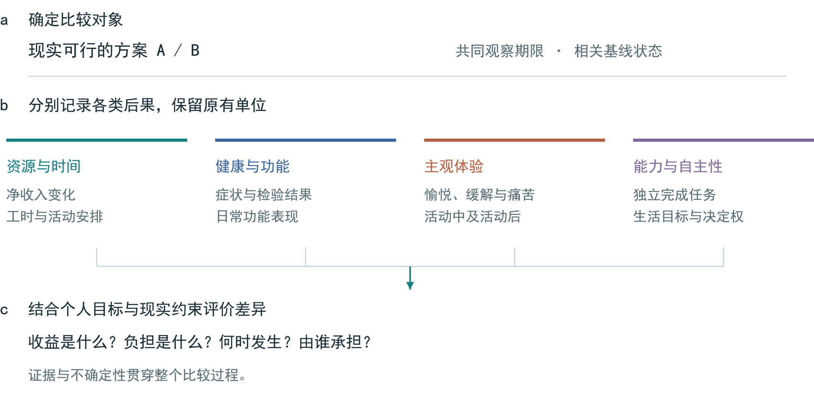
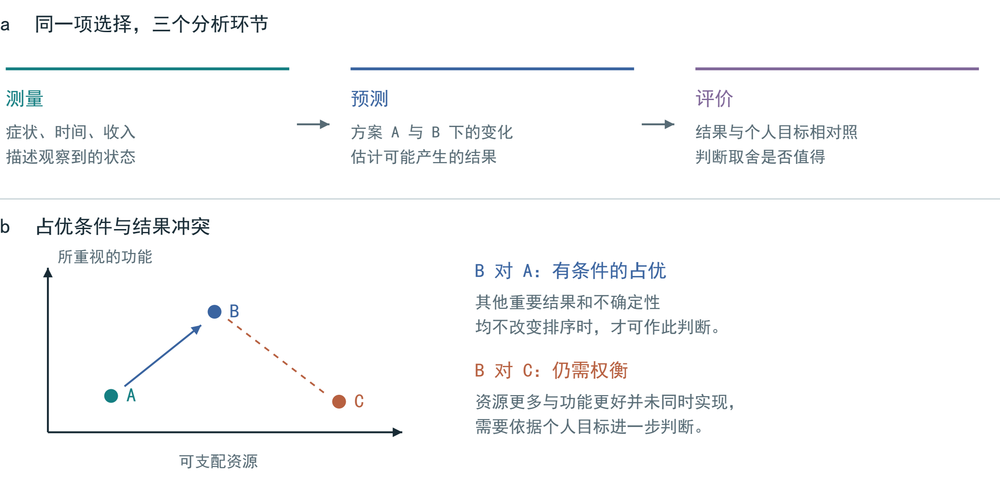
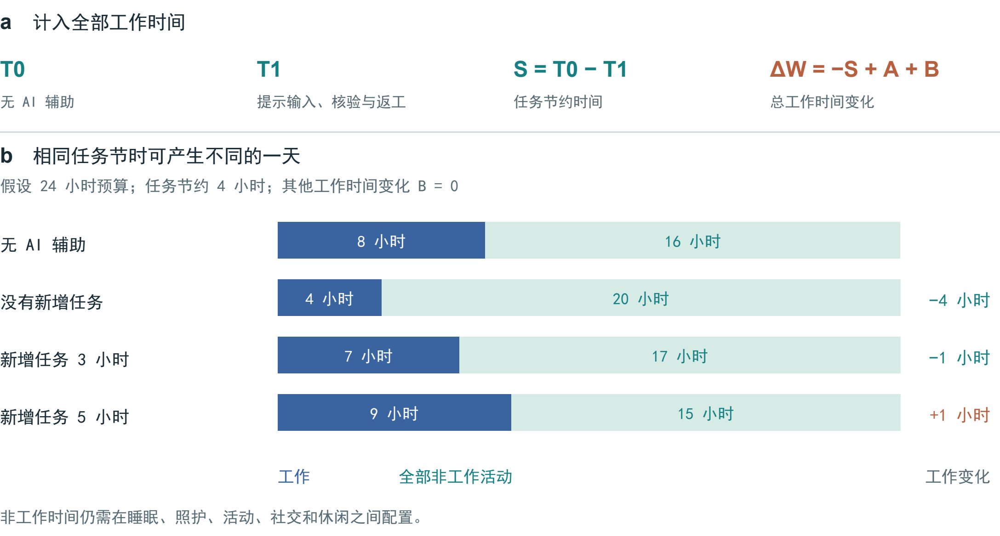
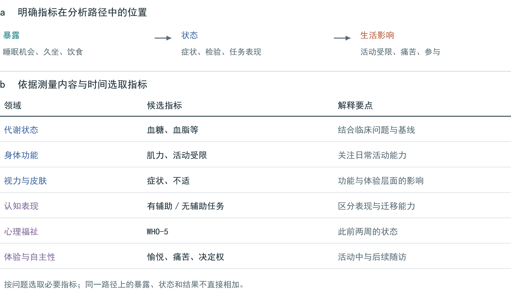
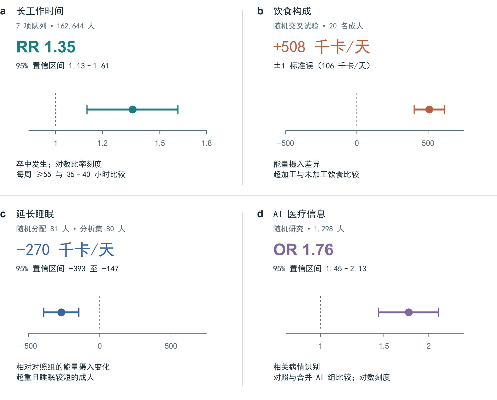
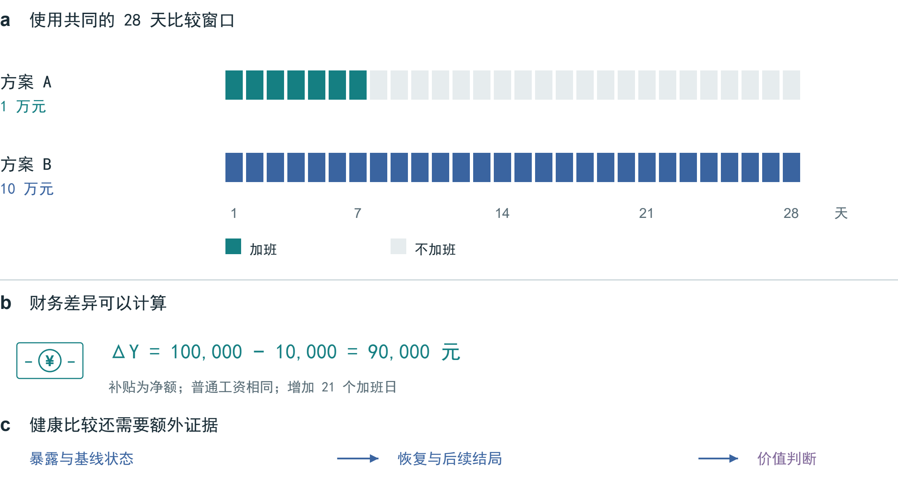
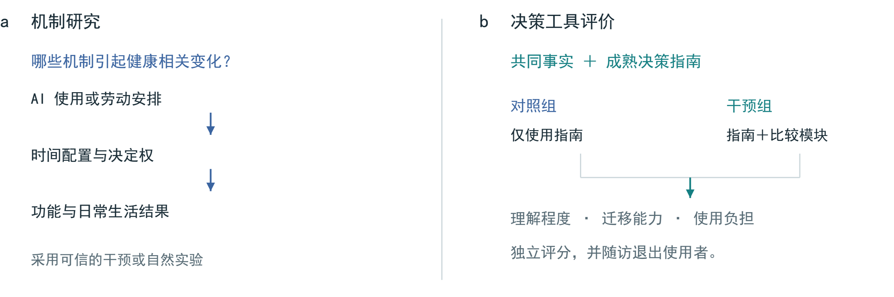

# 人工智能时代的健康经济价值：跨期权衡与评价框架

Richard T. Millian

杭州师范大学

## 摘要

收入增加、任务提速与生活便利，是人们容易辨识的经济收益；与之相伴的健康变化、恢复成本和时间占用，却常被遗漏。人工智能进一步改变了这种权衡：完成任务所需时间缩短，并不必然带来更多休息；有工具辅助时表现改善，也不等于独立能力同步提高。本文结合健康资本、时间配置、健康可行能力与决策分析，提出健康后果比较框架。框架以现实可行的备选方案为起点，在统一的观察期限内，分别考察资源与时间、健康与功能、主观体验、能力与自主性，并区分状态测量、结果预测与价值评价。相关实验和现场研究表明，上述结果具有不同的计量单位、发生时点和适用条件。评价因此需要保留这些差异，而不能仅凭货币补偿或综合评分作出判断。通过加班、饮食、睡眠和 AI 使用等情境，本文说明如何呈现健康相关取舍，并提出关于时间收益分配、效果持续性和决策质量的研究命题，为连接卫生经济评价与日常选择提供分析路径。

图 1 | 健康后果比较框架。 以可行方案和共同观察期限为起点，分别记录资源与时间、健康与功能、主观体验、能力与自主性，再结合个人目标比较。图中为分析环节，非估计所得的因果效应。

图 2 | 测量、预测与评价的衔接。 a，同一问题需要三类信息。b，二维图展示条件性占优与结果冲突；坐标无数值单位，结论还须考虑其他重要结果与不确定性。

## 一、经济收益如何转化为生活改善

同样增加一笔收入，付出的代价可能很不相同。白天延长工作、连续夜班和借助 AI 提高效率，都会改变收入或产出，却未必带来相同的睡眠、负荷与恢复机会。评价这些选择，需要把经济回报放回日常生活：增加了哪些资源，占用了哪些时间，又影响了哪些身体功能和心理体验。图 1 展示这一比较思路，图 2 进一步区分测量、预测与评价三个环节。

这一问题可以从既有理论中找到清晰的起点。Grossman 将健康视为兼有消费与生产作用的资本存量，Becker 则把非市场时间纳入资源配置分析。[1, 2] 马克思关于工作日的论述，将劳动时间、议价关系与劳动力再生产联系起来。[3] 三者分别强调健康存量、时间约束和劳动关系，为讨论健康代价提供了互补视角。沿着马克思的思路，可以追问生产收益与健康负担如何分配；但若要把某项健康损失归因于劳动安排，仍须识别具体暴露、替代方案及其结果。

健康可行能力理论关注的，不仅是已经实现的健康状态，还有人们维护健康、追求自身目标的真实机会。[4] 对于依赖加班收入支付住房或照护费用的人，拒绝加班的名义权利与实际能力可能相距甚远。健康状态也会影响收入对生活的意义，同额收入增量未必产生相同的福利改善。[5] 收入因此仍是重要资源，但其价值需要结合用途和约束来判断：它能否减轻困境，又以何种时间和健康代价换取。

本文所称健康经济价值，是健康与功能变化在资源配置和个人选择中的意义。它既涉及健康本身，也涉及健康对日常活动和生活目标的支持。为使这一价值进入具体决策，本文提出健康后果比较框架：在相同期限内比较可行方案，分别列出收益、负担及其不确定性，再依据当事人的目标作出评价。比较可以形成明确选择，也可以揭示选择成立的条件，或保留尚无法排序的分歧。

表 1 | 比较记录的基本项目。 结合健康可行能力、ICF、WHO-5、多准则决策分析与决策质量研究组织信息，尚未构成经验证的量表。[4, 6, 7, 8, 9]

| 维度 | 记录内容 | 比较时的要点 |
|---|---|---|
| 备选方案 | 具体安排；能否拒绝；共同期限 | 区分名义选项与实际机会 |
| 资源与时间 | 净收入变化；总工时；替代的活动 | 记录节约时间的实际用途 |
| 健康与功能 | 相关症状、功能表现或临床结局 | 结合基线及临床情境解释 |
| 主观体验 | 愉悦、缓解或痛苦；活动中与活动后 | 区分即时反应与持续变化 |
| 能力与自主性 | 独立表现；重视的活动；决定权 | 同时考虑辅助的可及性收益 |
| 证据与评价 | 适用人群；对照；期限；不确定性；目标 | 保留未知项及偏好差异 |

## 二、从状态测量到价值评价

健康状况能够被测量，并不意味着健康价值能够从检验单上直接读出。血糖检测描述当下状态，饮食干预研究估计状态可能如何变化，而一个人是否愿意为这种变化付出金钱、时间或口味上的代价，属于价值评价。三个环节相互衔接，却各有依据。将它们混为一谈，容易把参考区间当成价值尺度，也容易把群体相关性误作个人预测。

货币估值适用于特定的政策与资源配置问题，但补偿和恢复是两回事。补贴可以改善经济处境，却不据此证明功能损失已被弥补；某项损失难以逆转，也不妨碍比较预防、缓解和其他可行安排。尤其在备选机会有限时，接受补偿所反映的可能是生计约束，而不只是对健康风险的偏好。行为福利分析对选择条件的讨论，有助于说明为何实际选择不能无条件地代表充分知情的价值判断。[10]

成本—后果分析将不同结果并列呈现，多准则决策分析则要求说明评价标准及其权重。[8, 11] 成熟的决策指南也已包含备选方案、价值取向和支持需求。[12] 本文在这些方法基础上，突出四项容易在日常选择中遗漏的信息：时间重新分配到何处，结果如何随时间变化，有辅助与无辅助时的功能是否不同，以及收益和负担分别由谁承担。由此形成的比较记录见表 1。

采用统一工具有利于不同研究之间的比较。EQ-5D 等基于偏好的健康状态测量工具，可在合适的赋值体系下用于卫生经济评价。[13] 不过，日常决策还涉及人际关系、自主安排和个人重视的能力。自我决定理论对自主、胜任和关系需要的讨论，为理解这些方面提供了补充。[14] 因而，阅读、游戏、运动或虚拟陪伴的意义，应结合具体体验与功能变化分析，而不宜仅凭活动名称判断。

比较框架追求的是记录规则的一致，而非偏好的一致。当收入、睡眠与家庭时间发生冲突时，首先应把冲突呈现出来，再考察不同优先目标会如何改变结论。汇总评分只有在量尺、权重和重复计量问题得到合理处理后才有解释力。对于缺少可靠换算关系的结果，分别报告往往更便于判断。

图 3 | 任务节时如何改变一天的安排。 a，T1 包含提示输入、核验及返工；A 为新增任务，B 为其余工作时间净变化。b，假设每天 24 小时，原工作 8 小时，固定任务节约 4 小时，B = 0。非工作时间的健康意义取决于实际用途。

## 三、跨期比较与时间约束

设 x_i(a;τ) 为个体 i 选择方案 a 后，在时点 τ 的结果向量，分别记录资源、时间、健康与功能、体验及能力等信息，各分量保留原有单位。对可以计算数值差异的指标，方案 a 与 b 的比较为：

Δx_i(a,b;τ) = x_i(a;τ) − x_i(b;τ).  (1)

式（1）用于表达比较对象；各分量的数值仍需来自观测资料或具有依据的预测。类别变化可用文字记录。若疲劳、恢复或能力变化随时间累积，则应比较变化轨迹，而非只看某个终点。进一步令 z_j 表示在适用范围内数值越大越受偏好的评价准则；若满足下式，则方案 a 在所列准则上占优：

Δz_j ≥ 0 (∀j); Δz_k > 0 (∃k).  (2)

这一判定以准则足够完整、估计不确定性不足以改变排序为前提。许多生物指标存在适宜范围，不能简单按高低确定优劣。实际决策中更常见的是不同结果相互牵制，此时仍须依据个人目标权衡，无法由式（1）或式（2）推出统一的健康兑换率。

AI 的时间收益可进一步拆分。令 S = T0 − T1 表示完成固定任务所节约的时间，其中 T1 包含提示输入、核验和返工；令 A 表示新增任务耗时，B 表示其余工作时间的净变化。各项互不重复时，总工作时间变化为：

ΔW = −S + A + B.  (3)

图 3 给出固定任务节约 4 小时的假设情境。当 B = 0 时，若没有新增任务，总工时减少 4 小时；新增任务占用 3 小时，总工时只减少 1 小时；新增任务占用 5 小时，总工时反而增加 1 小时。即便总工时减少，节约的时间仍可能用于睡眠、照护或其他活动，其健康意义需要结合实际用途判断。

表 2 | AI 研究的不同结局层次。 所列研究的设计与结局各异，分别用于说明任务效率、体验及判断表现。

| 场景与研究设计 | 主要结果 | 解释范围 |
|---|---|---|
| 专业写作; 随机研究；453 人 [15] | 任务完成更快，产出质量改善 | 全天时间配置与健康 |
| 客服工作; 分阶段部署；5,172 人 [16] | 每小时解决问题数约提高 15%；不同结局的数据可得性不同 | 依赖因果识别假设；未测量时间收益归属 |
| AI 陪伴; 持续 7 天的研究 3 [17] | 即时孤独缓解；尚未证明互动前状态持续改善 | 组间退出差异；对照未匹配时长 |
| 医疗场景; 1,298 人 [18] | 对照组相对合并 AI 组的识别 OR 为 1.76（95% CI 1.45–2.13） | 场景表现，而非临床患病结局 |

## 四、人工智能收益的三个评价层次

任务效率是最直接的评价层次。Noy 和 Zhang 对 453 名专业人士开展的随机研究显示，AI 辅助提高了写作速度与产出质量。[15] Brynjolfsson 等在涉及 5,172 名客服人员的现场研究中，利用分阶段部署进行双重差分分析，优选估计显示每小时解决问题数约提高 15%。[16] 后者属于准实验研究，测量的是工作效率。这些结果说明 AI 可以提高生产率，但节约的时间如何分配、健康是否改善，还需要另外测量。

第二个层次是能力变化。辅助条件下完成任务，与撤去辅助后独立完成任务，反映的是不同能力。Bastani 等的教育实验说明，仅观察辅助练习的成绩，难以判断学习效果，还需安排无辅助测评。[19] 对 AI 的评价因此应同时关注即时表现、独立表现和向陌生任务的迁移。工具支持本身也有价值：即使独立能力未变，原本难以完成的活动变得可及，仍可能改善日常生活。

第三个层次是收益能否持续。De Freitas 等持续 7 天的第三项研究发现，AI 陪伴带来的孤独感缓解主要体现于互动后的即时测量，尚未证明互动前的孤独水平持续下降。[17] 组间退出差异、对照组互动时长不匹配，也限制了结果解释。即时安慰值得被记录，而长期收益需通过后续测量判断。短内容与虚拟互动同样应考察愉悦、睡眠、人际联系和自主退出等具体结果，单凭使用时长难以确定其价值。

医疗建议体现了从信息到行动的另一道距离。Bean 等发现，使用者处理假设医疗场景时，未能达到模型单独作答的表现；图 5d 列出其对照组与 AI 辅助组的识别结果。[18] 这里测量的是场景判断，并非真实患病结局。停用 Facebook 的研究也提示，应关注平台使用之外的生活变化，但其结果不能直接作为生成式 AI 的效应。[20] 近期关于健康素养导向 AI 的讨论强调理解、自主性、责任和相称性。[21] 将任务表现、持续能力和生活结果分开评价，有助于把这些要求落实到可观察的指标上。

图 4 | 指标的测量层次与决策含义。 上部区分暴露、状态和生活影响；箭头表示待检验的联系。下部列出候选指标及测量时点，按具体问题选取。ICF 强调功能与环境的联系；WHO-5 测量此前两周的心理福祉。[6, 7]

## 五、指标选择与测量层次

指标选择应从决策问题开始。比较一餐饮食、一个月夜班或一种 AI 陪伴工具，所需的信息并不相同。先明确备选方案是否可行、观察期限是否一致，再依据基线状况选择少量关键指标，才能避免将评价变成没有重点的全面检查。图 4 按测量层次组织了候选指标。

暴露、状态与生活影响需要区分。睡眠机会、久坐时长和饮食结构描述行为或环境；症状、实验室结果和任务表现描述状态；活动受限、痛苦或参与机会则说明这些状态为何重要。国际功能、残疾和健康分类（ICF）将功能置于具体环境之中，为这种区分提供了依据。[6] 若把久坐、相关代谢指标和下游疾病风险直接相加，就可能重复计算同一条路径上的影响。

身体指标应有明确的临床或功能含义。血糖、血脂、血压、肌力、视力和皮肤症状分别反映不同问题，笼统的“血液质量”无法替代这些测量。解释结果时还需考虑基线、测量条件与适宜范围。外观变化可能影响舒适、情绪和社会交往，却不足以单独推断内部健康。身体与心理状态存在复杂联系，相关方向与强度随人群和情境而异，不能预设为恒定的正相关，更不应据此排列人的价值高低。

心理体验和功能表现也各有测量时点。WHO-5 反映此前两周的心理福祉，适合观察一段时期的状态，而不适合测量一次互动后的即时反应。[7] 注意任务、症状报告与活动日记回答的同样是不同问题。工具选择需兼顾信度、反应性、语言适用性和使用负担；重复测量有助于区分短暂波动与持续变化，但频繁记录也可能增加焦虑和退出。

每项比较都应说明哪些结果已经观察到，哪些来自预测，哪些仍然未知。未测量的影响不能当作零影响；缺少适用的基线风险时，也不宜把相对效应直接换算为个人的绝对风险。评价可随证据、环境和个人目标的变化而更新，使记录真正服务于选择。

图 5 | 四项研究的估计结果。 a，7 项队列的卒中发生，随访 1–20 年。[22] b，20 人住院交叉饮食试验的能量摄入。[23] c，延长睡眠试验：随机分配 81 人，分析集 80 人。[24] d，假设医疗场景的病情识别，对照组相对合并 AI 组。[18] a、c、d 为 95% 置信区间，b 为正负一个标准误。比率轴为对数刻度；RR 与 OR 均非绝对概率变化，四项效应不作合并。

## 六、实证结果及其适用范围

图 5 将四项研究结果分别绘制，以保留各自的结局、单位和不确定性。长工时与卒中发生的关联来自队列研究荟萃分析，不能据此估算加班一周的个人风险。[22] Hall 等的 20 人住院交叉试验发现，超加工饮食条件下能量摄入更高；Tasali 等的延长睡眠试验则发现，相对对照组，估计能量摄入下降。[23, 24] 饮食试验图中的区间为正负一个标准误，其余三项为 95% 置信区间。医疗信息试验的比值比描述病情识别表现，并非患病概率。[18]

这些研究共同说明：劳动安排、饮食、睡眠和数字工具的后果可以进入经验研究，但每个估计都有特定含义。将研究结果用于个人选择，需要逐项核对人群、暴露、比较对象、结局与随访期限。本文据此建立比较的依据，不合并这些不同结局，也不把它们换算为个人健康价格。

图 6 | 在共同期限内比较加班方案。 两方案均覆盖 28 天，假定普通工资相同、补贴为净额。B 比 A 增加 9 万元及 21 个加班日。该示例仅计算收入与天数差异，健康评价还需班次、基线和后续恢复等信息。

## 七、典型情境中的权衡

以 28 天为共同期限，设方案 A 加班 7 天，获得税费后补贴 1 万元；方案 B 加班 28 天，获得补贴 10 万元。若普通工资相同，则 ΔY = 100,000 − 10,000 = 90,000 元（4），同时多出 21 个加班日（图 6）。这一步使收入比较具有相同的时间基准。健康比较还需知道具体班次、其余日子的活动与恢复机会；若影响持续至第 28 天以后，观察期也应相应延长。

两方案的取舍取决于更多条件：每天加班多久、是否跨越夜间、原有健康状况如何、能否中止，以及补贴是否用于必要支出。不同经济约束可以导致不同选择，却不会让健康代价凭空消失。框架的作用，是把这类差异和冲突明确列出，使“10 万元是否值得”成为有条件的判断。法律或合同支付解决的是责任与补偿问题，不能单凭支付发生就认定身体功能得到恢复。

睡眠研究说明，仅凭自我感觉也可能低估功能变化。Van Dongen 等的实验中，35 名成人被随机分配到连续 14 晚卧床 4、6 或 8 小时的条件，另有 13 人参加完全睡眠剥夺实验。4 小时和 6 小时组的表现损害逐渐累积，报告的困倦程度却未充分反映这种变化。[25] 这提示评价应同时记录主观体验与客观表现。该结果涉及功能损害，不能进一步推断一次熬夜会造成永久性神经元损伤。

饮食与休闲选择可沿用相同思路。饮食比较需要同时考虑价格、准备时间、可获得性、口味和健康结果，受控供餐试验的效果不能直接代替家庭情境的评价。游戏、户外活动和 AI 陪伴则需要明确它们替代了什么，愉悦与支持是否持续，睡眠或人际联系是否受到挤占。框架由此支持个人根据自身条件权衡，而不预设一种适合所有人的生活方式。

图 7 | 两类研究问题及其验证路径。 机制研究解释结果如何产生；工具评价检验新增比较模块的作用。主动对照使两组共享事实与成熟指南，差异在于是否增加比较模块。所列为研究设计，非已获得的试验结果。

表 3 | 待检验命题及反证条件。 每项比较均需预先确定目标效应与结局。

| 研究命题 | 关键比较 | 可能削弱命题的结果 |
|---|---|---|
| 决定权影响 AI 节时分配 | 任务收益相近、工作量决定权有可信差异的群体 | 未见有意义的配置差异，且估计足够精确 |
| 即时缓解与持续收益可能不同 | 匹配对照，重复测量使用前后及随访状态 | 使用前状态获得与即时缓解相当的稳定改善 |
| 比较模块提高决策质量 | 同一指南，比较有无新增模块 | 理解或迁移未改善，或负担超过收益 |

## 八、可检验命题与验证设计

框架的验证包含两个问题：哪些机制导致健康相关结果发生变化，以及比较框架能否帮助人们作出更充分知情的选择。前者提供内容依据，后者决定工具是否有实际用处。图 7 将两类研究分开，表 3 列出三项待检验命题及可能削弱命题的观察。

工作场所研究可结合任务日志、全天时间日记和重复测量，记录 AI 使用后节约的时间流向，以及劳动者对工作量和日程的决定权。组织政策随机试验或可信的自然实验，有助于识别时间收益如何分配。仅比较 AI 使用者与非使用者，仍可能混入岗位选择、原有工作负荷和健康差异。机制分析需预先设定，避免因机械控制干预后的时间变量而遮蔽总效应。

工具评价宜采用主动对照：两组获得相同事实和成熟决策指南，干预组再增加时间、后果与不确定性记录。决策质量研究和 Cochrane 综述可为结局选择提供依据。[9, 26] 主要结局应在招募前确定，并由独立评分者评价理解程度；陌生情境中的运用、选择与个人价值的一致性，可作为次要结局。

使用负担也应纳入评价，包括完成时间、退出、焦虑和可及性，并保留停止使用者的反馈。方案需预先说明目标效应、样本量依据、缺失数据和多重比较的处理。若新增模块未改善理解，或负担超过收益，就应简化或调整。评价标准在于决策质量，而非参与者是否作出了研究者偏好的选择。

图 8 | 选择条件与后果分配。 工作场所、平台和家庭条件影响方案可行性；同一安排的收入、时间与照护负担可能分布于不同主体。图示组织评价问题，箭头不代表已估计的因果效应。

## 九、制度条件、分配与研究展望

个人选择发生在一定制度条件之中。工作规则、平台设计、住房、食物可获得性和照护责任，都会影响备选方案及其可行性（图 8）。当收入不稳定或工作量要求使休息难以实现时，健康评价若只强调自律，就会遗漏真正的约束。比较框架可以使这些约束显现，但改变选择条件仍需要组织和公共政策的参与。

收益与负担还可能由不同主体承担。劳动者净收入、企业产出、家庭无偿照护与公共支出，应分别记录。一笔补偿在个人层面是收入，在社会层面则可能只是主体之间的转移；一个人节约的时间，也可能转化为他人的核验、纠错或照护负担。因此，评价既要确定总量如何变化，也要追踪变化落在谁身上。

由此可以提出具体的制度评价问题：生产率提升是否增加劳动者可自主安排的时间，平台是否支持自主退出，某项安排是否对资金、行动能力或数字接入受限者同样可行。信息收集应限于决策需要，避免将健康比较转化为监控劳动者或限制机会的评分工具。

本文的主要贡献，是把健康相关结果的内容、时间和分配纳入同一比较过程。AI 使这一问题更为突出，因为任务效率、独立能力与生活改善并不总是同步。共同的记录规则可以帮助人们讨论分歧，却无须要求所有人共享同一套偏好。

本文属于理论探讨，结合经济理论、测量工具与代表性实证研究进行叙述性整合。所提框架尚需验证：较广的测量范围可能增加负担，群体研究结果未必适用于个人，偏好也可能随处境改变。下一步应从具体场景开展可行性研究，再与既有决策支持工具比较，检验它能否持续改善理解与选择。

## 参考文献

1. Grossman, M. On the concept of health capital and the demand for health. Journal of Political Economy 80, 223–255 (1972). https://doi.org/10.1086/259880

2. Becker, G. S. A theory of the allocation of time. The Economic Journal 75, 493–517 (1965). https://doi.org/10.2307/2228949

3. Marx, K. The working-day. Capital, Vol. I, ch. 10. Marxists Internet Archive (n.d.). https://www.marxists.org/archive/marx/works/1867-c1/ch10.htm

4. Ruger, J. P. Health capability: conceptualization and operationalization. American Journal of Public Health 100, 41–49 (2010). https://doi.org/10.2105/AJPH.2008.143651

5. Finkelstein, A., Luttmer, E. F. P. & Notowidigdo, M. J. What good is wealth without health? The effect of health on the marginal utility of consumption. Journal of the European Economic Association 11 (Suppl. 1), 221–258 (2013). https://doi.org/10.1111/j.1542-4774.2012.01101.x

6. World Health Organization. International Classification of Functioning, Disability and Health. WHO (n.d.). https://www.who.int/standards/classifications/international-classification-of-functioning-disability-and-health

7. World Health Organization. The World Health Organization-Five Well-Being Index (WHO-5). WHO, WHO/UCN/MSD/MHE/2024.01 (2024). https://www.who.int/publications/m/item/who-ucn-msd-mhe-2024.01

8. Thokala, P. et al. Multiple criteria decision analysis for health care decision making—an introduction: Report 1 of the ISPOR MCDA Emerging Good Practices Task Force. Value in Health 19, 1–13 (2016). https://doi.org/10.1016/j.jval.2015.12.003

9. Sepucha, K. R. et al. Establishing the effectiveness of patient decision aids: key constructs and measurement instruments. BMC Medical Informatics and Decision Making 13 (Suppl. 2), S12 (2013). https://doi.org/10.1186/1472-6947-13-S2-S12

10. Bernheim, B. D. & Rangel, A. Beyond revealed preference: choice-theoretic foundations for behavioral welfare economics. The Quarterly Journal of Economics 124, 51–104 (2009). https://doi.org/10.1162/qjec.2009.124.1.51

11. Office for Health Improvement and Disparities. Cost consequence analysis: health economic studies. GOV.UK (2020). https://www.gov.uk/guidance/cost-consequence-analysis-health-economic-studies

12. Ottawa Hospital Research Institute. Ottawa Personal Decision Guide. Patient Decision Aids (2025). https://decisionaid.ohri.ca/decguide.html

13. EuroQol Research Foundation. What is the difference between the EQ-5D descriptive system, the EQ VAS and the EQ-5D index values? EuroQol (2023). https://euroqol.org/faq/what-is-the-difference-between-the-eq-5d-5l-descriptive-system-the-eq-vas-and-the-eq-5d-index-values/

14. Ryan, R. M. & Deci, E. L. Self-determination theory and the facilitation of intrinsic motivation, social development, and well-being. American Psychologist 55, 68–78 (2000). https://doi.org/10.1037/0003-066X.55.1.68

15. Noy, S. & Zhang, W. Experimental evidence on the productivity effects of generative artificial intelligence. Science 381, 187–192 (2023). https://doi.org/10.1126/science.adh2586

16. Brynjolfsson, E., Li, D. & Raymond, L. Generative AI at work. The Quarterly Journal of Economics 140, 889–942 (2025). https://doi.org/10.1093/qje/qjae044

17. De Freitas, J., Oğuz-Uğuralp, Z., Uğuralp, A. K. & Puntoni, S. AI companions reduce loneliness. Journal of Consumer Research 52, 1126–1148 (2026). https://doi.org/10.1093/jcr/ucaf040

18. Bean, A. M. et al. Reliability of LLMs as medical assistants for the general public: a randomized preregistered study. Nature Medicine 32, 609–615 (2026). https://doi.org/10.1038/s41591-025-04074-y

19. Bastani, H. et al. Generative AI without guardrails can harm learning: Evidence from high school mathematics. Proceedings of the National Academy of Sciences 122, e2422633122 (2025). https://doi.org/10.1073/pnas.2422633122

20. Allcott, H., Braghieri, L., Eichmeyer, S. & Gentzkow, M. The welfare effects of social media. American Economic Review 110, 629–676 (2020). https://doi.org/10.1257/aer.20190658

21. Ivic, R. K., Ratzan, S. C. & Parker, R. M. Building health-literate artificial intelligence. Nature Human Behaviour, Advance online publication (2026). https://doi.org/10.1038/s41562-026-02595-1

22. Descatha, A. et al. The effect of exposure to long working hours on stroke: A systematic review and meta-analysis from the WHO/ILO Joint Estimates of the Work-related Burden of Disease and Injury. Environment International 142, 105746 (2020). https://doi.org/10.1016/j.envint.2020.105746

23. Hall, K. D. et al. Ultra-processed diets cause excess calorie intake and weight gain: An inpatient randomized controlled trial of ad libitum food intake. Cell Metabolism 30, 67–77.e3 (2019). https://doi.org/10.1016/j.cmet.2019.05.008

24. Tasali, E. et al. Effect of sleep extension on objectively assessed energy intake among adults with overweight in real-life settings: A randomized clinical trial. JAMA Internal Medicine 182, 365–374 (2022). https://doi.org/10.1001/jamainternmed.2021.8098

25. Van Dongen, H. P. A., Maislin, G., Mullington, J. M. & Dinges, D. F. The cumulative cost of additional wakefulness: dose-response effects on neurobehavioral functions and sleep physiology from chronic sleep restriction and total sleep deprivation. Sleep 26, 117–126 (2003). https://doi.org/10.1093/sleep/26.2.117

26. Stacey, D. et al. Decision aids for people facing health treatment or screening decisions. Cochrane Database of Systematic Reviews 1, CD001431 (2024). https://doi.org/10.1002/14651858.CD001431.pub6
