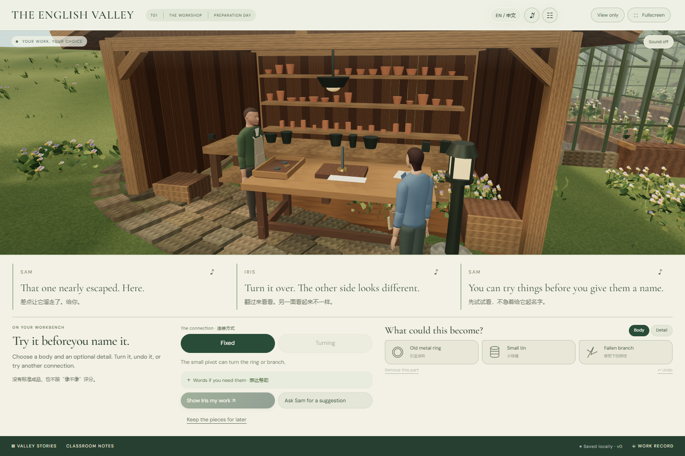

# 完整对白排版与人物接触精制

2026-11-08。本轮响应“文本对话框不要滚轮式，完整显示”的反馈，同时继续T02人物与装置的接触制作。当前仍为可玩制作版。

## 实际变化

当前剧情段落的所有对白按原顺序显示，不再把其余台词收进“Earlier lines”，也不再随着播音把节点移来移去。英文、中文和每句的重听按钮均保留。宽屏对白横向排布；教学区按完整内容计算高度，场景使用剩余空间，不覆盖人物。

窄屏使用明确的Conversation、Place、Next steps、Workbench视图；T02另有Sound notes。切换视图不推进剧情、不改变观察证据，也不会重新自动播一遍台词。横屏重新分栏而不是延用一条长列。语料没有删减，字体没有缩成脚注来凑屏。

任务操作过长时按完整区块翻页；个人记录达到1798字及无空格长串时，阅读页按词/字素边界组织，保留每个字符。输入框仍用于编辑原文；分页只影响只读显示。页码明确，翻页保留键盘焦点。普通照片、设置、长篇教师材料仍是主动打开的独立阅读窗口，本轮“无内部滚动”验收针对剧情对白、任务分区和结尾个人记录；没有把所有任意长度的文档宣称为同屏展示。

## T02接触动作

Sam固定装置前走到可触及的位置，手掌参考点对齐同一个活动金属环。两段手臂求解在角色躯干坐标内完成，不伸长上臂或前臂。说话动作先计算，手部接触随后保持；切到另一个观察位，装置与接触目标都不复制。释放或检查木板后恢复常规手臂姿态，不保留“远程固定”。原先替代手部的临时支架已移除。

这次完成的是上臂/前臂与手掌参考点接触，不是手指逐节抓握、完整布料接触或动捕表演。近景皮肤、表情、手指和配音情绪仍待后续精制。

## 验证

| 范围 | 证据与结果 |
|---|---|
| 修复前复现 | `app/artifacts/complete-dialogue/before/dialogue-layout.json`记录T01首段存在滚动、隐藏与截断，作为实际故障证据 |
| 自动测试 | 76/76通过，包含新增手臂长度、目标误差、说话保持、释放和不可达目标检查 |
| 实际三维接触 | [接触研究](../../app/artifacts/complete-dialogue/contact/contact-study.json)：真实renderer、两个观察角度、说话时保持接触、释放解除；最大手掌参考点误差约8.9×10⁻¹⁶世界单位。该误差只衡量参考点，不等同于手指皮肤精度 |
| 最终生产路线 | 同一生产入口：C1完整路线、T01 9组、T02 10组通过，均无浏览器错误 |
| 完整对白 | 3章×5种尺寸：1440×960、1366×768、390×844、375×667、844×390；逐一检查英文段落及祖先容器无内部滚动、隐藏、截断或出屏 |
| 长记录 | 1798字符普通句子与1798字符连续字符串；逐页可读、拼接后逐字符等于存档、导航保持可见 |
| 独立复核 | 修正了横屏声音记录挤掉场景、长笔记把导航挤出屏幕、翻页丢焦点；复核在最终入口确认关闭，另验证320×568缩放后的文字保留 |

最终构建入口为`index-Bxsf210v.js`，共用渲染器为`renderer-D5Z6J-id.js`。各项生产结果见[最终验证总表](../../app/artifacts/complete-dialogue/final/final-verification.json)。现有C1/T01/T02存档格式未改变，没有重置学生记录。

技术依据：[MDN ResizeObserver](https://developer.mozilla.org/en-US/docs/Web/API/ResizeObserver)用于响应内容尺寸变化；[Three.js Object3D](https://threejs.org/docs/pages/Object3D.html)和[Quaternion](https://threejs.org/docs/pages/Quaternion.html)用于角色局部/世界坐标和旋转关系。教学与原始语料来源继续见既有制作总案。

## 下一阶段

先继续角色手指、注视与停顿的细化，以及初三教师走课和配音听审。新章节仍按制作台账进入，不把当前接触和排版改进当作其余九个故事已完成。环境教育的溪流调查路线与三个模块的独立记录均保留。

## 实际运行画面与复现

[手机对白](../../app/artifacts/complete-dialogue/final/layout/T01-390.png) · [T02横屏](../../app/artifacts/complete-dialogue/final/layout/T02-844.png) · [长记录页](../../app/artifacts/complete-dialogue/final/long-note/words-0.png) · [真实装置接触研究](../../app/artifacts/complete-dialogue/contact/held.png)

`npm run build`、`npm test`；`APP_URL=http://127.0.0.1:4173/`运行三章browser脚本、`dialogue-layout-check.mjs`、`long-note-layout.mjs`和`browser-night-access.mjs`。脚本通过可见的视图/分页按钮到达操作，不强行点击隐藏元素；每个主路线截图点额外检查完整对白。`contact-study.mjs`在5173使用实际renderer研究触及误差，底部说明不是课件UI。
