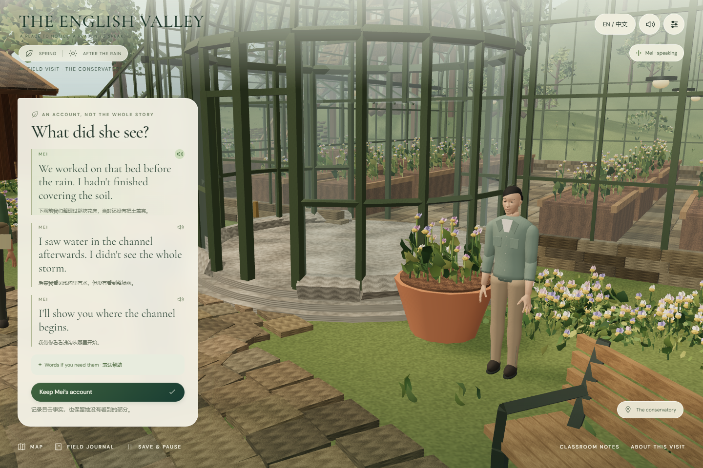

# English Valley · 人物、图片与声音升级交付

2026-11-08。直接回应样段体验中的人物玩具感、任务图片不足、对白需要逐次手点和声音单一的问题。仍在同一山谷、同一条雨后溪流旅程中制作，没有用新地图替换已有故事或清空学习记录。

## 这次真正改了什么

| 体验问题 | 实际改变 |
|---|---|
| 人物像积木玩具 | 四位角色改用有明确许可的人体头部与手部网格，重新制作正常头身比例、五指、脸部结构、不同发型与服装。增加屈膝、呼吸、眨眼和说话时的姿态。 |
| 三维场景缺少有用的图片 | 桥边、上游和操作台加入实体图片板；调查面板直接展示对应地点的图片预览；实施前能打开覆盖物的细节说明图。 |
| 每句话都要先点播放 | 第一次点击进入后，人物与场景引导按当前可见顺序自动播放一次。已经播过的句子不会因界面刷新重播，旁边的声音按钮负责重听。 |
| 所有人共用一个声音 | Noor、Rowan、Mei、Sam和旁白各用独立声线；26段录音已打包在本地，无需临时请求远程生成服务。 |
| 场景始终安静或氛围相同 | 六首原创配乐服务七种情境，另有花园与溪流环境声。切换时淡入淡出，人物开口时压低背景，语音、音乐与环境声可分别控制。 |

## 人物与镜头

保留 Noor 的深蓝轻外套与赭色小包、Rowan 的苔色外套与册子、Mei 的灰绿衣着与浅棕裤、Sam 的工作衬衣与亚麻色围裙。四人通过发际线、脸部尺度、体态和配件区分；不把同一模型换颜色当作四个人。

基础头脸与手部来自 MakeHuman 的 CC0 核心图形资产，全身衣着和角色调整由项目制作。原始文件、转换记录和许可均保留，网页中没有展示未着衣基础人体。温室访谈镜头进一步向Mei取景，避免说话者挤到画面边缘。

[四位角色全身](../../app/artifacts/characters-v2-study.png) · [Mei脸部近景](../../app/artifacts/characters-v2-mei-close.png) · [人物制作与许可](character-upgrade-v2.md)

目前仍是可继续精制的游戏人物。细发丝、皮肤细节、自然服装褶皱、手部接触和音素级口型尚未完成，不能仅凭新增人体网格就把最终逼真画质标为通过。

## 图片为什么属于这个任务

桥位、上游和浅沟缩略图从当前三维山谷的固定机位生成，与展开后的记录对应。预览图片和看见场景记录板本身不自动完成调查；仍由学习者打开完整记录并保存观察。已有证据图片保留原始采集时刻，不随物件变化被悄悄改写。

覆盖物细节图是专门为当前操作制作的材料说明：棕色植物纤维覆盖物、四块压边石和工作台。三维现场覆盖物、沙盘表示和图片使用一致的棕色材料方向。说明图明确标为材料插图，不进入学生的现场证据来源列表，不被用来证明水变清。

图片也出现在世界中的实体记录板上；桥边增加了瓶子的实际收纳容器，改善清理物件突然消失的感觉。[图片性质与对象对应清单](../../app/public/illustrations/manifest.json)

## 声音怎样工作

首次点击 **Explore the stream** 后启动声音。初到桥边按顺序听见Noor和Rowan，进入上游、裸土与温室有简短引导，访谈和试验回应使用角色本人的声线。学生可自由继续，不必等录音结束才能行动。

- 同一场面只自动播一次；重听按钮允许随时重复。
- 开始移动时取消旧地点的对白，新的场面到达后再播；打开图片时附带当前播报文字，避免只听声音却找不到字幕。
- 人物说话时背景音乐降低；不同地点与操作阶段更换配乐，旧音轨淡出。
- 顶部声音按钮控制总静音；设置分别提供对白、场景音乐、自然声与音量。
- 记住本轮设置。旧版本的默认静音记录迁移为新版自动声音，之后用户明确选择的静音会保留。
- 浏览器后台暂停声音，返回后恢复未完成的句子；已经完成的句子不因切回页面而重复。
- 播放被浏览器阻止或音频加载失败时提供可重试入口；文本和操作仍可使用。

浏览器要求声音由用户交互启动，因此将解锁放在首次进入，而不是要求每个地点再次点声音按钮。[MDN自动播放说明](https://developer.mozilla.org/en-US/docs/Web/Media/Guides/Autoplay)

录音采用五种独立的开放模型预置声线，没有克隆特定个人，没有用同一声音变音高来伪装不同角色。录音为合成表现版本，仍需要结合真实课堂试听完善情绪和可懂度。[五种声线串联试听](../../app/public/audio/voice-cast-preview.wav) · [音频素材、配乐与来源](audio-assets-v2.md) · [播放与恢复机制](audio-runtime-v2.md)

## 验证与打开方式

[本机课件](http://127.0.0.1:4173/)已提供生产预览。进程停止后，在 `D:\Eng-Valley\app` 运行 `npm run build`，然后 `npm run preview`；开发使用 `npm run dev`。生成语音时所用模型与工具留在 `.audio-tools/`，网页运行只加载已经生成的音频文件。

- 31项领域、共同场景与声音调度测试通过，包含自动顺序、重渲染不重播、取消旧句、手动重听后接续队列、静音、后台恢复、播放失败、迟到下载，以及同曲目进入不同场景时更新音量。
- [新版完整旅程](../../app/artifacts/v2/browser-main-path.json)通过；图文编辑、实际安装、返回与存档未回退。
- [新版12项异常与恢复检查](../../app/artifacts/v2/resilience-results.json)通过，包含损坏存档、失败重试、未解问题和窄屏键盘操作。
- [音频文件验证](../../app/public/audio/validation.json)覆盖26条原文与录音对应、5种声音身份、文件解码、非静音与削波检查。
- [真实浏览器声音集成审阅](audio-integration-review-v2.md)独立记录实际音频输出、首播与重听、静音、切换背景声及设置恢复。以其结果为准，不只验证“正在播放”的状态文字。

最终冻结构建为 `index-Bo-zs6P9.js`；完整旅程、12项异常恢复与8组声音集成检查均对应这一构建。[本轮验收索引与文件校验值](../../app/artifacts/v2/final-verification.json)

[新版连续运行录屏](../../app/artifacts/v2/first-journey.webm)是自动化操作的画面记录；Playwright录屏本身不采集扬声器音轨，声音请在课件或上面的声线试听中体验。

构建时渲染模块约1.12MB（压缩后约323KB），新增人体网格增加了下载和绘制成本；正式学校设备的流畅度与真实手机触摸尚未实测。此阶段完成体验修订，不替代最终美术、教师逐句审校或学生课堂验证。

## 后续制作约束

后续章节默认包含：与任务相关且来源明确的图片、进入场面的声音安排、独立角色声线、对白与音乐的混音、字幕与重听，以及静音/中断/返回的实际测试。缺少其中一项时须在该章交付中明确指出，不再把“能点通流程”当作场景体验完成。
