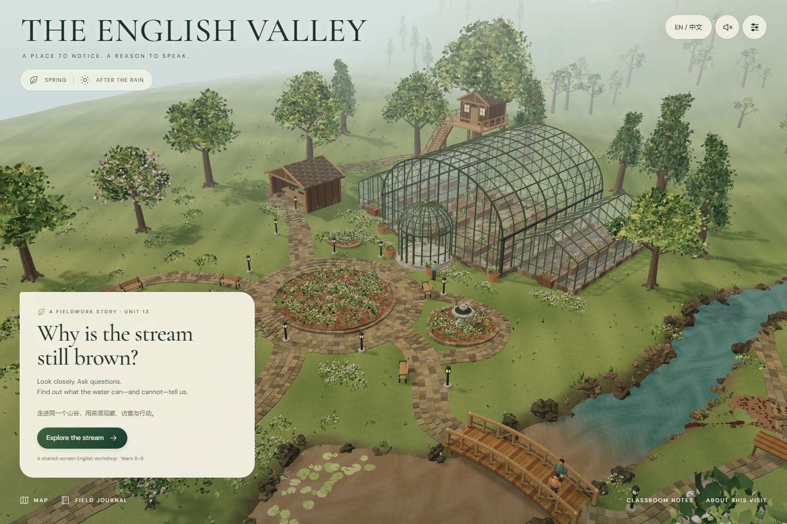
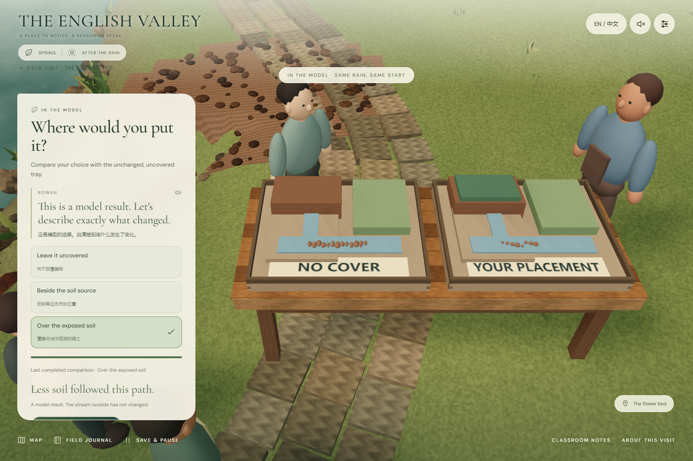

# English Valley · 首条可玩旅程交付

2026-11-08 · 对应设计 v6.1 · Three.js 浏览器制作样段

## 本轮推进到哪里

设计准备度复核和定向润色已经完成。十二章、共同人物与作品、环保走线、已批准的三张视觉方向均保留；十四条主对白和六处场面已改写，首课执行材料、独立分支对白和首旅程流程合同已补齐。详细依据见 [v6.1复核与打磨](../design/v6/readiness-and-refinement-v6_1.md)。

随后进入的一个阶段是 **首条完整可玩旅程与共同三维底座**。工程位于 `app/`，与旧设计和素材目录分开保存。这次实际实现的是 T03 内部的 C1 雨后溪流访查；其余十一章仍是制作设计，未被冒称可玩。第一条旅程允许独立进入，不虚构玩家已经完成此前整段游园。

## 打开与体验

本机预览：[English Valley](http://127.0.0.1:4173/)。此地址依赖本地预览进程；不是已发布网站。

重新启动开发预览：

```powershell
Set-Location D:\Eng-Valley\app
npm run dev
```

开发地址为 `http://127.0.0.1:5173/`。依赖已在当前工作区安装；另一台机器先运行 `npm ci`。生产预览使用 `npm run build`，再运行 `npm run preview`。构建产物在 `app/dist/`，可以后续交给静态站点服务；本轮没有部署外网。

建议第一次按这条路线体验：

1. 桥边打开雨前与本次照片。可以先观察，也可以先拿走瓶子；瓶子移除后，褐色水流仍在。
2. 自选上游、裸土浅沟、温室的访问次序。问 Mei 她看见了什么；也可提出较直接的质疑，仍能听到完整目击范围。
3. 回到裸土旁的试验台。先试“放在旁边”，再试“覆盖源头裸土”，比较同样条件下的两个沙盘。
4. 写自己的提案。可以保留提案，也可以与 Mei 确认用途后检查、拿起、试放并确认覆盖物；放错位置可以重新摆放。
5. 用实际取得的画面和自己的文字制作三幅记录。允许空白、未完成与保留问题；示例句不代替学生自己的作品。
6. 回到原来的桥位，约定下次看什么、何时回来、学校里是否有相似地点。保存的是计划，系统不会编造已经发生的复查。

随时可保存暂停；再次打开后继续。也可在说明阶段选择 **Save an open question**，直接留下尚未解答的问题。

## 实际落地的体验

| 设计要求 | 本阶段已经实现 | 边界 |
|---|---|---|
| 大地图和小地点连续 | 温室、树屋、工坊、花环、溪流、主桥使用同一场景；移动镜头经过共同道路 | 不是完整开放世界；可玩访问点集中在 C1 |
| 可操作的真实3D | 原创几何、材质、透明玻璃、阴影、水面、植被、三维试验台、覆盖物状态 | 是实时三维样段，尚未达到批准概念图的最终逼真程度 |
| 有意义的不同选择 | 访问次序、访谈语气、模型位置、保留提案或安装、未解问题出口 | 沙盘是预设定性比较，不是水文模拟或真实污染检测 |
| 学生自己的英语表达 | 提案、证据图文、复查问题与现实联系可自由填写；按需中文与句式帮助 | 不用关键词评分解锁；未实现录音评测 |
| 状态与证据可信 | 清理、模型、实施分开；照片来自实际场景；同机位历史对照；原记录可导出 | 历史画面是虚构教学记录，不是现实拍摄 |
| 人物进入场面 | 四位角色的走位和到场条件、分支对白、可回听的设备语音 | 人物为动作占位模型；设备语音为预听，不是正式演员配音 |
| 中断与保存 | 暂停、恢复、未解问题、重复操作去重、写入失败重试、损坏记录导出 | 当前为单设备课堂体验；不支持跨设备账号同步或多人在线 |

所有证据、作品、偏好保存在当前浏览器的本地存储。没有上传学生文字。导出可保存 JSON 副本；清除浏览器数据或使用另一浏览器会失去当前浏览器里的记录。设置中的新旅程会明确提示先导出。

## 实际画面

以下图片来自真实浏览器运行，不是概念生成图。





更多：[桥位证据](../../app/artifacts/03-bridge-records.png) · [自己的图文说明](../../app/artifacts/08-picture-note.png) · [窄屏保存页](../../app/artifacts/10-mobile.png)。

[完整连续运行录屏](../../app/artifacts/first-journey.webm)保留从初次加载到保存重开的实际操作。它是无配音的自动化快速走查，用于查看同场景移动和操作衔接，不是学生课堂实录，也不是最终角色表演样片。

## 验证与审阅记录

最终冻结构建 `index-U85a2Duk.js`：20项领域/场景测试通过，完整浏览器主路线通过，12项浏览器异常与恢复检查通过，另有缺图说明的键盘恢复回归通过。检查未捕获意外控制台或页面错误。[最终验证索引](../../app/artifacts/final-verification.json)记录构建、源文件哈希与各项证据。连续录屏为1440×960、53.44秒。

- [领域运行测试](../../app/tests/journey.test.mjs)：错误顺序、分支回接、目击对白送达、比较与实施分离、晚到回调、暂停草稿、重复命令、存储失败、损坏存档与中断恢复。
- [共同场景测试](../../app/tests/environment.test.mjs)：唯一桥/温室、八个锚点、真实放置区域与方向检查，以及历史截图恢复后的瓶子和覆盖物状态。领域与场景测试合计20项通过。
- [浏览器主路线结果](../../app/artifacts/browser-main-path.json)：从桥位入口走到复查计划与保存，含两次不同位置比较、无效后有效安装、图文说明与重载。
- [浏览器异常验证](../../app/artifacts/resilience-results.json)及[说明](browser-resilience-report.md)：实际拦截浏览器存储写入，检查失败后状态、重试身份与恢复；包含未完成路线及键盘、窄屏检查。
- [独立运行审阅与处理](runtime-review.md)：保留原问题记录及后续核对，不以修复描述代替回归结果。
- [渲染器检查](renderer-report.md)与[环境制作记录](environment-report.md)：相机、同场景证据、走位、材质及剩余美术工作。
- [设计合同检查](../design/v6/first-journey-contract-check.json)：20个节点、45个事件、52个状态字段、36个首旅程对白引用；完整编辑索引为342条，不等于已经制作342条表演。

浏览器检查使用当前机器的无界面 Edge 与 SwiftShader；这是软件渲染功能验证，不能据此承诺学校显卡的帧率、首次加载时间或长时间课堂性能。1440px 桌面、1152px 桌面与390px窄屏用于不同检查；尚未做真实手机触摸和教室投影实测。

复跑领域测试与构建：

```powershell
Set-Location D:\Eng-Valley\app
npm test
npm run build
```

先启动生产预览，再运行 `node scripts/browser-check.mjs` 和 `node scripts/browser-resilience.mjs`。脚本默认使用这台机器的 Edge 与 Codex 已附带的 Playwright；其他环境可设置 `BROWSER_PATH`、`PLAYWRIGHT_MODULE`、`APP_URL`。

主路线添加 `--video` 可重新录制连续实录。`artifacts/development-timeout.*` 保留开发过程中一次超时记录，最终冻结构建的结果以 `browser-main-path.json` 和异常验证结果为准。

## 进入下一批制作前仍要解决什么

**视觉方向已经批准，不需要重新选风格；实时成片质量尚未通过最终验收。** 当前环境是可玩制作底座。自然枝叶、近景土石、皮肤布料、手与物体接触、视线和表情都仍需定制资产与表演制作。现有角色不能当最终角色交付，设备语音也不能代替有情绪起伏的连场录音。

下一批应以同一场景的桥边、Mei访谈和操作台为三个固定取景点，替换并验收近景主资产；保持现在的坐标、对象身份、证据来源与存档行为。T01触感、T02声影、T05纸样、T08表演仍是后续专项样板，未在本轮中伪装成已完成。

教学仍需教师走课和学生实际试玩，尤其观察：学生是否主动提出问题、是否真的用英语交换线索、操作是否挤占同伴说话、保留疑问是否自然。45分钟只是待验证课时安排，不能从自动化测试推断课堂有效。

语言为项目原创，教材与词典依据按 [语言核对记录](../research/language-notes-v6.md) 的实际支持范围使用。学校在用教材具体版次、全句教师审校、最终字幕与发音仍待核对；本轮没有将原创整句标为官方认证，也没有抓取来源不明配音代替审核。

## 工程与资产入口

[主界面](../../app/src/main.js) · [声明式旅程运行器](../../app/src/core/journey.js) · [环境](../../app/src/world/environment.js) · [渲染器](../../app/src/world/renderer.js) · [锁定依赖](../../app/package-lock.json) · [资产及许可记录](../../assets/ASSET-MANIFEST.md) · [阶段计划](../superpowers/plans/2026-11-07-first-playable-journey.md)

Three.js与Vite锁定到已安装版本。两个本地字体随OFL文本保留；三维环境及简单图标为项目制作。旧 Kenney 准备模型和旧声音文件未混入此次近景作为最终资产；概念图未作为渲染画面使用。
