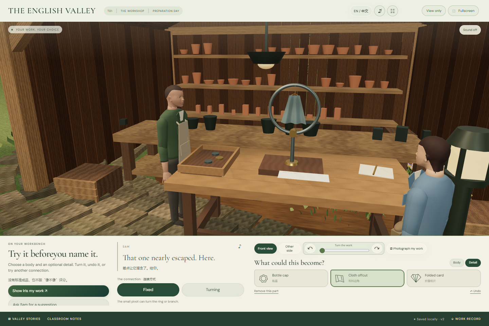

# 沉浸式全屏布局 · 共用屏幕契约

2026-11-08。针对“对话框遮挡人物与关键场景”的反馈，C1与T01已改为独立三维观看区与底部交互区。T02可复用同一外壳；它不会把一个更透明的卡片继续盖在人身上。

## 实际布局

桌面1440×960中，顶栏64px、三维视口630px、底部课件区224px、导航42px。三维画布真实边界的底部为y=694，交互区从y=694开始，两者没有交叠。镜头按画布真实尺寸重新渲染，不依靠裁掉被面板遮住的区域。

长对白保留当前句，之前的句子进入“Earlier lines / 对话记录”；可展开回看和重听。工坊工具、材料抽屉和连接选择进入底部工作区，持续操作不盖住作品。窄屏使用可滚动底部区域，当前句与重听按钮固定在该区域顶部，不浮在人物脸上。

加入浏览器原生全屏按钮和F快捷键；输入文字时F不会触发全屏。浏览器不允许全屏时，课件仍可在窗口中正常使用。“View only”可暂时收起UI，用“Restore controls”或Escape恢复。收起UI使原操作区不可聚焦，避免键盘在不可见按钮中游走；声音和已保存进度保持。

图片放大、设置、记录等主动打开的阅读界面也使用独立底部区域。开启时，该区域扩展至视口高度的56%（最高520px），三维画布同步缩小并重新取景；图片、文本、设置按钮始终在画布边界下方。背景透明，不模糊场景；关闭后恢复普通课件区。原生`dialog.valley-dialog`与C1自定义阅读界面采用同一规则，关闭按钮、Escape和原有焦点行为保留。

## 接入方式

`mountImmersiveShell({canvas,root})`返回`sync()`、`updateSpeech()`、`resize()`、`setScenic(boolean)`与`dispose()`。

- 控制器每次重绘完成后调用`sync()`。保留原按钮、文本输入与数据属性，不新建另一套任务行为。
- 更新当前音频ID与说话状态后调用`updateSpeech()`。C1使用`data-line`，T01使用`data-work-line`，后续兼容`data-night-line`。
- 移动节点后恢复当前键盘焦点；原旋转滑块可连续按方向键，不因布局重排只响应一次。
- 三维相机仍需针对新的画布构图。保证UI不覆盖三维区域不等于自动保证人物都在相机取景内；窄屏演员与作品的取景由场景模块继续核对。

实现文件：[外壳控制](../../app/src/ui/immersive-shell.js)、[屏幕布局](../../app/src/ui/immersive.css)。C1与T01只新增外壳挂接，未修改领域状态和语料。

## 开发浏览器验证

[布局检查](../../app/artifacts/immersive/layout-study.json)与[检查脚本](../../app/scripts/immersive-study.mjs)覆盖C1/T01桌面、390px窄屏、原生全屏进入与F退出、纯场景视图及Escape恢复；控制区/画布矩形不交叠，窄屏无页面横向溢出，无页面异常。

[T01完整开发版回归](../../app/artifacts/immersive/workshop/browser-workshop.json)9组通过，涵盖真实语音输出、材料约束、键盘旋转、照片导出、输入保留、章节切换、暂存/恢复与窄屏。首次检查发现重排后滑块焦点丢失，修复并完成全路线复验。最终生产构建验收由总集成另行记录，以上不冒称生产版已冻结。

[阅读界面专项检查](../../app/artifacts/immersive/modal-layout-study.json)4组通过、无页面异常：C1照片对比与T01声音设置均检查1440px桌面、390px窄屏。桌面画布底部和阅读区顶部同为y=398；窄屏分别为333.359px与333.375px，均不交叠。两种界面关闭后恢复，Escape检查通过。已人工查看C1桌面照片对比与T01窄屏设置截图，场景与人物保留在独立上方观看区。

[桌面照片对比](../../app/artifacts/immersive/C1-modal-1440.png) · [窄屏声音设置](../../app/artifacts/immersive/T01-modal-390.png)

[窄屏工坊](../../app/artifacts/immersive/T01-mobile.png) · [溪流新布局](../../app/artifacts/immersive/C1-desktop.png) · [纯场景视图](../../app/artifacts/immersive/T01-scenic.png)

两份布局检查脚本均支持`APP_URL`（默认开发预览5173）与`ARTIFACTS_DIR`（默认`artifacts/immersive`）。在`app`目录设`APP_URL=http://127.0.0.1:4173/`及新的产物目录，依次运行`node scripts/immersive-study.mjs`和`node scripts/immersive-modal-study.mjs`，即可独立验收生产版；前者保存入口构建名，后者记录实际来源地址和阅读区边界，不需要覆盖开发版截图。T02接入后的故事流程与不同相机取景仍由总集成独立验收。
