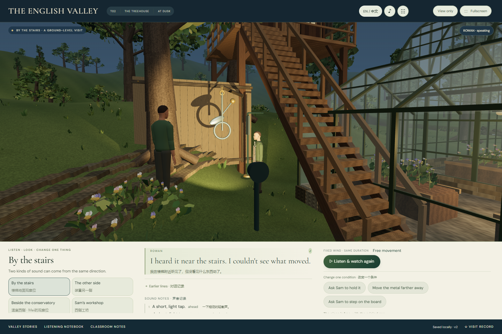

# 沉浸式界面与T02树屋夜声 · 交付登记

2026-11-08。当前状态：共用沉浸式界面和T02核心可玩路线已集成，C1、T01、T02均已接入章节入口。生产构建、73项自动测试和三个模块的浏览器路线已通过。当前发布为可玩制作版，精细人物表演、学校设备性能与课堂效果仍按文末范围继续验收。

## 体验入口

- [C1 雨后的溪流](http://127.0.0.1:4173/?module=C1)：发现变化、访查、有限比较、可选行动与回访记录。
- [T01 旧物奇想展](http://127.0.0.1:4173/?module=T01)：组合旧物、选择连接、换角度、写展签、展出或暂存。
- [T02 树屋夜声](http://127.0.0.1:4173/?module=T02)：换位置观察、询问人物、做声源对照、保留个人解释或问题。

上述本机入口需要预览进程运行。在`D:\Eng-Valley\app`运行`npm run build`，再运行`npm run preview`；开发预览使用`npm run dev`和5173端口。十二章目录区分三个可玩模块与其余待制作故事；C1是T03内独立溪流回访，不代表完整偏好游园已经完成。

## 本轮实际改动

三维场景与教学界面采用独立区域。普通对白、当前句重听、历史台词、任务按钮和工坊材料进入底部操作区；照片、笔记、设置与章节目录打开时，底部区域扩大，实际三维画布随之缩小并重新取景。阅读界面不靠提高透明度遮住角色。窄屏保留可滚动操作区与当前句；浏览器全屏按钮和F快捷键、纯场景模式及明确恢复入口共用一套实现。输入文字时不抢占F键，开启照片或笔记后保留原生关闭与键盘行为。

T02复用同一山谷的树屋、温室和西侧工坊，以暮蓝环境和固定暖灯组织观察。活动部件、接触片、挡风板、木板及光源有实际三维位置；照片直接来自当前场景。关键接触动作、短声源和文字描述由同一事件触发，配乐与环境风声独立。角色声线延续既有身份，自动对白保留重听入口。

## 树屋夜声的可玩范围

1. 首次进入先呈现一段固定条件声源序列，再让Rowan回应刚发生的声音；学生可停止，不会把中断的回放写成完成证据。
2. 观察位包括楼梯地面、装置另一侧、温室西侧和工坊。学生可以询问Sam或Mei，也可以先返回比较；角色陈述与实际完成的观察分别记录。
3. 固定部件、拉开接触间距、检查木板分别改变相应条件。敲击的解释需要同一观察位下完成的原条件与敲击停止的对照；木板有自己的检验，不随敲击解释自动成立。
4. 学生可以拍摄当前视角、用自己的英语写说明或下次问题。照片为本次会话临时捕获，可随当前访问记录导出，尚未制作持久相册。系统根据已有证据呈现保留未知、仅解释敲击、分别解释两种声音三类收束，不要求选中唯一结论才能离开。
5. 本地记录支持恢复与导出；失败写入保留旧记录，未保存的完成回放有重试入口，损坏记录先保留原文再经明确操作归档。初始入口的笔记只读，进入后再编辑。

上述状态规则已在本页所列真实浏览器路线和领域测试范围内验证；未进行课堂效果推断。

## 同一世界与台词使用边界

Mei此次站在**温室西侧观察位**，位置遵循当前世界几何；这里不被描述为她的家门口。`T02.006`中“my doorway”的原录音已准备，但当前不播放，以免台词与实际地点冲突。保留资源不等于启用剧情。

T01作品继续保留原有身份和摆放位置。T02目前使用Sam自有装置；学生作品的悬挂适配、碰撞条件和单独借展许可尚未实现。`T02.026`借展请求同样只保留备音，不播放，也不把T01的“以后可询问”当成已同意借展。

教材关联是人教版九年级Unit 8 Section A 3a–3c的观察与推断主题。山谷谜题、角色对白和结果为项目原创，不是教材原文，也没有替教材补写未揭晓的答案。语言支持和实际来源读取范围见[内容与声音说明](night-content-audio.md)。

## 资源与工程入口

| 范围 | 文件或说明 |
|---|---|
| 共用界面 | [布局说明](immersive-layout-upgrade.md)、[外壳](../../app/src/ui/immersive-shell.js)、[样式](../../app/src/ui/immersive.css) |
| T02控制器与记录 | [night-main.js](../../app/src/night-main.js)、[领域规则](../../app/src/core/night-inquiry.js) |
| 三维装置与共同世界 | [night-inquiry.js](../../app/src/world/night-inquiry.js)、[renderer.js](../../app/src/world/renderer.js) |
| 语料与播放 | [night-content.js](../../app/src/content/night-content.js)、[短声源运行器](../../app/src/audio/night-sources.js) |
| 21个备好音频文件 | [音频清单](../../app/public/audio/night-manifest.json)、[资源逐项登记](../../assets/ASSET-MANIFEST.md)、[来源与许可](../../app/public/audio/night-provenance.json) |
| 制作依据 | [本轮实施计划](../superpowers/plans/2026-11-08-immersive-and-night-inquiry.md)、[T02原剧本](../design/v6/episodes/T02.md)、[模块台账](modular-production-roadmap.md) |

21个音频文件为16条NPC/旁白、两首音乐、一个风声循环、两种单次接触声。备音包含尚未启用的条目；预听拼接另列，不计入21个文件。角色采用本地Kokoro预置声线，无真人声音克隆；配乐、风声和接触声为项目原创合成。

## 最终验收登记

生产入口 `index-GgQcGrjz.js`；T02 `night-main-BPfgzjP2.js`；共用渲染器 `renderer-BSSkIeqj.js`。完整构建资产SHA-256及测试范围见[验证总表](../../app/artifacts/immersive-night/final-verification.json)。本轮只使用本机Headless Edge与SwiftShader，不将其帧率推算为学校显卡性能。

| 项目 | 结果与实际范围 | 证据 |
|---|---|---|
| 生产构建与自动测试 | 构建成功；73/73通过。覆盖状态、失败保存、三维对象、接触取消、语料身份和音频运行器。渲染块约1.14MB，仍需学校设备实测 | [命令记录](../../app/artifacts/immersive-night/build-and-tests.txt) |
| C1完整路线 | 通过，0浏览器错误；访查、两次比较、重新加载、错误/正确放置、自己说明、回访与保存 | [C1报告](../../app/artifacts/immersive-night/c1/browser-main-path.json) |
| T01完整路线 | 9组通过，0浏览器错误；材料/连接、连续键盘操作、作者草稿、照片导出、跨章作品、窄屏和损坏存档 | [T01报告](../../app/artifacts/immersive-night/workshop/browser-workshop.json) |
| T02完整路线 | 10组通过，0浏览器错误；自动开场5敲/2木响、人物陈述与证据分开、固定后0敲/2木响、木板自动演示、三类收束、真实照片、跨章独立记录 | [T02报告](../../app/artifacts/immersive-night/night/browser-night.json) |
| T02停止与保存重试 | 中断回放不落观察；完成回放写入失败后保留待存结果，重试不重播或重复计数。损坏/陈旧记录、准备阶段迟到声音取消与隐藏页面取消另有领域/声音测试 | 同上及73项测试 |
| 实际音频输出 | 检测解码缓冲与通向输出的节点信号；开场自动播放在可信进入操作后，023对白位于木板演示后；独立场景音乐实际播放。非人耳听审 | T02报告内audioEvidence、[音频资源检查](../../app/public/audio/night-validation.json) |
| 全屏与普通HUD | 最终入口C1/T01的F、全屏按钮、纯场景/Escape、1440×960及390×844边界通过；T02桌面/窄屏边界在主路线通过 | [布局报告](../../app/artifacts/immersive-night/layout/layout-study.json) |
| 阅读界面 | C1照片与T01设置的桌面/窄屏4项边界通过；T02照片、笔记、设置在主路线通过。画布与阅读区均不相交 | [阅读区报告](../../app/artifacts/immersive-night/layout/modal-layout-study.json)、T02报告 |
| T02输入与恢复补充 | 5组通过，0浏览器错误；原生对话框内保存失败提示实际可见、草稿原样重试、入口只读笔记不挡导航、全屏按钮/F与输入f保护、纯场景/Escape、损坏原文导出及归档恢复 | [补充报告](../../app/artifacts/immersive-night/access/browser-night-access.json) |

C1/T01全路线报告记录的入口是 `index-CWHkiaq2.js`。随后仅调整T02控制器的三栏分配和专用样式；C1 `main-ngIq5ffz.js`、T01 `workshop-main-Cp_sSCuc.js`、共用界面/声音和渲染器资产在最终构建中完全不变。最终入口再次完成C1/T01全屏、窄屏和阅读界面检查，并完成T02完整路线；没有把旧报告的入口名改成新名字。

实际画面（不是概念图）：

[手机笔记与场景分区](../../app/artifacts/immersive-night/night/09-mobile-notebook.png) · [T01桌面](../../app/artifacts/immersive-night/layout/T01-desktop.png) · [C1桌面](../../app/artifacts/immersive-night/layout/C1-desktop.png)

开发记录与历史交付保留原有范围。测试通过没有证明真人听审、情绪表演、学校设备性能或课堂效果已经通过。

## 仍需完成的制作

- 人物面部、手部实际接触、口型、布料和情绪停顿继续精制。当前可玩实现不能描述为已达到AAA游戏或逼真人物演出的最终标准。
- 声线、发音、情绪与教室混音尚未进行真人听审；音频非静音和循环边界检查只证明相应信号性质。
- 教师逐句审校、初三学生体验、真实课时与学校设备性能尚待验证。
- T01作品悬挂适配与另行借展许可未实现；未制作的其余章节保持待制作状态。
- 固定条件回放属于明示的教学情境；左右声像不是建筑声学或真实结构安全诊断。

完成本轮验收后，按台账继续人物接触与声音精制、教师走课，再推进后续模块；保留已经成立的共同地点、作品身份和独立记录。
