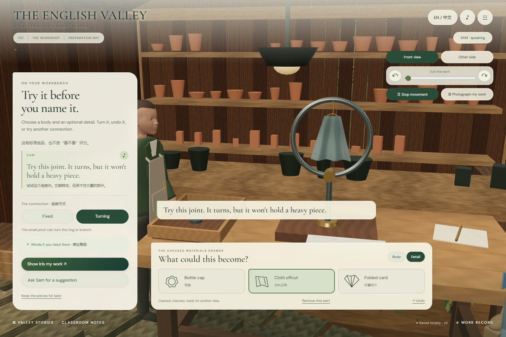

# T01 · 旧物奇想展模块交付

2026-11-08。本轮依照[十二章制作总案](../design/v6/production-bible.md)与[T01详稿](../design/v6/episodes/T01.md)，在既有溪流课例之后制作第二个可玩模块。它发生在开放日前的工坊准备日，不把章节切换误写成溪流调查中的时间跳转。

## 如何体验

[直接进入工坊](http://127.0.0.1:4173/?module=T01)，或在溪流课例底部点击 **Valley stories**。目录列出全部十二章，只把已经实现的T01与T03内C1设为可进入；其他故事说明尚未开放。两条路线的学习记录各自保存。

1. 点击 **Step into the workshop**。Sam与Iris的对白自动播放一次；旁边的音符按钮可重听。
2. 在材料抽屉选择旧环、铁罐或树枝，再试瓶盖、布片或折叠纸片。主体必须支撑附件；轻型活动连接不能承受铁罐。无效组合保留之前的作品。
3. 通过按钮、滑块或键盘转动，选择固定/活动连接；由学生主动启动和停止运动。最多保留32步结构撤销。
4. 邀请Iris观看。学生决定让她留意形状、运动还是一个问题。静态作品不出现运动回应；换观察角度时，Iris也真实移动到另一个观察位。
5. 写下自己的展签，可以不命名。选择小路或环形花圃展位，或者把未完成部件暂存在工坊。
6. 返回编辑会把同一件作品带回原工作台。可拍摄真实场景中的作品、下载记录，再去溪流故事；不会修改溪流水色或虚构环境改善。

## 本轮实际制作

**场景和物件。** 在西侧原有工坊廊下增加细节工作台、接点、支架、金属环、罐体、分叉树枝、悬挂布片、折叠纸片和纸质展签。环形花圃展台位于铺装路径，不落进花床。作品实体只有一个，不在搬走后留下复制品。Sam复用原角色，Iris新增灰蓝外套、速写册与独立轮廓。

**图片。** 分享阶段与拍照操作直接从同一Three.js场景捕获当前作品，包含真实结构、角度与地点。导出保存当前照片和作者文字；图片不是概念成品图，也不被当成环保实验结果。

**声音。** 新增Iris独立 `af_bella` 预置声线；Sam保持 `am_michael`，旁白保持 `af_heart`。19条NPC/旁白音轨已生成并逐字对照剧本，运行时仅调用满足情境的台词；学生示例不自动朗读为学生发言。工坊制作与展出各有原创音乐，复用山谷自然声、对白压低BGM、后台恢复与独立音量。

**表达与选择。** 支架提供材料、设计意图、澄清和联想句式，不强制照读、字数、标准造型或环保口号。Iris只对明确选择的结构/关注点作预写回应，不声称理解学生任意输入。可以选择不展示、不命名或暂不借展；“Ask me first”并不是借展同意。

**恢复与连续性。** 新状态位于 `english-valley.workshop.v1`，写入成功后才更新界面。存储失败不会覆盖已保存状态，展签输入保留在当前页面草稿中供重试；页面重新载入前仍需成功保存或下载。损坏记录保持原样，只有用户选择归档恢复时才另外存一份原件并新建草稿。恢复时作品运动暂停。

## 验收与审阅

领域、声音、场景与内容测试包含：作品唯一性、固定坐标、接点重量限制、附件支撑、空展签、撤销、存储失败、损坏原件保护、独立章节记录、准确台词与不同录音身份。

完整浏览器检查覆盖自动音频的真实非零输出、键盘旋转、错误组合、动态/静态对白、换位、照片导出、写入失败后的文本保留、未命名展出、跨章往返、暂存恢复、窄屏和损坏记录归档。验收结果以[生产版本报告](../../app/artifacts/workshop/browser-workshop.json)与[本轮最终索引](../../app/artifacts/modules-v3/final-verification.json)为准，不用开发预览截图代替冻结版证据。

冻结版本验证：**50项Node测试通过、T01浏览器9组检查通过、C1完整旅程回归通过**，错误列表为空。当前入口 `index-DRgNFgaA.js`；共享渲染器 `renderer-Ba8Ac2zl.js`。减少动态效果下的换位对白也确认完整播放后再接下一句。

[真实作品展出画面](../../app/artifacts/workshop/04-flower-exhibition.png) · [窄屏制作画面](../../app/artifacts/workshop/06-mobile-making.png)

独立审阅发现并修复：减少环境动画误停用户主动转动、无变化的保存清空照片、滑块重绘丢失键盘焦点、保存失败后重绘丢失文字，以及Iris换视角对白与实际站位不一致。重复选择同一接点不会再触发一次自动对白。

## 尚未达到最终制作品质的部分

- 采用六种材料和有限连接接口，尚不是任意形体制作或完整物理模拟；重力/负载规则为这套教学装置的明确约束，不是现实工程测量。
- 开场接住瓶盖、Sam伸手又收回、手指接触及独立材质碰撞声尚未完成精细表演。对应需要动作成立的T01.010/012不在当前自动分支播放；T01.020也未凭空触发。
- 人物精细皮肤、发丝、衣褶和音素口型继续制作；本轮不能标为最终逼真游戏美术。
- 教材具体印次、教师逐句审校、人耳情绪试听、学生课堂体验、目标学校硬件与真实手机操作尚未验证。
- 作品持久化为本机同一浏览器；当前导出供留档，没有账户、跨设备同步或作品导入。切换章节不是后续借展、拍摄或寄语的默认许可。

[语言与音频来源](workshop-content-audio.md) · [三维场景制作报告](workshop-world-t01.md) · [Sam与Iris试听](../../app/public/audio/workshop-voice-preview.wav) · [有序制作台账](modular-production-roadmap.md)
